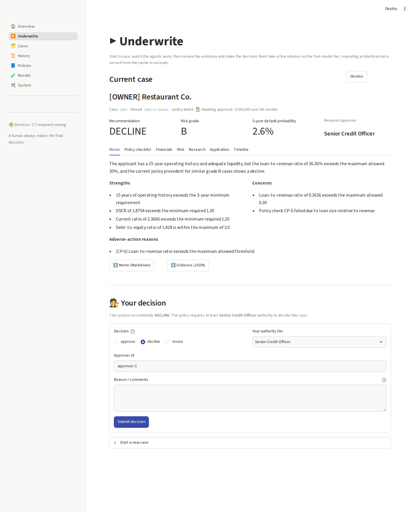

# WealthPilot — SME loan underwriting & credit research assistant

A multi-agent assistant that underwrites SME loans: it parses financial documents, computes credit ratios, scores
default risk, reads a **bank credit policy** (RAG), researches the borrower, drafts a credit memo — and then **stops for a
human decision**. It is *policy-agnostic*: given a clear policy, how faithfully does it apply it? US-flavoured inputs
(SBA 7(a) data, an ECOA/Reg-B-style compliance profile) are example configuration, not the thing under test.

Built on LangGraph + LangChain, three MCP servers, NVIDIA NIM (free hosted endpoints), Postgres/pgvector, MLflow.

## Architecture

```
Streamlit web console (7 pages) / Typer CLI                (thread_id = case_id)
                │
LangGraph StateGraph — deterministic workflow, Postgres checkpointer + store
   intake → parse ─┬(issues)→ doc_review [human] ─┐
                   └──────────────────────────────┴→ analyst ‖ research → risk → policy ⟲(missing data) → grade
                                                      → policy2 (CP-12, CP-13) → memo ⟲ memo_validator
                                                      → human_approval [interrupt] ⟲(revise) → finalize
                │   MultiServerMCPClient (retry + circuit breaker per server)
   ┌────────────┼─────────────┬───────────────┐
 fincalc :8101  policydocs :8102   research :8103     in-process: parsing, redaction, validator, audit
 ratios/DSCR/   hybrid search +    OFAC SDN screen,
 stress/PD+SHAP rerank, rules,     adverse media,
                precedents         registry, SBA stats
                │
 NIM gateway (shared by every process): Postgres response cache · global RPM token bucket · retry/backoff
                · circuit breaker per model · fallback model · fault injection (below the cache)
 Postgres+pgvector: checkpoints · long-term memory · policy vectors · precedents · cache · audit log
 MLflow: one trace per case (LangGraph autolog + a parent span tagged case/policy/thread), experiment runs, PD-model registry
```

**Agents (6 roles):** Parser · Financial Analyst · Credit Research · Risk Scorer · Policy/Compliance · Memo Writer (five call the LLM; the Risk Scorer is tool-only).
**There is no LLM supervisor**: all routing is code over typed state (`graph/nodes.py: route_*`). No LLM does arithmetic
(fincalc tools do), decides the final recommendation (the policy's fixed decision rule does), or sees protected attributes
(a redaction layer strips them).

Key design rules:
* The policy agent reads each rule from the **policy prose** (RAG); the YAML answer key (`data/policies/*/reference.yaml`)
  is visible only to the ground-truth engine, so the experiments measure real policy reading.
* The LLM answers plain questions (`applies`, `rule_satisfied`, `exception`); **code** maps them to a rule status.
* A degraded run (tool outage) can never auto-approve: the recommendation is capped at *refer* and the memo must say why.
* Every case ends at a **human approval interrupt**; the approver's tier is checked against the policy's delegation of authority.
* The audit log is hash-chained (`wealthpilot audit-verify`).

## Documentation

Full documentation (architecture, guides, experiments, reference) is built with MkDocs Material:

```bash
uv sync --group docs
make docs            # live preview at http://127.0.0.1:8000
make docs-build      # strict build into ./site (fails on broken links/anchors)
```

## Setup

```bash
uv sync
cp .env.example .env              # optional: .env > global env > error. Key may be NVIDIA_API_KEY or NVIDIA_NIM_API_KEY
docker compose up -d postgres     # Postgres 16 + pgvector
ollama pull nomic-embed-text      # embeddings (no NIM embedding model worked for the dev account)
# data: SBA 7(a) FY2010-19 CSV -> data/sba/raw/ (see "Data" below); OFAC SDN list -> data/ofac/sdn.csv
make mlflow &                     # MLflow server on :5000
uv run python -m wealthpilot.mcp_up &   # the three MCP servers
```

Build the synthetic world, train the risk model, index the policies:

```bash
uv run python -m wealthpilot.synth.applicants      # 80 applicants + watchlist
uv run python -m wealthpilot.synth.render_docs     # clean / noisy / scanned PDFs
uv run python -m wealthpilot.synth.news
uv run wealthpilot train-pd                        # SBA PD model -> MLflow registry
uv run python -m wealthpilot.synth.groundtruth     # PD + reference-engine truth under both policies
uv run wealthpilot ingest-policy
```

## Use

### Web console (recommended)

```bash
uv run wealthpilot doctor        # checks every service and prints the fix for anything missing
uv run wealthpilot ui            # http://127.0.0.1:8501
```



| Page | What it does |
|---|---|
| **Overview** | service health and how many cases are waiting for you |
| **Underwrite** | run a sample applicant, or enter a **new application and upload the financial-statement and bank-statement PDFs**; watch the agents work |
| **Cases** | every run, filterable; reopen any case to review the evidence and decide (paused cases survive refreshes and restarts) |
| **History** | decisions, overrides and the verified audit chain; CSV export |
| **Policies** | read, compare and search the credit policies |
| **Results** | the experiment reports |
| **System** | health with fix commands, configuration, model-call diagnostics |

Typical session: *Underwrite → pick an applicant (or upload your own) → ▶ Run → read the Memo, Policy checklist, Financials and Risk tabs → choose your authority tier → submit the decision → check History.*
The full manual is in the documentation: *Guides → Using the web console*. Needs Postgres, Ollama, the MCP servers and a NIM key; the console has **no login**, so keep it on `127.0.0.1`.

### Command line

```bash
uv run wealthpilot run C004 --policy strict --variant clean --thread demo-1   # runs until the human gate (use a FRESH --thread each time)
uv run wealthpilot approve demo-1 --decision decline --tier "Senior Credit Officer" --reason "..."
uv run wealthpilot audit-verify
```

## Tests and experiments

```bash
uv run pytest -m "not live"          # 56 offline tests (unit + console pages), ~15 s, no services needed
uv run pytest -m live                # 15 live tests: needs NIM key + Postgres + Ollama + MCP servers
cd experiments && uv run python e0_policy.py 12 && uv run python e1_parsing.py 12 && uv run python e2_rag.py \
  && uv run python e3_fairness.py && uv run python e3_counterfactual.py 4 && uv run python e4_reliability.py 4
```
Results land in `report/results/*.{json,md}` and as MLflow runs; the write-up is `report/REPORT.md`.

## Data

* **SBA 7(a) FOIA** (public, FY2010–2019): `data.sba.gov/dataset/7a-504-foia`. Used to train the probability-of-default model.
  It contains **no** race/gender/ethnicity fields. Label = charge-off within 5 years of approval.
* **Synthetic applicants and documents** (`wealthpilot.synth`): true 3-year financials, bank statements, planted sanctions /
  adverse-media cases, ground-truth decisions under two policies (strict "Conservative", lenient "Growth").
* **OFAC SDN list** (public) plus a small synthetic watchlist for planted hits. Adverse media and the business registry are **mock** sources.

## Reproducing the reported experiments

Defaults are the validated configuration: `NIM_RPM_BUDGET=15`, **no fallback chat model** (`CHAT_FALLBACK_MODEL` empty). E4 enables the 550B
fallback itself. E0/E1/E2/E3 were run exactly as in "Tests and experiments" above. The test suite writes a few `pytest` rows into the audit log.

## Things that differ from the original plan (and why)

* **Observability: MLflow, not Langfuse** — WSL has 5.8 GB RAM; Langfuse self-hosted needs ~6 containers.
* **Embeddings: local Ollama `nomic-embed-text`** — none of the 12 NIM embedding models worked for the dev account.
* **Chat model: `nemotron-3.5-lightning-30b` primary, 550B fallback** — the 550B model returned 503s/timeouts during testing; the
  public NIM catalog lists many models that are retired (`410`) for the account. Thinking is switched off (`enable_thinking=false`)
  for ~3× lower latency; extended thinking made a single extraction take >4 minutes.
* **No LLM supervisor** — deterministic routing.
* **Rules are judged in batches, with RAG done in code** — a per-rule tool-using agent needed ~40 chat calls per case, and the free tier
  delivers a handful of calls per minute. Code now retrieves passages per rule through the `policydocs` MCP server (hybrid search + NIM
  rerank), then one LLM call judges 4 rules (~13 chat calls per case). `compare`/`get_rule` remain available as MCP tools.
* **Numeric verification of the LLM's comparisons** — the first batched E0 showed the model making arithmetic errors ("132,000 is above
  150,000"). The model now lists every comparison it relied on; code re-evaluates them and triggers a targeted re-ask on any contradiction
  (strict decision accuracy 92% -> 100%, lenient 67% -> 92%; see `report/results/ablation_no_numeric_verify`).
* **Adaptive shared rate limit + hardened gateway** — real 429s appeared below the nominal budget, so the shared token bucket is AIMD
  (cut on 429, creep up on success; floor 6 RPM). 429s do not open the circuit breaker. Empty model replies are retried and never cached
  (a cache that stored empty replies silently poisoned the first E0 run; 105 entries purged). The 550B model later returned *garbled* text
  for long structured outputs, so accuracy experiments run on the 30B model alone (`CHAT_FALLBACK_MODEL=""`); E4 keeps the fallback chain.
* **PD model** — a first model reached AUC 0.95 because `TermInMonths` is the *realised* term for charged-off loans (a label leak). It is excluded; the honest test AUC is ~0.68.
