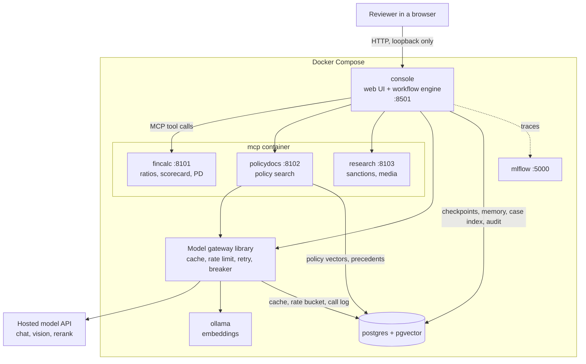

# WealthPilot: a policy-driven underwriting assistant for small-business loans

**CS5903 Final Project Report**

| | |
|---|---|
| Project ID | 13 |
| Group number | 22 |
| Members | Ponguru Bhanu (CS23BTECH11046), Krapa Sandeep (CS23BTECH11027) |
| Repository | [github.com/bhanuponguru/WealthPilot](https://github.com/bhanuponguru/WealthPilot) |
| Final tag | `cs5903-final-2026`. The exact commit SHA is recorded in the annotated tag message (`git rev-parse cs5903-final-2026^{commit}`) and in the submission message. |
| Related documents | [Architecture Decision Records](Architecture_Decision_Records.md) · [extended writeup](../writeup/WealthPilot-writeup.pdf) · [documentation](../docs/index.md) |

## Executive summary

Preparing a small-business loan for decision is slow, error-prone and regulated: an underwriter reads statements, recomputes ratios,
checks every clause of a prose credit policy, screens the borrower and writes a memo. WealthPilot automates that preparation and leaves
the decision to a person. A language model only reads (documents and policy text) and writes prose; software computes ratios,
verifies every comparison, derives the recommendation with a fixed rule, and records each decision in a hash-chained audit log. The
delivered system is a containerized stack: a web console, a deterministic LangGraph workflow with two human pause points, three Model
Context Protocol tool servers, a model gateway, Postgres with vector search and MLflow tracing. It deploys with a single command and passes
61 automated offline tests. Five experiments measured it against ground truth, for example 100 % and 91.7 % decision accuracy under two
policies on 12 synthetic cases each, and no unsafe approval in 28 fault-injected runs. The system is a complete prototype for decision
support. It has not been validated on real documents and has no authentication, and its evaluation uses small synthetic samples, so the
results demonstrate mechanisms and do not establish production accuracy.

## 1. Problem, scope and success criteria

**Users and actors.** A *reviewer* who prepares or checks a case; an *approver* whose authority tier the policy limits; an *administrator*
who maintains the credit policy and operates the stack; the *applicant*, who supplies documents and is protected by redaction and by
the human gate.

**Problem.** Given an application, financial statements and a written credit policy, produce an evidence-backed recommendation (approve,
refer, decline) and a credit memo that a person with the required authority can verify and decide, without using protected attributes,
and with every decision auditable.

| In scope | Out of scope |
|---|---|
| Parsing statements (text and scanned PDFs); ratios and risk grade; reading a prose policy; sanctions screening; memo; human approval; audit log; web console and CLI; container deployment | Automatic decisions; real adverse-media and registry providers (mocks only); authentication; real-world accuracy claims; legal compliance for any jurisdiction |

**Assumptions and constraints.** The lender has a written policy with numbered rules. Inputs are one to three fiscal years of statements
plus a twelve-month bank summary. Hosted models are free-tier NVIDIA NIM endpoints (about 10 to 20 chat calls per minute observed); embeddings
run locally. The development machine has 5.8 GB of memory. The bundled policies, US-style data and compliance profile are example
configuration, not the subject of evaluation.

**Success criteria and "done when".** Numeric targets were not fixed before the experiments, so the table states each criterion and the
observed result (Section 5).

| Criterion | Done when | Observed |
|---|---|---|
| A clean checkout starts the whole system | `docker compose up -d --build` then `wealthpilot doctor` reports ready | Stack starts and `doctor` reports ready; a clean copy passes the offline suite (Section 5.3) |
| Every case ends with a human decision | No code path decides without the gate; approver tier checked against the policy | Enforced in code; tests; 0 automatic decisions |
| The system applies a policy it is given | Decision accuracy and policy-flip agreement against a hidden answer key (E0) | 100 % / 91.7 %; flip 5 of 6 |
| Statements are extracted accurately | Field accuracy by document variant (E1) | 100 / 100 / 96.9 % |
| Faults never produce an unsafe decision | 0 unsafe approvals and 0 wrongful declines under fault injection (E4) | 0 and 0 in 28 runs |
| Identity does not reach the model | Leak rate with redaction on (E3) | 0 of 84 requests |

## 2. Related work, baselines and alternatives

**Related work.** *Orchestration:* LangGraph (stateful graphs with checkpoints and human interrupts) and agent-team frameworks such as
CrewAI and AutoGen, which route between agents with a model or a conversation. *Tool protocol:* the Model Context Protocol
(modelcontextprotocol.io). *Retrieval:* retrieval-augmented generation [1], BM25 [2], reciprocal rank fusion [3], and the `nomic-embed-text`
embedding model [4]. *Risk and fairness:* gradient-boosted trees [5], SHAP [6], Fairlearn [7], equalized odds [8] and the selective-labels
problem [9]. *Documents:* layout-aware pretrained models such as LayoutLM [10]. *Regulation:* ECOA and Regulation B (12 CFR 1002) for
adverse-action reasons [11], and the Federal Reserve's model-risk guidance, now SR 26-2 superseding SR 11-7 [12].

**Approaches considered.**

| Question | Approach A | Approach B (selected) | Why B |
|---|---|---|---|
| Who decides the next step and the outcome | A model supervisor or agent team decides, justifies and routes | A fixed graph; code derives statuses and the recommendation; the model reads ([ADR-002](Architecture_Decision_Records.md#adr-002-deterministic-routing-instead-of-a-model-supervisor), [ADR-004](Architecture_Decision_Records.md#adr-004-the-language-model-reads-code-decides)) | Repeatable, testable, explainable; removed observed confident errors |
| How statements are read | A layout-aware pretrained model, or a vision model alone | Coordinate-based table reconstruction, a language model for label mapping, reconciliation checks, a vision model for scans ([ADR-013](Architecture_Decision_Records.md#adr-013-layout-reconstruction-before-extraction)) | No training data needed; 80.3 % → 100 % on noisy layouts |
| How the policy is found | Dense vectors only, or the whole policy in the prompt | Hybrid search, a reranker, section chunks ([ADR-014](Architecture_Decision_Records.md#adr-014-hybrid-retrieval-with-a-reranker-and-structure-aware-chunks)) | 97.1 % against 74.0 to 79.8 % at rank 1 |

**Working baselines.** For each experiment the baseline is the simplest working alternative: a version of the system without the studied
component (E0, E4), a model-free label matcher (E1), or a weaker retrieval arm (E2). **No independent end-to-end baseline** (for
example, one prompt that reads the policy and decides) was built or run; see Section 5.4.

**Reused components** (versions from `uv.lock`; licences from package metadata):

| Component | Version | Licence | Role |
|---|---|---|---|
| LangGraph / LangChain | 1.2.20 / 1.4.10 | MIT | Workflow engine, agents |
| langchain-nvidia-ai-endpoints | 1.5.0 | MIT | Hosted chat, vision, rerank client |
| MCP SDK / langchain-mcp-adapters | 1.30.0 / 0.3.2 | MIT | Tool servers and client |
| MLflow | 3.18.0 | Apache-2.0 | Tracing, model registry |
| Streamlit | 1.67.0 | Apache-2.0 | Web console |
| LightGBM / SHAP | 4.7.0 / 0.54.1 | MIT | Default-risk model, reason codes |
| Fairlearn | 0.15.0 | MIT | Fairness audit and mitigation |
| PyMuPDF | 2.1 | **AGPL-3.0** or commercial | PDF text and rasterization (see Section 10) |
| psycopg | 3.3.8 | LGPL-3.0 | Postgres driver |
| Postgres + pgvector, Ollama | 16 (image) | PostgreSQL, MIT | Storage, local embeddings |

**What the team added.** The team's own work comprises the workflow and its routing, the decision rule, rule-status mapping, numeric
verification, the model gateway (shared cache, adaptive limiter, fault injection), layout reconstruction, the policy-search pipeline, the
sanctions screening, redaction and the memo validator, the hash-chained audit log, the console, the container deployment, the reference
engine, the synthetic-data generator and all experiments.

## 3. Architecture and implementation

**Request path.** The reviewer submits an application and PDFs in the console. A background worker starts the workflow: *intake*
(validate, seal protected attributes) → *parse* → *quality gate* (accounting reconciliation; document-review pause if it fails) → *analyst*
and *research* in parallel → *risk* → *policy* (retrieve and judge rules, verify arithmetic) → *grade* → *memo* → *memo validator* →
**human approval pause** → *finalize* (decision, precedent, audit record). All routing is code over typed state.

| Component | Responsibility and interface | Source |
|---|---|---|
| Console and CLI | Six pages (Inbox, New case, Cases, History, Credit policies, System); `wealthpilot` CLI (`doctor`, `show`, `approve`, `audit-verify`) | `src/wealthpilot/ui/`, `cli.py` |
| Workflow | LangGraph graph, six agent roles, Postgres checkpoints | `src/wealthpilot/graph/` |
| Tool servers | 16 deterministic or retrieval tools over streamable HTTP | `mcp_servers/` |
| Model gateway | The only caller of hosted models and embeddings; shared cache, adaptive limiter, retry, fallback, fault injection | `src/wealthpilot/nim/` |
| Domain logic | Ratios, scorecard, grade matrix, decision rule: pure functions shared by tools and workflow | `src/wealthpilot/` |
| Pipelines | Parsing, retrieval, risk model, compliance (redaction, language scan, audit) | `parsing/`, `rag/`, `risk/`, `compliance/` |
| Research package | Synthetic world, reference engine, experiments; never imported by the product | `research/` |

**Data stores.** One Postgres 16 database holds checkpoints, long-term memory, policy vectors (768 dimensions), the response cache, the
shared rate bucket, the call log, the case index and the audit log ([schema](../docs/reference/database.md)). MLflow keeps traces and the
registered risk model. Named volumes: `pgdata`, `ollama`, `data`, `mlflow`.

**External dependencies.** A hosted model API (chat, vision, rerank), the US Treasury sanctions list (downloaded at start), and the
Ollama model download. **Trust boundaries:** the console is published on `127.0.0.1` only and has no login; identity is sealed in the case
state and removed from every model-bound text; the model never sees names it screened; only the gateway crosses to the hosted API.
Design rationale: [Architecture Decision Records](Architecture_Decision_Records.md) (ADR-001 to ADR-022); tool contracts: [tool reference](../docs/reference/tool-reference.md).

## 4. Methodology and experiment setup

**Questions.** E0: does the system apply a prose policy correctly, and does its decision change when the policy changes? E1: how accurate
is statement extraction, and what does each component add? E2: which retrieval design finds the right rule? E3: does the risk model treat
groups differently, would an audit detect planted bias, do identity attributes change decisions and does redaction keep them from the
model? E4: what happens under injected faults and a crash?

**Data and provenance.**

| Data | Source and identifier |
|---|---|
| Synthetic applicants | 80 applicants from `wealthpilot_lab.synth.applicants` with seed 7; documents rendered per case in three variants (clean, noisy, scanned; seed derived from the case id); regenerated by the commands in [reproduction](../docs/research/reproduce.md) |
| Answer key | Reference engine over a hidden YAML per policy, in `research/reference/`; never visible to the product (enforced by a test) |
| Policies | Two example policies, `policies/strict/policy.md` and `policies/lenient/policy.md`; 13 numbered rules each |
| Risk model data | SBA 7(a) FOIA, FY2010 to FY2019, 545,751 rows, `FOIA_7a_FY2010_FY2019_asof_260930.csv`, SHA-256 `39aa32b7…0abb2`; public US government data from data.sba.gov; not stored in the repository |
| Sanctions | US Treasury OFAC SDN list, downloaded by the `bootstrap` service |

**Environment.** 8 logical CPUs, 5.8 GiB memory, no GPU, WSL2 (Linux 6.18.58.1), Docker 29.10.0, Python 3.12.3; library versions in
Section 2. Chat model `nvidia/nemotron-3.5-lightning-30b-a3b` (thinking off, temperature 0, no fallback) for E0 to E3; E4 adds
`nvidia/nemotron-3-ultra-550b-a55b` as fallback; scans use `nvidia/nemotron-3.5-super-vl-120b-a12b`; rerank `nvidia/llama-nemotron-rerank-vl-1b-v2`;
embeddings `nomic-embed-text`. Rate ceiling `NIM_RPM_BUDGET=15`. Risk model: LightGBM, 5-year charge-off label, trained on FY2010 to 2015,
calibrated on 2016, tested on 2017 to 2019.

**Baselines, metrics and repeats.**

| Exp | Baseline | Metrics | Runs |
|---|---|---|---|
| E0 | Same system without numeric verification | Decision accuracy, per-rule accuracy, flip agreement, Wilson 95 % interval | 12 cases × 2 policies, once |
| E1 | Model-free canonical-label matcher; raw-text model extraction | Field accuracy, exact documents, reconciliation catches | 12 applicants × 3 variants, once |
| E2 | BM25, dense, hybrid without reranker | Recall@1/3, MRR, bootstrap interval | 104 queries × 10 arms, once |
| E3 | Redaction off; naive redaction | Identity leak rate, decision flips; planted-bias detection over 20 seeds | 3 cases × 6 counterfactuals; 20 seeds per level |
| E4 | Degraded cap on approval only | Completion, outcome class against truth, latency factor | 4 cases × 7 profiles, cache off, once |

**Exact scripts.** `research/experiments/e0_policy.py 12`, `e1_parsing.py 12`, `e2_rag.py`, `e3_fairness.py`, `e3_counterfactual.py 3`,
`e4_reliability.py 4` then `e4_outcomes.py`, run with `docker compose --profile lab run --rm lab python experiments/<script>`; full
instructions in [Reproducing the experiments](../docs/research/reproduce.md).

## 5. Results, observations and analysis

### 5.1 Baseline against solution

| Exp | Metric | Baseline | Solution |
|---|---|---|---|
| E0 | Decision accuracy, strict policy | 91.7 % (11/12) | **100 %** (12/12; CI 76 to 100) |
| E0 | Decision accuracy, lenient policy | 66.7 % (8/12) | **91.7 %** (11/12; CI 65 to 99) |
| E0 | Policy-flip agreement | 33 % (2/6) | **83 %** (5/6; CI 44 to 97) |
| E0 | Thresholds read correctly from prose | 100 % | 100 % |
| E1 | Field accuracy, noisy layout | 36.7 % (label matcher); 80.3 % (raw model) | **100 %** (608 fields) |
| E1 | Field accuracy, scanned | 0 % (no text layer) | **96.9 %** (2 of 12 documents wrong) |
| E2 | Recall@1 (104 queries) | 76.9 % (hybrid); 79.8 % (BM25) | **97.1 %** (MRR 0.971, CI 0.93 to 1.0) |
| E3 | Requests with identity, redaction | 69/88 (off); 3/84 (substring) | **0/84** |
| E3 | Decision flips under identity swap | 0/6 (off) | 0/6 (on) |
| E4 | Wrongful declines, degraded-tool profiles | 4 (cap on approval only) | **0** (all 11 degraded runs referred) |
| E4 | Unsafe approvals, all 28 runs | 0 | **0** |
| Risk | Brier score, test set (n = 155,941) | 0.0412 (constant rate) | **0.0404**; AUC 0.68 |

Raw outputs: [E0](../research/results/e0_policy.md), [E0 baseline](../research/results/ablation_no_numeric_verify/e0_policy.md),
[E1](../research/results/e1_parsing.md), [E2](../research/results/e2_rag.md), [E3 audit](../research/results/e3_fairness_ab.md),
[E3 counterfactuals](../research/results/e3_counterfactual.md), [E4](../research/results/e4_reliability.md),
[E4 baseline](../research/results/ablation_degraded_may_decline/e4_reliability.md), [model probe and comparison](../research/results/model_compare/).
The risk model improves only marginally on a constant predictor in Brier score and has a modest AUC; its value is a calibrated,
explainable signal and not strong discrimination.

### 5.2 Observations and analysis

**Successes.** (1) Moving arithmetic and decisions into code removed the confident-error classes seen early; adding numeric verification
raised lenient-policy accuracy by 25 points in E0, although n = 12 means the intervals overlap. (2) Rebuilding table layout from
coordinates fixed a column-swap error that reconciliation cannot detect. (3) Reranking lifted retrieval by about 20 points. (4) Redaction
removed identity from every model request. (5) Fault injection never produced an unsafe or unfair outcome: 429 storms and timeouts cost
1.2 times the latency, and a crash after the risk step resumed from the checkpoint and re-ran one node.

**Weaknesses.** *E0:* 12 of 288 rule judgements (4.2 %) were wrong in the final run, against 183 of 288 in the first complete run, which measured an infrastructure defect (ADR-008). Errors
concentrate in CP-8 (a loan-size condition; 7 of 24 wrong) and one run asserted an adverse-media finding that did not exist; one lenient
case remains wrong. *E1:* scans lose 3.1 points, from digit errors that reconciliation detects but does not correct. *E3:* the real-data
audit found large proxy-group gaps (region demographic-parity difference 0.28; equalized-odds difference 0.46); mitigation on region cut the
equalized-odds difference from 0.60 to 0.39 at no balanced-accuracy cost, but doubled the selection rate (0.21 to 0.40). *E4:* with a tool
down, runs complete but refer by design, so 0 of 4 are "correct" in two profiles; malformed model output gave 1 of 4 correct decisions, the
rest were escalated or referred safely.

**Edge cases covered.** Rate-limit storm, timeouts, corrupted output, flaky tools, research server down, calculation server down, process
crash and resume, scanned documents, a prohibited industry and a sanctions hit (planted cases), and identity swaps in structured fields and
document text. **Conclusions.** The evidence supports the mechanisms (code-side decisions, verification, safe degradation); it does not
support production accuracy claims because samples are small, each run happened once and the data are synthetic.

### 5.3 Tests and reproduction

| Check | Command | Observed |
|---|---|---|
| Offline suite (unit, boundary, console) | `uv run pytest -q -m "not live"` | 61 passed ([log](../tests/logs/offline_tests.txt)) |
| Live suite (deployed stack and model API: tool contracts, gateway retry and fallback, end-to-end console cases, runs surviving navigation) | `make test-live-docker` | 17 passed in 69 s ([log](../tests/logs/live_tests.txt)); most model replies came from the response cache populated by earlier runs |
| Demonstration-data generation into the volume | `make demo-data` | 80 applicants, 47 articles, 240 document sets in about 1 minute ([log](../tests/logs/demo_data_generation.txt)) |
| Unseen valid case: `C007`, used in no experiment, strict policy, via `wealthpilot demo-run`, `show`, `approve` and `audit-verify` in the deployed container | [`examples/C007`](../examples/C007/application.json) | decline, grade C, Senior Credit Officer; 12 of 12 rule statuses match the reference; decision recorded; audit chain intact (48 records) ([log](../tests/logs/unseen_case_C007.txt)) |
| Clean checkout | Copy of the tracked files, `uv sync --all-packages --group dev --frozen`, offline suite | 61 passed with no generated data present |
| Product/research boundary | `tests/test_boundary.py` | Passing within the offline suite |
| Deployed end-to-end flow | `scripts/check_deployed_flow.py` | Upload, decision, audit verification and traces checked on the stack |

### 5.4 Tests and measurements not run

No independent end-to-end baseline; no repeated runs (variance unmeasured, except one noise-floor comparison in E3(c)); no full-size E0
(80 applicants) and no second model beyond a 2-case comparison; no real documents; no real adverse-media or registry providers; thinking
mode not evaluated end to end; backup and restore, and the CLI commands `ingest-policy`, `train-pd` and `fetch-ofac` were not exercised in the deployed containers
([issue 4](https://github.com/bhanuponguru/WealthPilot/issues/4)); one unseen case and one 17-test live run constitute a smoke test and not a statistical sample. Experiments ran against system versions that changed between
runs; the order is stated in the [research overview](../docs/research/index.md#experimental-versions-and-re-runs).

## 8. Current state, limitations and risks

| Working | Partial | Missing |
|---|---|---|
| End-to-end underwriting on synthetic cases; human gate and tier check; audit chain verification; console (six pages, background runs, reviewer profile); one-command deployment; five experiments with results | Document understanding (one layout family; scans lose digits); research checks (only sanctions are real); reviewer identity (declared, not verified); resumability (checkpoints, but no durable queue) | Authentication ([#1](https://github.com/bhanuponguru/WealthPilot/issues/1)); real providers and real documents ([#3](https://github.com/bhanuponguru/WealthPilot/issues/3)); a risk model with borrower financials ([#6](https://github.com/bhanuponguru/WealthPilot/issues/6)); encryption at rest; audit anchoring |

**Known defects and failure modes.** Policy reading errors on conditional rules (4.2 % of judgements in E0) and the occasional
invented finding; results vary between runs; a console restart interrupts runs in flight; digit errors in scans are detected, not
corrected; model-service availability and rate limits dominate run time (about 6 to 7 minutes per case on the free tier).

**Risks.** *Privacy and security:* no login, unencrypted uploads, tamper-evident but not tamper-proof audit log, applicant data sent to a hosted
model service (redaction does not cover scanned images). *Dependencies:* free-tier models can be retired without notice (the probe found 37 of 54
catalog entries returning 404); PyMuPDF is AGPL ([#5](https://github.com/bhanuponguru/WealthPilot/issues/5)). *Method:* synthetic data, a reference
engine written with the policies, selective labels. Workarounds are documented in [troubleshooting](../docs/administration/troubleshooting.md)
and [limitations](../docs/administration/limitations.md). Open work is tracked in
[issues 1 to 6](https://github.com/bhanuponguru/WealthPilot/issues).

## 9. Way forward

| # | Task | Starting point | Rationale | Done when | Blockers |
|---|---|---|---|---|---|
| 1 | Add authentication and verified approver identity | [#1](https://github.com/bhanuponguru/WealthPilot/issues/1); `ui/app.py` | Largest deployment gap | Unauthenticated requests are refused; approver id comes from the identity; `audit-verify` passes | Identity provider |
| 2 | Run E0 at full size with repeats and a second model | [#2](https://github.com/bhanuponguru/WealthPilot/issues/2); `research/experiments/e0_policy.py` | Intervals are wide; model choice is unranked | Result files per model and repeat; spread reported | Model quota (many hours) |
| 3 | Validate on real documents and a third policy | [#3](https://github.com/bhanuponguru/WealthPilot/issues/3) | All results are synthetic | E1 on at least 20 real statements; E2 on a third policy | Permission to use documents |
| 4 | Exercise backup, restore, demo data and CLI paths | [#4](https://github.com/bhanuponguru/WealthPilot/issues/4); `docs/administration/operations.md` | Written but unverified | Restore passes `audit-verify` with a decided case present | None |
| 5 | Resolve the PyMuPDF licence | [#5](https://github.com/bhanuponguru/WealthPilot/issues/5) | AGPL against an MIT release | A new ADR; no AGPL in `uv.lock`, or the obligation documented | Owner decision |

## 10. Contributions, AI use and attribution

**Contributions.** Primary contributor for each area:

| Area | Primary contributor | Location |
|---|---|---|
| Workflow graph, six agent roles, decision rule | Ponguru Bhanu | `src/wealthpilot/graph/`, `src/wealthpilot/decision.py` |
| MCP tool servers and model gateway | Ponguru Bhanu | `mcp_servers/`, `src/wealthpilot/nim/` |
| Container deployment and operations | Ponguru Bhanu | `Dockerfile`, `docker-compose.yml`, `docs/administration/` |
| Documentation, project report, decision records | Ponguru Bhanu | `docs/`, `writeup/` |
| Document parsing and policy retrieval | Krapa Sandeep | `src/wealthpilot/parsing/`, `src/wealthpilot/rag/` |
| Default-risk model, fairness audit, compliance (redaction, audit log, approval gate) | Krapa Sandeep | `src/wealthpilot/risk/`, `src/wealthpilot/compliance/` |
| Streamlit console and command-line interface | Krapa Sandeep | `src/wealthpilot/ui/`, `src/wealthpilot/cli.py` |
| Synthetic data, reference engine, experiments E0 to E4 | Krapa Sandeep | `research/` |

**AI-assisted work.** Claude Code (Anthropic) was used throughout for implementation, tests, experiments and documentation. All outputs
were checked by running the automated tests, by the ground-truth experiments, and by manual review of the console and audit log.

**Third-party code, data and models.** Library licences are listed in Section 2. The project's own code is released under the MIT licence
([LICENSE](../LICENSE)). **PyMuPDF is AGPL-3.0 (or commercial):** it is a runtime dependency of the parsing pipeline, so a network
deployment of the combined work carries AGPL source-offer obligations that have not been assessed ([issue 5](https://github.com/bhanuponguru/WealthPilot/issues/5)).
Psycopg (LGPL-3.0) is used unmodified. *Data:* SBA 7(a) FOIA data (public US government data) and the OFAC SDN list (public) are downloaded,
not redistributed. *Models:* `nomic-embed-text` is Apache-2.0 [4]; the NVIDIA Nemotron models are used through free hosted endpoints and are
governed by NVIDIA's terms, which differ by model (the Nemotron Open Model License or the API trial terms); this was not audited per
model. No API keys or private data are committed; the synthetic data is generated from the seed above.

## References

1. P. Lewis et al., "Retrieval-Augmented Generation for Knowledge-Intensive NLP Tasks", NeurIPS 2020.
2. S. Robertson, H. Zaragoza, "The Probabilistic Relevance Framework: BM25 and Beyond", Foundations and Trends in IR 3(4), 2009.
3. G. V. Cormack, C. L. A. Clarke, S. Büttcher, "Reciprocal Rank Fusion outperforms Condorcet and individual Rank Learning Methods", SIGIR 2009, doi:10.1145/1571941.1572114.
4. Z. Nussbaum, J. X. Morris, B. Duderstadt, A. Mulyar, "Nomic Embed: Training a Reproducible Long Context Text Embedder", arXiv:2402.01613.
5. G. Ke et al., "LightGBM: A Highly Efficient Gradient Boosting Decision Tree", NeurIPS 2017.
6. S. Lundberg, S.-I. Lee, "A Unified Approach to Interpreting Model Predictions", NeurIPS 2017.
7. S. Bird et al., "Fairlearn: A toolkit for assessing and improving fairness in AI", Microsoft Research MSR-TR-2020-32; H. Weerts et al., "Fairlearn: Assessing and Improving Fairness of AI Systems", JMLR 24(257), 2023.
8. M. Hardt, E. Price, N. Srebro, "Equality of Opportunity in Supervised Learning", NeurIPS 2016.
9. H. Lakkaraju, J. Kleinberg, J. Leskovec, J. Ludwig, S. Mullainathan, "The Selective Labels Problem", KDD 2017, doi:10.1145/3097983.3098066.
10. Y. Xu et al., "LayoutLM: Pre-training of Text and Layout for Document Image Understanding", KDD 2020, arXiv:1912.13318.
11. Consumer Financial Protection Bureau, Regulation B, 12 CFR part 1002 (adverse-action notices, §1002.9).
12. Board of Governors of the Federal Reserve System, SR 26-2, revised model risk management guidance (supersedes SR 11-7).

## Appendices (links)

[Extended writeup (PDF)](../writeup/WealthPilot-writeup.pdf) · [Architecture Decision Records](Architecture_Decision_Records.md) ·
[Documentation index](../docs/index.md) · [Experiment results](../research/results/) · [Offline test log](../tests/logs/offline_tests.txt) ·
[Reproducing the experiments](../docs/research/reproduce.md) · [Open issues](https://github.com/bhanuponguru/WealthPilot/issues).
