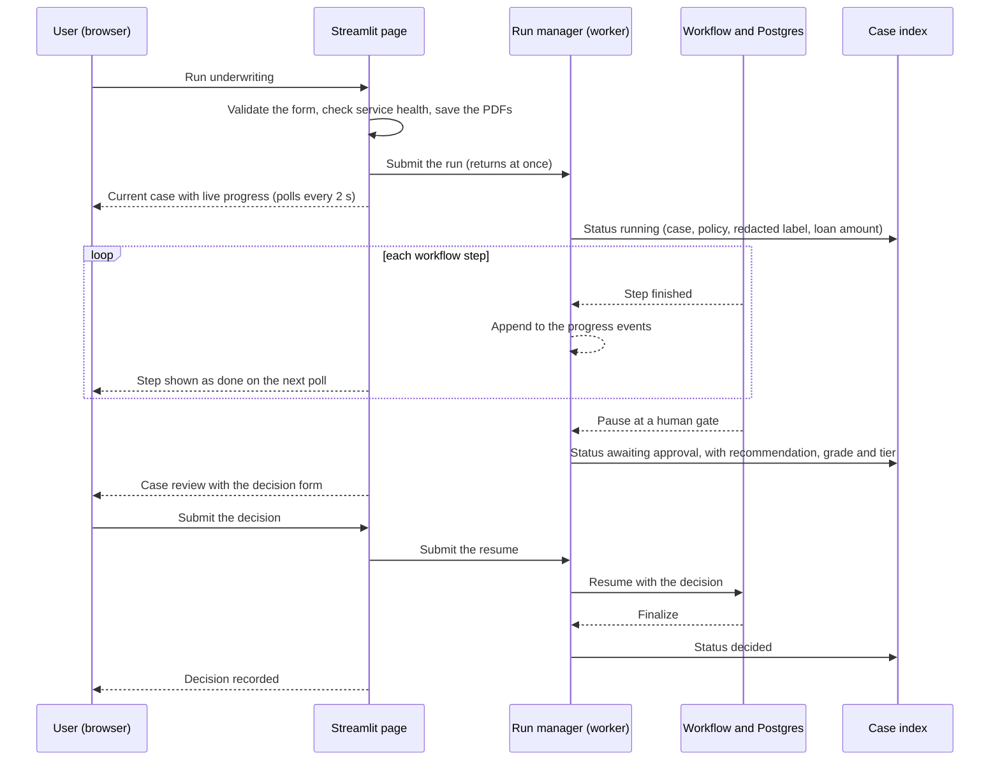
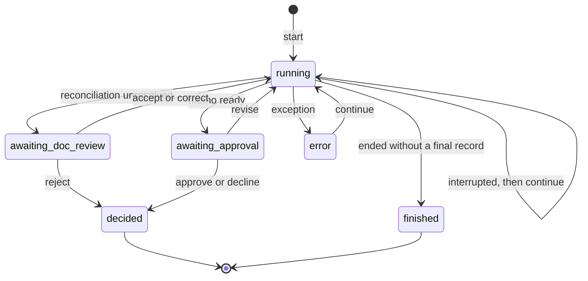

# How the console is built

The web console is a thin Streamlit application over the underwriting workflow. This page describes its design goals, its structure and
the mechanisms that keep it responsive and safe. For how to use it, see [Using the console](../user-guide/console.md).

## Design goals

1. **Built around the reviewer's job.** The first page is an inbox of cases that need a decision. Reference material and
   administration sit in their own sidebar sections.
2. **A human can always see and decide.** Every paused case is reachable from the console, including after a restart, and a run never
   depends on the browser tab staying open.
3. **Never block on a dead service.** A missing database or tool server produces an immediate, actionable message, not a long hang or a
   stack trace.
4. **One code path.** The console starts and resumes the same workflow as the command line. It contains no underwriting logic of its own.
5. **Testable without a browser.** Validation, export and status mapping are pure functions, pages are tested with Streamlit's
   application-testing framework, and browser-driven scripts check behavior that only a real browser shows.

## Page structure

The sidebar groups pages by who needs them. The product has exactly six pages.

| Section | Page | Purpose |
|---|---|---|
| Work | **Inbox** (home) | Cases waiting for a decision, runs in progress, runs that stopped with an error and recent decisions. |
| Work | **New case** | Submit an application with its two PDF statements. A second tab, "Try a sample applicant", appears only in demonstration mode. |
| Work | **Cases** | Every case, filtered by "needs attention", "decided" or "all", with search. Opening a case shows the review screen. |
| Work | **History** | The audit log with chain verification, filters, summary counts and a CSV export. |
| Reference | **Credit policies** | Read a policy, list its rules, compare two policies side by side and try the retrieval the agents use. |
| Administration | **System** | Service health with the command that fixes each problem, the effective configuration and a 24-hour summary of model calls. |

The sidebar also holds the [reviewer profile](#the-reviewer-profile) and a one-line service summary. The review screen for a case has
seven tabs (memo, policy checklist, financials, risk, research, application and timeline) and downloads of the memo and the evidence.
The decision form or the document-review panel appears below them when the case is waiting for a human.

## Components

| Component | Role |
|---|---|
| Navigation | Defines the sections and pages and provides helpers for jumping between them, for example from an Inbox card to the opened case. |
| Run manager | Owns one background worker with its own event loop and executes every run. Pages submit work to it and watch a progress object. |
| Case index | A small Postgres table that mirrors the status and headline facts of every run, so cases can be listed and reopened. |
| Health checks | Fast, non-failing checks of every service and data artifact, shared with the `wealthpilot doctor` command. |
| Form logic | Pure functions for application validation, applicant building, upload checks, export and policy-rule parsing. It imports nothing from Streamlit. |
| Case review view | One reusable view that shows a case in any state: running, interrupted, failed, waiting for a human or decided. |
| Demonstration module | Reads the optional sample applicants and their statements as plain files. |

## Request flow

If the user leaves the page at any point, the worker carries on and the Inbox lists the case when it needs a decision.

## Design decisions

### Runs belong to a worker, not to the page

Streamlit reruns the whole script on every interaction and stops a running script when the user switches page or closes the tab. A
run executed inside the page script would therefore be abandoned half-way and leave its case marked as running forever.

The run manager owns one daemon thread with its own event loop. Starting, resuming or continuing a run schedules a coroutine on it.
The coroutine opens its own workflow session (tool connections, checkpointer, long-term store, tracing), drives the workflow and
records progress in a progress object with the completed steps, a done flag, an error and the final snapshot. Pages never wait for a
run. They submit it and return, and the live progress element refreshes itself every two seconds, rendering the progress object and
reloading the page once the run is done.

One entry point shows a case in any state: running (live progress), interrupted, failed, waiting for a human, or decided. A case is
interrupted when the index says it is running but the current console process knows nothing about it, for example after a restart.
Interrupted and failed cases offer **Continue the run**, which resumes from the last checkpoint.

The manager is shared by every browser session of the console process. It is not a durable queue: restarting the console interrupts
runs in flight, which is why Continue exists.

### Case index

Workflow checkpoints store the full state per thread but are not designed for listing. The workflow engine therefore mirrors the
headline facts and lifecycle status of every run into a small table. It is written when a run starts, when it pauses or finishes and
when it fails. It is best effort: an index failure never affects underwriting. The index stores only the redacted business label, never
identity, while redaction is on. See [Database](../reference/database.md).

The status of a run follows from the pause type of its latest snapshot and whether the workflow has ended. A run that ended without a
final decision record is shown as finished.

### Two kinds of session

| | Execution session | Read-only session |
|---|---|---|
| Opens | Tool connections, checkpointer, long-term store, tracing | Checkpointer only |
| Used for | Starting and resuming runs, which execute the workflow | Viewing a case |
| Cost | Seconds | Tens of milliseconds |

Viewing a case happens on every widget interaction, so it uses the cheap read-only session, cached for a few seconds and cleared
explicitly after each action.

### Fail fast on a missing database

* The shared connection pool is created once and times out after 5 s, with a 3 s connection timeout. It keeps retrying in the
  background and recovers by itself when Postgres returns.
* The database schema is created lazily on the first successful use.
* Pages first consult a health check cached for 5 s and show the fix immediately, without touching the pool.

### Health checks

The health checks cover Postgres (a real connection with a 3 s timeout), the embeddings service and whether its model is pulled, each
tool-server port (a TCP connect), the model API key (presence only, never a paid or rate-limited call), MLflow, the risk model, the
sanctions list and, in demonstration mode, the demo data. Every check returns a name, a pass flag, a plain-language detail, the command
that fixes it and whether it is required.

The command line prints the checks with `wealthpilot doctor`. The console caches them for 5 s and shows them on the System page and as
a summary in the sidebar. Four checks are blocking because a run cannot work without them: Postgres, the model API key, the risk model
and the embeddings service. Everything else only degrades a run.

### Forms are pure functions

The form logic validates the whole application and reports every problem at once, builds the applicant record that the workflow expects
(the same one the sample path uses) and validates each uploaded PDF before anything is written. A file must be non-empty, at most 25 MB,
at most 40 pages and openable, so a rejected upload leaves no files behind. The memo and evidence exports are built here and never
include the sealed identity. The 25 MB limit is also enforced by Streamlit itself, so the uploader's label agrees with the validator.

Uploaded PDFs are stored per case under the uploads folder of the `data` volume.

### Demonstration mode

Demonstration mode is off by default. It is enabled with the `WEALTHPILOT_DEMO` environment variable and takes effect only when the
sample applicants file exists in the demonstration data folder. In that mode the New case page offers the "Try a sample applicant" tab.
It lets the user choose an applicant, a policy and, under advanced options, the document layout (clean, noisy or scanned) and the
redaction setting, and it offers the sample PDFs for download so the upload path can be tried too. When no cases exist yet, the Inbox mentions the tab. Without demonstration mode neither the tab nor any sample data is visible. The data is a set of plain files and the
console does not depend on how they were produced. See [Design decisions](decisions.md#d24-product-and-research-are-separate-packages).

### Identity handling

* The facts shown to the models use the redacted business label. The owner's name lives only in the sealed part of the case state.
* The case index and the downloads never contain the sealed block.
* The Application tab keeps identity behind an explicit checkbox, so an approver sees what the model saw unless they ask for more.

### The reviewer profile

The sidebar holds a name or id and an authority tier. The decision form reads them to pre-fill its fields and never writes back to
them. The id is required and has no default value. If no tier is set in the profile, the form pre-selects the required tier. The
profile identifies the reviewer in the audit log. It is not authentication: the console has no login.

### Human gates are the same pauses as the command line

The decision form resumes the workflow with the same payload the command line sends: decision, approver tier, approver id and reason.
The form adds client-side checks (the tier is at least the required tier, an id is entered, and a reason accompanies an override or a
revision). The authoritative tier check remains in the approval gate, so the rule holds for every client.

### Error translation

Common low-level failures, such as an unreachable database, a missing model key or an unreachable embeddings service, are translated
into the sentence a user needs. Anything else is shown as the error type and message, truncated to 300 characters.

## Testing

| Layer | How |
|---|---|
| Form validation, applicant building, upload checks, export, rule parsing, status mapping, identity-free index rows, health checks | Unit tests with no services |
| Every page renders with or without services (a page must show a message, never a stack trace) | Streamlit application tests |
| The whole application with its navigation, including the exact list of pages | Streamlit application tests and a boundary test |
| Run a sample case, block an under-authorized approver, record a valid decision and update the case index | Application tests against the live stack |
| A run finishes although the page that started it is gone; an interrupted run can be continued | Application tests against the live stack |
| An override without a reason is refused | Application tests against the live stack |
| A new application with uploaded PDFs, end to end | Application tests against the live stack |
| Leaving the page mid-run in a real browser, after which the case still reaches the Inbox | Browser-driven script (Playwright) |
| Real rendering, used for the documentation screenshots | Browser-driven script (Playwright) |

Browser checks complement the unit tests because some defects appear only in a real browser or in the full application: layout, a
widget key written by a page, or navigation. A running Streamlit server keeps the modules it has loaded, so restart the console after
changing code that pages import. See the [Developer guide](development.md#tests) for how to run each layer.

## Extending the console

1. Add a page that exposes a render function. Check the database health before touching Postgres, and wrap data access so that
   failures are shown through the error translation.
2. Register the page in the navigation, in the section where it belongs, with a title, an icon and a URL path.
3. Put any non-trivial logic in the form logic, or a new pure module, and unit-test it. Add the page to the render tests.
4. Update the expected page list in the boundary test. The test pins the list of pages on purpose, so that pages do not appear
   without a decision.
5. Regenerate the documentation screenshots if the page belongs in the documentation.

See [Developer guide](development.md#extending-the-product) for locations and commands.

## Limitations

The console is single-user in effect: it has no authentication, it runs on one process with a worker that has no durable queue, and a
new application is validated by form rules and PDF readability, not by understanding the documents. See
[Known limitations](../administration/limitations.md).
