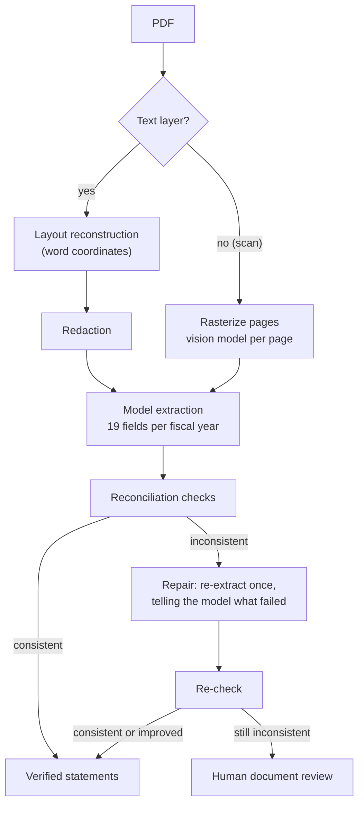

# Document parsing

The parser converts an applicant's PDFs into verified numbers. Its design goal is to be robust to messy layouts and scans, and to
know when it is wrong.

## Inputs

Two PDFs are read for each application.

| Document | Contents |
|---|---|
| Financial statements | Income statement and balance sheet, one to three fiscal years |
| Bank statement | A 12-month summary (opening balance, deposits, withdrawals, closing balance) with account-holder and signatory lines |

Both text PDFs and scanned, image-only PDFs are supported. Uploads are limited to 25 MB and 40 pages per file.

## Pipeline



### 1. Text or image

The parser extracts the text layer. If it holds more than about 40 characters, the document is treated as text. Otherwise it is
treated as image-only and every page is rasterized at 110 dpi.

### 2. Layout reconstruction (text PDFs)

Plain text extraction loses which number belongs to which column. A model reading such text can assign values of one fiscal year to
another when the column headers are formatted differently, and reconciliation cannot catch that error, because each year's totals
still balance.

Layout reconstruction rebuilds each table from word coordinates. Year-header words become column anchors, numbers are assigned to the
nearest anchor by their right edge, and each row is emitted with its values labeled by year:

```text
Sales: FY2023=867,262; FY2024=870,000
Cost of Sales: FY2023=427,812; FY2024=427,808
```

The model then only has to map labels to fields and cannot swap columns. The effect on noisy layouts is measured in the
[parsing evaluation](../research/e1-parsing.md).

### 3. Redaction

Document text passes through the [redactor](compliance.md#redaction) before it reaches the model, so owner names that appear on
statements or in bank memo lines are replaced with a placeholder. Image pages cannot be redacted this way; see
[Known limitations](../administration/limitations.md).

### 4. Model extraction

A system prompt fixes the rules: plain integers, parentheses mean negative, null for fields that do not appear, never compute. The
user prompt defines 19 canonical fields with plain-language descriptions and asks for one JSON object keyed by fiscal year.

| Statement | Fields |
|---|---|
| Income statement | Revenue, cost of goods sold, operating expenses, depreciation, interest expense, income tax, net income |
| Balance sheet | Cash, accounts receivable, inventory, total current assets, net fixed assets, total assets, accounts payable, current portion of long-term debt, total current liabilities, long-term debt, total liabilities, total equity |

Malformed JSON receives one automatic request for a corrected object. Scanned documents are read page by page and the pages' results
are merged, keeping the first value found for each field.

### 5. Reconciliation

Each fiscal year is checked with a tolerance of the larger of $2 and 0.1 percent.

| Check |
|---|
| No field is missing |
| Total assets equal total liabilities plus total equity |
| Total current assets equal cash plus receivables plus inventory |
| Total assets equal current assets plus net fixed assets |
| Current liabilities equal payables plus the current portion of long-term debt |
| Total liabilities equal current liabilities plus long-term debt |
| Net income equals revenue minus cost of goods sold, operating expenses, depreciation, interest and tax |

The bank statement is checked for each month (closing balance equals opening balance plus deposits minus withdrawals) and across
months (each opening balance equals the previous closing balance).

### 6. Repair, then a human

If checks fail, the extraction is repeated once with the failed checks described in the prompt. The repaired result is kept only if
it has no more issues than before. Anything still inconsistent sends the case to the document-review gate, where a person can accept
the values, correct specific values or reject the documents. A rejected case is closed as declined for unusable documents.

A parsing failure, such as an unreadable file, takes the same route to document review.

## What the parser does not do

* It does not verify that a document is genuine, only that its numbers are internally consistent.
* It does not detect consistent but wrong values, such as a digit misread in both a line item and its total.
* It does not read documents other than the two described above.

The measured accuracy on clean, noisy and scanned documents is reported in the [parsing evaluation](../research/e1-parsing.md).
