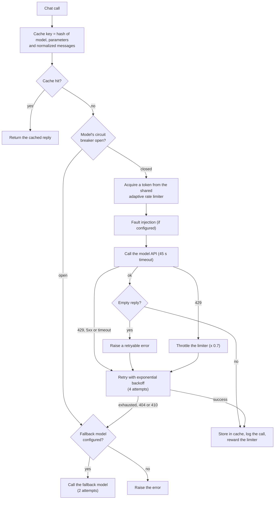

# Model gateway

The model gateway is the only component that talks to the hosted model API (chat, vision and rerank) and to the local embeddings
service. It is a library whose state lives in Postgres. The workflow process and the `policydocs` tool server therefore share one
request budget, one response cache and one call log.

## Anatomy of a chat call



The gateway wraps the standard chat client of the model library, so tool binding, agents and structured output work unchanged.
Asynchronous calls run the same code path in a worker thread.

## Components

### Response cache

Replies are stored in Postgres, keyed by a hash of the call kind, the model, the parameters and the payload. For chat the payload is a
normalized view of the conversation: role, content, tool calls and tool-call ids only. Message ids, usage figures and response
metadata differ on every run and would defeat the cache, so they are excluded.

Never cached: corrupted replies produced by fault injection, and empty replies. Embeddings are cached per text and rerank results per query and
document list.

Effect: re-running a case is served from the cache in seconds, and identical requests across processes cost one call. Set
`NIM_CACHE_ENABLED=false` to force every call to reach the service. See [Configuration](../get-started/configuration.md).

### Adaptive rate limit

A single row in Postgres holds a token bucket with a capacity of five, shared by all processes, plus the currently allowed rate. The
rate follows additive increase and multiplicative decrease:

| Event | Action |
|---|---|
| A request receives `429 Too Many Requests` | Rate multiplied by 0.7 and the bucket drained |
| A request succeeds | Rate increases by 0.15 requests per minute, up to the ceiling |
| Floor | 6 requests per minute |

The ceiling is `NIM_RPM_BUDGET` (default 15). Hosted model services enforce limits that fluctuate and differ by model, so a fixed
budget either wastes capacity or keeps overshooting. The adaptive limiter finds the usable rate automatically. Responses with `429`
do not count towards the circuit breaker, because rate limiting means "back off", not "the service is down".

### Retry

Calls use exponential backoff with jitter, from 2 s up to 25 s, with 4 attempts (2 on the fallback path). Retryable failures are HTTP
`429`, any `5xx` status, timeouts and connection errors. Responses with `404` or `410` indicate a retired model, so retrying cannot
help. Those go straight to the fallback.

### Circuit breaker

There is one breaker per model. It opens after 4 consecutive failed calls and stays open for 30 s, during which calls go straight to
the fallback. Only availability failures count. Rate limits and client errors such as `400` do not.

### Fallback model

`CHAT_FALLBACK_MODEL` names an optional second chat model. It is empty by default. A fallback model that handles long structured
outputs worse than the primary would trade a visible failure for a silent wrong answer, so enable it only after checking its output
on representative cases.

### Empty-reply guard

A reply with no content and no tool calls is raised as a retryable error and is neither returned nor cached.

### Thinking off

The chat and vision models are reasoning models. The gateway disables their extended thinking by default (`NIM_THINKING=false`),
which removes nearly all reasoning tokens and lowers latency substantially. Set `NIM_THINKING=true` to enable it.

### Call log

Every call (chat, vision, embeddings or rerank, cache hit or miss) is recorded in the call log with its latency, retries, token counts,
model, outcome and an optional tag. The tag labels a group of calls; calls made during normal case runs are untagged. Latency is measured around the whole gateway call, so it includes time
spent waiting for a rate-limiter token and retry backoff, which is what a caller experiences. See [Observability](observability.md)
and the [Database reference](../reference/database.md).

## Other model calls

| Call | Implementation |
|---|---|
| Vision | The same gateway chat client over the vision model. Page images are sent as base64 image parts. |
| Embeddings | The local embeddings service, in batches of 32, with the document and query prefixes that `nomic-embed-text` requires. Cached per text. |
| Rerank | The hosted reranker through the same limiter, cache and circuit breaker. Returns one score per document. |

## Fault injection

The gateway can inject faults for reliability testing. Faults are injected between the cache and the network, so a cache hit never
hides a fault. The configuration is a JSON document in the `WP_CHAOS` environment variable of the process under test:

| Key | Effect |
|---|---|
| `p_429`, `p_503`, `p_timeout` | Probability that a call raises that failure. The probabilities are checked in order and add up. |
| `p_malformed` | Probability that a reply is replaced by corrupted text and its tool calls are removed. |
| `latency_s` | Extra delay before every call. |
| `kinds` | Restrict injection to certain call kinds, such as chat, rerank or tool calls. |
| `down_servers` | A list of tool servers to treat as unavailable, such as `["research"]`. |

```bash
WP_CHAOS='{"p_429": 0.35, "kinds": ["chat", "rerank"]}'
```

!!! warning "Not for production"
    The default Compose file does not pass `WP_CHAOS` to any service. Never set it on a deployment that handles real cases. Injected
    `429` responses are raised before the limiter is throttled, so they do not reduce the shared rate. Only real `429` responses
    do. The [reliability evaluation](../research/e4-reliability.md) uses fault injection.

## Tool-call resilience

Calls from the workflow to the tool servers have their own protection: 3 attempts with 0.5 s and 1 s backoff, behind an asynchronous
circuit breaker per server that opens after 3 failures for 20 s. A failure marks the run as degraded instead of crashing it. See
[Tool servers](tool-servers.md#failure-handling).
