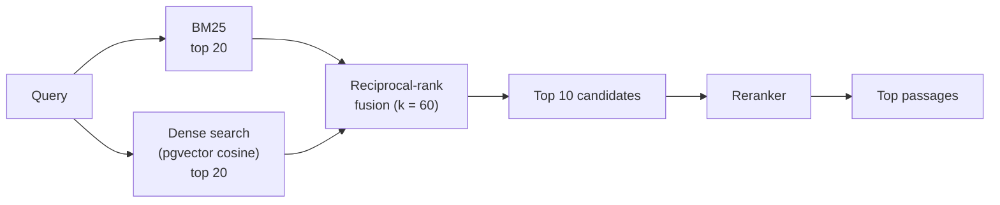
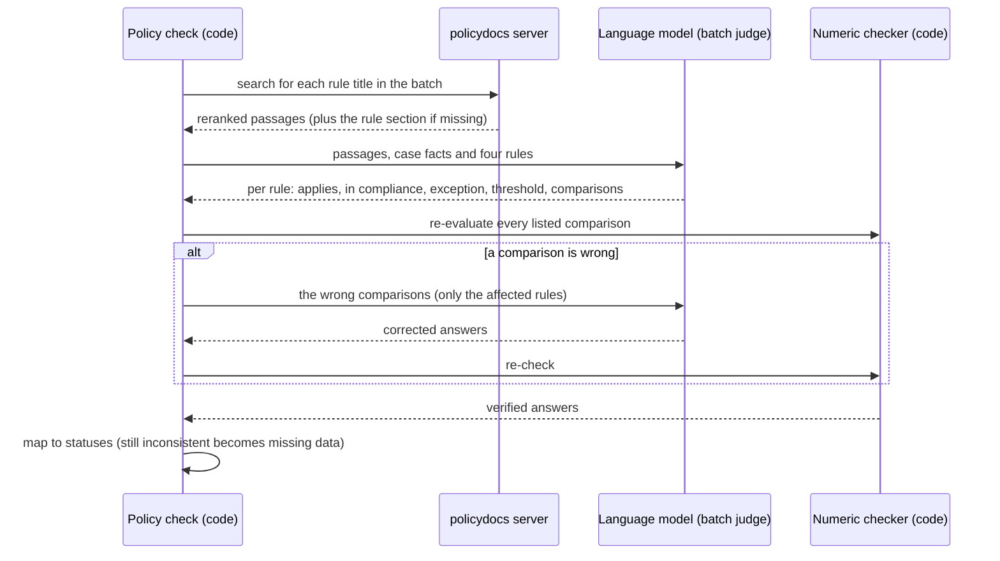

# Policy retrieval

A credit policy is a Markdown document, not code. The system reads it, finds the relevant rule, extracts thresholds and applies the
rule's text to a case. This page explains how a policy is indexed, searched and judged.

## Anatomy of a policy

Each policy lives in its own folder under `policies/` and consists of a single file, `policy.md`. It contains the policy in prose:
purpose and scope, definitions, the numbered rules CP-1 to CP-13, the decision rule and any governance sections. The folder name is
the policy id shown in the console.

The policy is the only input. There is no machine-readable copy of its thresholds anywhere in the product. The system extracts every
threshold from the prose, so changing a number or a qualitative condition in the text changes the system's behavior without any code
change.

### Conventions a policy must follow

| Convention | Why |
|---|---|
| Each rule is a section whose heading starts with the rule id, for example `## CP-3 Minimum Debt Service Coverage` | Rule sections are the retrieval unit and rule ids are cited in memos and the audit log. |
| Rules CP-1 to CP-13 are present | The workflow judges every rule it finds; CP-12 is judged after the grade is known and CP-13 sets the approver tier. |
| CP-3, CP-4 and CP-5 state the debt service coverage, leverage and liquidity thresholds in numbers | These three values feed the scorecard. See [Decision rule](decision-rule.md#risk-grade). |
| CP-13 states the approval limits by loan amount and what exceptions require | The model extracts the limits and code selects the tier. |
| Definitions of the ratios appear in the policy | The ratios are computed by the tool servers; the definitions document them for readers. |

See [Managing credit policies](../administration/policies.md) for the full procedure.

### The example policies

Two example policies ship with the product. Both are the same fictional bank's SME credit policy and differ in numbers and in
qualitative rules, so a correct system must change its behavior rather than a constant.

| Rule | Conservative edition | Growth edition |
|---|---|---|
| CP-1 Operating history | At least 3 years | At least 2 years |
| CP-2 Prohibited industries | Cannabis, firearms, gambling, adult entertainment, cryptocurrency exchanges | Cannabis and adult entertainment only |
| CP-3 Minimum DSCR | At least 1.30, no exceptions | At least 1.15; 1.05 up to 1.15 is an exception if collateral coverage is at least 1.20; below 1.05 fails |
| CP-4 Maximum debt-to-equity | 3.0 or less | 4.5 or less |
| CP-5 Minimum current ratio | At least 1.20 | At least 1.00 |
| CP-6 Maximum loan-to-revenue | 0.30 or less | 0.50 or less |
| CP-7 Statement years | 3 | 2 |
| CP-8 Collateral | Coverage of at least 1.00 for loans above $150,000 | Coverage of at least 0.80 for loans above $400,000 |
| CP-9 Personal guarantee | Always required | Only if the loan exceeds $250,000 or the business is under 5 years old |
| CP-10 Sanctions | Any confirmed match fails | Same |
| CP-11 Adverse media | Medium or high severity is an exception | Only high severity is an exception |
| CP-12 Acceptable grade | A, B or C | A, B, C or D |
| CP-13 Authority | Analyst up to $75,000, officer up to $250,000, otherwise committee | Analyst up to $150,000, officer up to $500,000, otherwise committee |

The complete rule listing is in [Policy rules](../reference/policy-rules.md).

## Indexing

Each policy is chunked and indexed under two strategies.

| Strategy | How the text is split | Chunks per example policy |
|---|---|---|
| Structure (default) | One chunk per `## ` section. A rule's heading and body stay together and carry its rule id. | 19 |
| Fixed | Sliding windows of 450 characters with 90 characters of overlap. Each window records which rule sections it overlaps. | 13 to 14 |

The workflow always uses the structure strategy. The fixed strategy exists for comparison; the Credit policies page of the console
lets a user try either one, and the [retrieval evaluation](../research/e2-rag.md) compares them.

Each chunk is embedded with the `nomic-embed-text` model (768 dimensions, with the document prefix that the model requires) and stored
in Postgres with pgvector. The `policydocs` tool server indexes any policy and strategy that has no chunks yet when it starts. A newly
added policy is therefore indexed on the next start of the tool servers. After editing an existing policy, rebuild its index and restart the services that cache it:

```bash
docker compose exec console wealthpilot ingest-policy
docker compose restart mcp console
```

## Retrieval



* **Hybrid fusion.** Reciprocal-rank fusion combines a BM25 ranking with a vector ranking.
* **Rerank.** A cross-encoder reranker rescores the ten best candidates. If the reranker is unavailable, retrieval keeps the fused
  order and marks the result as degraded instead of failing.
* **Switches.** Each stage can be turned off (BM25 only, dense only, no rerank), which the Credit policies page and the retrieval
  evaluation use.

## How rules are judged

For every rule, code takes the rule's title and searches the policy through the `policydocs` server. If the rule's own section is
missing from the top results, code also fetches it directly and appends it. The language model never decides whether to look:
retrieval always happens.

Rules are then judged in batches of four, with one model call per batch.



### Numeric verification

Language models make arithmetic comparison errors, for example asserting that 132,000 is above a threshold of 150,000. The judge is
therefore required to list every numeric comparison it relied on, together with its claim of whether the comparison is true:

```json
"comparisons": [{"left": 132000, "op": ">", "right": 150000, "claimed_true": false}]
```

Code re-evaluates each comparison with the same comparison tool the tool servers expose. A contradiction triggers one targeted
re-ask that names the wrong comparison. If the answer is still inconsistent, the rule becomes missing data, which leads to a
referral, rather than carrying a silent error. The effect of this check is measured in the
[policy adherence evaluation](../research/e0-policy-adherence.md).

### Extracted thresholds feed the scorecard

For rules CP-3, CP-4 and CP-5 the judge also returns the main pass threshold as written in the text. Those numbers become the
arguments of the scorecard (see [Decision rule](decision-rule.md#risk-grade)), so the risk grade itself depends on the policy that
was read.

## Answer keys

The product holds no answer key for any policy. The evaluation compares the system's judgments with a reference engine that lives in
a separate research package. See [Research](../research/index.md) and [Design decisions](decisions.md#d3-the-policy-is-data).
