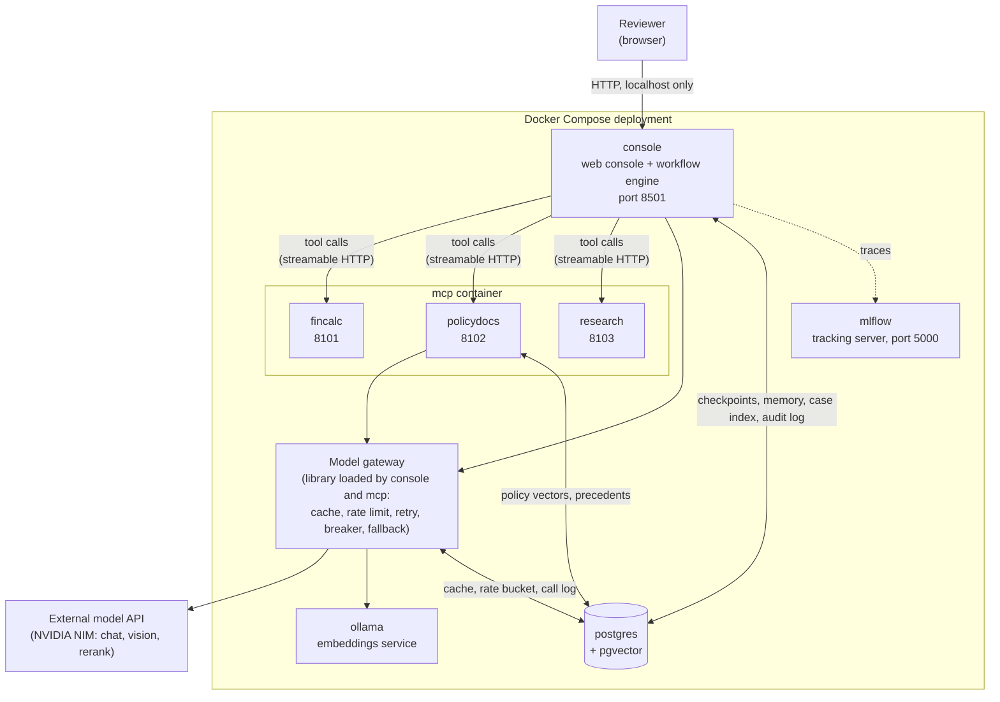

# System design

WealthPilot is a small set of containers around one workflow engine. This page describes the layers, the deployed topology, the data
stores and the rules that constrain what the language model is allowed to do.

## Deployed topology

The product is deployed with Docker Compose. One container image runs every WealthPilot service; the command chosen at start-up
decides which one.

| Service | Role | Port and exposure |
|---|---|---|
| `postgres` | The single database: workflow state, memory, policy vectors, cache, call log, case index and audit log. Postgres 16 with pgvector. | 5432, published on the host loopback interface only |
| `ollama` | Local embeddings service serving the `nomic-embed-text` model. | Internal |
| `ollama-pull` | One-shot job that downloads the embedding model before dependent services start. | None |
| `bootstrap` | One-shot job that creates the data folders and downloads the OFAC sanctions list. | None |
| `mlflow` | Tracking server for traces and the model registry. | 5000, internal |
| `mcp` | The three tool servers in one container: `fincalc` (8101), `policydocs` (8102) and `research` (8103). | Internal |
| `console` | The Streamlit web console. It also hosts the background worker that runs the underwriting workflow. | 8501, published on the host loopback interface only |
| `lab` | Optional research tooling, started only under the `lab` Compose profile. It is not part of the product. | None |

Four named volumes hold state: `pgdata` (database), `ollama` (embedding model), `data` (uploads, the sanctions list and optional
demonstration data) and `mlflow` (tracking database and artifacts). The credit policies are read from the `policies/` folder and the
trained risk model and sector statistics from the `artifacts/` folder; both ship inside the image.

The console has no login. Keep it on the loopback interface or place it behind an authenticating reverse proxy. See
[Security](../administration/security.md) and [Deploy with Docker](../get-started/deploy.md).

## Layers

| Layer | Responsibility |
|---|---|
| **Interfaces** | The web console and the command-line interface. They start cases, show evidence, collect the human decision and report service health. See [How the console is built](console.md). |
| **Orchestration** | The workflow engine runs the underwriting steps, persists state after every step and pauses at the two human gates. See [Underwriting workflow](workflow.md). |
| **Tool servers** | Deterministic credit math, policy search and borrower research, exposed as Model Context Protocol tools. See [Tool servers](tool-servers.md). |
| **Model gateway** | The only component that talks to the external model API and to the embeddings service. It adds caching, rate limiting and resilience. See [Model gateway](model-gateway.md). |
| **Domain logic** | Pure functions for ratios, the scorecard, the grade matrix and the decision rule. The tool servers and the workflow share them, so results cannot diverge. |
| **Pipelines** | Document parsing, policy retrieval, the default-probability model and the compliance checks. |
| **Storage** | One Postgres database, plus MLflow for traces and the model registry. |

## Processes and shared state

The workflow engine runs inside whichever process starts a case: the console's background worker, or a command-line session. It
connects to the tool servers over the network and to Postgres for state.

The model gateway is a library, not a service. Both the workflow process and the `policydocs` tool server load it, and its state lives
in Postgres. The request budget, the response cache and the call log are therefore shared across processes without an additional
gateway container.

Tracing is best effort. If MLflow is unavailable, underwriting continues without traces.

## Data stores

| Store | Contents |
|---|---|
| Postgres: workflow state | Per-case checkpoints and the long-term applicant and decision records. See [Memory](memory.md). |
| Postgres: retrieval | Policy chunk vectors and the similar-case precedents. See [Policy retrieval](policy-retrieval.md). |
| Postgres: gateway | Response cache, the shared rate bucket and the call log. See [Model gateway](model-gateway.md). |
| Postgres: console and audit | The case index that lists and reopens cases, and the hash-chained audit log. See [Compliance](compliance.md). |
| MLflow | One trace per case run and the registered default-probability model. See [Observability](observability.md). |
| `data` volume | Uploaded PDFs, the OFAC sanctions list and optional demonstration data. |
| `policies/` and `artifacts/` | Credit policy text, the trained model and sector statistics. Read-only inputs. |

Table-level detail is in the [Database reference](../reference/database.md).

## Design rules

!!! abstract "Rules that shape the rest of the design"
    1. **The language model reads; code decides.** The model extracts numbers from documents, reads policy passages and writes
       prose. It does not route the workflow, compute the final recommendation or classify sanctions matches, and code re-checks its
       numeric comparisons.
    2. **No model supervisor.** Routing is a set of conditions over typed state, so control flow is testable, repeatable and
       explainable.
    3. **The policy is data.** A policy is a Markdown document with stable rule ids. The system extracts thresholds from the text.
       The `policies/` folder holds policy text only.
    4. **A human always decides.** Every case ends at a pause for a person. The approver's authority tier is checked against the
       policy's own delegation-of-authority rule.
    5. **Degraded means refer.** If any tool or check is unavailable, the run is flagged degraded and cannot be recommended for
       approval or decline.
    6. **Protected attributes never reach a prompt.** Identity lives in a sealed part of the case state and is redacted from any text
       sent to a model.
    7. **Everything is observable and auditable.** One trace per case, a log of every model call, and a hash-chained audit record
       for each decision.

### What the language model may do

* Extract statement values from document text or page images.
* Answer plain yes/no/unknown questions about whether a policy rule applies, is satisfied or carries an exception.
* Extract numeric limits (such as approval authority) from policy prose.
* Summarize research findings and write the analyst narrative and the credit memo.

### What the language model may not do

* Choose the next workflow step.
* Perform arithmetic that determines an outcome. Ratios, comparisons, the scorecard and the grade come from tools.
* Assign rule statuses, derive the recommendation or select the approver tier.
* Classify sanctions matches. It never sees the names that were screened.
* See the owner's identity while redaction is on.
* Decide a case.

Each rule is enforced in code, not by prompt wording. See [Decision rule](decision-rule.md), [Compliance](compliance.md) and
[Design decisions](decisions.md).

## Locations

| Location | Purpose |
|---|---|
| `policies/<id>/policy.md` | One folder per credit policy. See [Managing credit policies](../administration/policies.md). |
| `artifacts/` | The trained default-probability model, its metrics and the sector default statistics. |
| `config/compliance_profiles/` | The compliance profile: prohibited terms and adverse-action requirements. |
| `data/` | Runtime data: uploads, the sanctions list and optional demonstration data. A volume in the Docker deployment. |

The product contains no experiment code and no answer keys. The evaluation lives in a separate package, described in the
[Research](../research/index.md) section and in [Developer guide](development.md).
