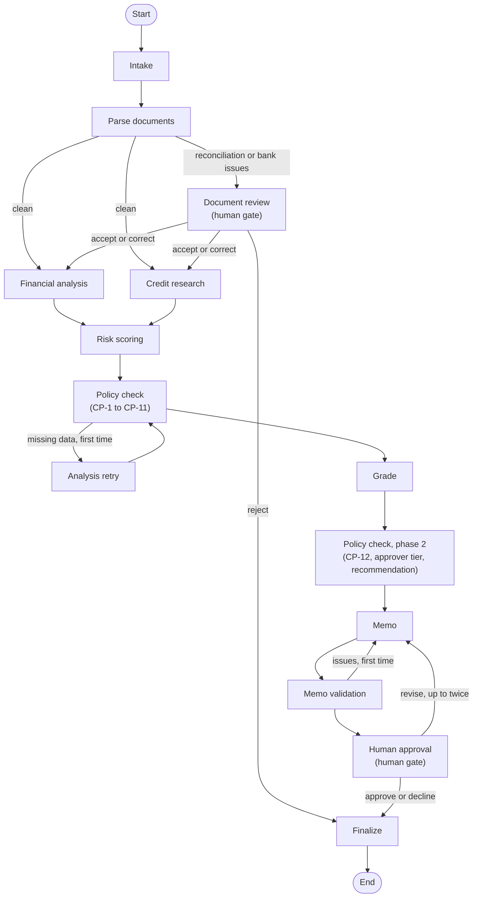

# Underwriting workflow

The workflow turns an application and two PDF statements into a verified recommendation and a credit memo, then pauses for a human
decision. It is deterministic: every branch is a condition over typed case state and every loop has a counter. No language model
chooses the next step.

## The workflow

* **Parallel branch.** Financial analysis and credit research run concurrently and join at risk scoring.
* **Human gates.** Document review and human approval pause the workflow. The full state is saved to Postgres, the process can
  exit, and a later session resumes the same case from the saved checkpoint.
* **Why the analysis retry is a separate step.** A join waits for all of its sources. Looping back into financial analysis alone
  would leave risk scoring waiting for credit research indefinitely, so the retry is its own step that returns straight to the policy
  check.

## Steps

| Step | Kind | What it does |
|---|---|---|
| Intake | Code | Validates the application (loan amount, term, years in business, industry), loads the applicant's prior decisions from long-term memory and initializes the loop counters. |
| Parse documents | Language model, vision | Reads the financial statements and the bank statement, extracts 19 fields per fiscal year, reconciles them and repairs the extraction once. See [Document parsing](document-parsing.md). |
| Document review | Human | Runs only when reconciliation problems remain. The reviewer can accept the values, correct specific values or reject the documents. |
| Financial analysis | Tools and language model | Computes ratios, the revenue trend and a stress test with a 10 percent revenue drop through the tool servers. A language model writes a short narrative from those figures. |
| Credit research | Tools, optional language model | Screens the owner and the business against sanctions lists and looks up adverse media, the business registry and the sector default rate. A model summarizes findings only if there are any. See [Agents](agents.md#credit-research). |
| Risk scoring | Tools | Returns the five-year probability of default with the top risk-increasing factors. No language model is involved. See [Risk model](risk-model.md). |
| Policy check | Retrieval and language model | Judges rules CP-1 to CP-11 against the policy text, four rules per model call, with the calls running concurrently. See [Policy retrieval](policy-retrieval.md#how-rules-are-judged). |
| Analysis retry | Tools | Runs when the policy check reports missing data. Recomputes ratios, filling gaps from the prior fiscal year and flagging those figures as estimated. |
| Grade | Tools | Computes the scorecard class from the thresholds extracted from the policy, then applies the grade matrix. |
| Policy check, phase 2 | Retrieval and language model | Judges CP-12 (acceptable grade), extracts the approver authority limits from CP-13, selects the approver tier and applies the [decision rule](decision-rule.md). |
| Memo | Language model | Drafts a structured credit memo that explains, and never changes, the recommendation. |
| Memo validation | Code | Checks the memo against the case facts (see [Memo validation](#memo-validation)). |
| Human approval | Human | Pauses with the memo and the evidence and enforces the approver's tier. See [Human approval](compliance.md#human-approval). |
| Finalize | Code | Writes the decision to long-term memory, adds the case to the precedents index and appends the audit record. |

## Routing conditions

All routing is evaluated in code and is covered by tests that run without a model.

| After | Condition | Next step |
|---|---|---|
| Parse documents | Reconciliation issues or bank issues remain | Document review |
| Parse documents | Otherwise | Financial analysis and credit research, in parallel |
| Document review | The reviewer rejected the documents | Finalize |
| Document review | Otherwise | Financial analysis and credit research, in parallel |
| Policy check | Any rule has missing data, the retry has not run yet and statements were extracted | Analysis retry |
| Policy check | Otherwise | Grade |
| Memo validation | Issues found and the memo has been regenerated at most once | Memo (one regeneration) |
| Memo validation | Otherwise | Human approval, with the issues shown to the approver |
| Human approval | The decision is revise and it is the first or second revision request | Memo |
| Human approval | Otherwise | Finalize |

## Memo validation

The memo writer explains a recommendation that code already derived. Memo validation rejects the memo if any of these hold:

1. Its recommendation differs from the decision-rule result.
2. It cites a rule id that was not evaluated.
3. It contains a number that does not appear in the case facts. A small tolerance applies, and rule ids, fiscal years and small
   integers are exempt.
4. It uses prohibited-basis language such as gender, race or marital status. See the [language scan](compliance.md#language-scan).
5. Redaction is on and it contains the owner's name, ZIP code or street address.
6. The recommendation is decline, but there are no adverse-action reasons or none cites a failed rule.
7. The run is degraded but the memo lists no limitations.

A rejected memo is regenerated once with the list of issues appended to the prompt. If the second attempt still fails, the case
goes to the human with the issues visible. The validator never silently passes a bad memo.

## Human gates and loops

| Loop | Bound | When the bound is reached |
|---|---|---|
| Analysis retry | One pass | The policy check runs again once, then the workflow continues to grading whatever the result; rules still missing data lead to a referral. |
| Memo regeneration | One regeneration per drafting round | The memo goes to the human with its issues listed. |
| Revision requested by the approver | Two revisions | The case is finalized as a referral rather than decided. |

An approver who asks for a revision resets the memo counter, so each revised memo gets its own validation round.

## Persistence and resumption

* The workflow state is checkpointed in Postgres after every step. A long-term store in the same database holds applicant history
  and decision records. See [Memory](memory.md).
* Each case run has a thread id. Resuming a thread with a decision continues from the saved checkpoint; resuming it with no input
  continues an interrupted run from its last completed step. Completed steps are not repeated, and the step that was in flight
  when a process stopped runs again.
* The workflow engine mirrors each run's lifecycle status (running, awaiting document review, awaiting approval, decided or
  error) into the case index, which the [console](console.md#case-index) uses to list and reopen cases. The index is best effort and
  never affects underwriting.

The measured behavior of crash and resume is documented in [Reliability](../research/e4-reliability.md).
