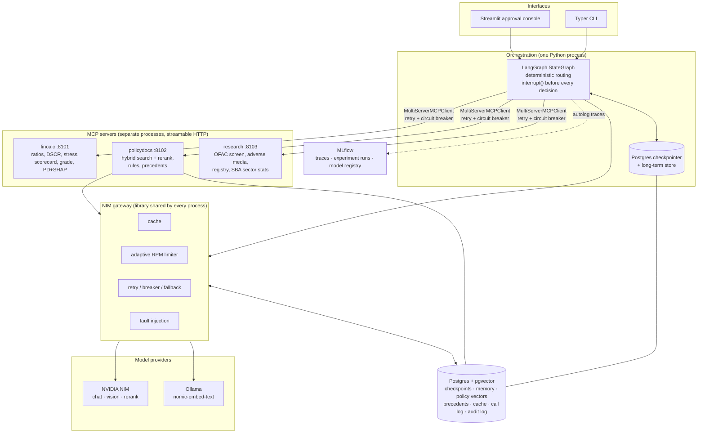

# Architecture

## System overview



## Layers

| Layer | Responsibility | Key modules |
|---|---|---|
| **Interfaces** | Start cases, show evidence, collect the human decision. | `wealthpilot.cli`, `wealthpilot.ui.app` |
| **Orchestration** | Run the workflow, persist state, pause and resume. | `wealthpilot.graph.builder`, `.nodes`, `.state`, `.runtime` |
| **Tools (MCP)** | Deterministic credit math, policy search and borrower research, exposed as MCP tools. | `mcp_servers/*`, `wealthpilot.mcp_client` |
| **Model gateway** | The only place that talks to NIM and Ollama; adds caching, rate limiting and resilience. | `wealthpilot.nim.*` |
| **Domain logic** | Pure functions shared by tools, tests and the ground-truth engine. | `wealthpilot.finance`, `wealthpilot.policy_ref` |
| **Pipelines** | Document parsing, RAG, risk model, compliance. | `wealthpilot.parsing`, `.rag`, `.risk`, `.compliance` |
| **Storage** | One Postgres database; MLflow for traces and experiments. | `docker-compose.yml` |

## Processes

A running system consists of:

* **Postgres** (container) — the single source of truth for state.
* **MLflow** — optional; traces and experiment runs are best-effort and never block underwriting.
* **Three MCP servers** — started by `wealthpilot mcp-up`; each is stateless apart from what it reads from Postgres and disk.
* **The graph process** — the CLI, the Streamlit app, or an experiment script. It owns the LangGraph run.
* **Ollama** — the embedding model.

Because the NIM gateway is a *library* backed by Postgres, the graph process **and each MCP server** import it. That is how the
request budget, the response cache and the call log are shared across processes without a separate gateway service.

## Design principles

!!! abstract "Rules that shape everything else"
    1. **The LLM reads; code decides.** An LLM extracts numbers from documents, reads policy passages and writes prose. It does
       not route the graph, does not compute the final recommendation, and its numeric comparisons are re-checked by code.
    2. **No LLM supervisor.** Routing is a set of code predicates over typed state, so the control flow is testable, repeatable
       and explainable.
    3. **The policy is data.** Policies are Markdown documents with stable rule ids. The system extracts thresholds from the text;
       the machine-readable answer key is visible only to the ground-truth engine used by the experiments.
    4. **A human always decides.** Every case ends at an `interrupt()`; the approver's authority tier is enforced against the
       policy's own delegation-of-authority rule.
    5. **Degraded means refer.** If any tool or check is unavailable, the run is flagged degraded and cannot auto-decide in
       either direction.
    6. **Protected attributes never reach a prompt.** Identity lives in a sealed part of the state and is redacted from any text
       sent to a model.
    7. **Everything is observable and auditable.** One MLflow trace per case, a per-call log in Postgres, and a hash-chained
       audit record for each decision.

## Repository layout

```text
src/wealthpilot/
  config.py            settings (precedence: .env > environment > error)
  finance.py           credit math: ratios, DSCR, stress, scorecard, grade
  policy_ref.py        reference policy engine + the fixed decision rule
  screening.py         sanctions screening (OFAC SDN + synthetic watchlist)
  mcp_client.py        MultiServerMCPClient helpers; mcp_up.py launches the servers
  observability.py     MLflow tracing
  cli.py               Typer CLI
  graph/               state, nodes, runtime (MCP calls + breaker), builder (graph + Runner)
  nim/                 gateway.py (chat/vision/embed/rerank), store.py (cache/limiter/log), chaos.py
  parsing/pipeline.py  PDF -> numbers
  rag/index.py         chunking, indexing, hybrid search, rerank
  risk/pd_model.py     SBA default model
  compliance/          redaction, language scan, audit chain
  memory/precedents.py semantic similar-case memory
  synth/               synthetic applicants, documents, news, ground truth
  ui/app.py            Streamlit console
mcp_servers/           fincalc, policydocs, research (FastMCP)
data/policies/         strict/ and lenient/ policy.md + hidden reference.yaml
data/compliance_profiles/   example (US ECOA/Reg-B style) profile
experiments/           E0-E4 scripts
report/                REPORT.md and raw results
tests/                 unit, MCP contract and live tests
```
