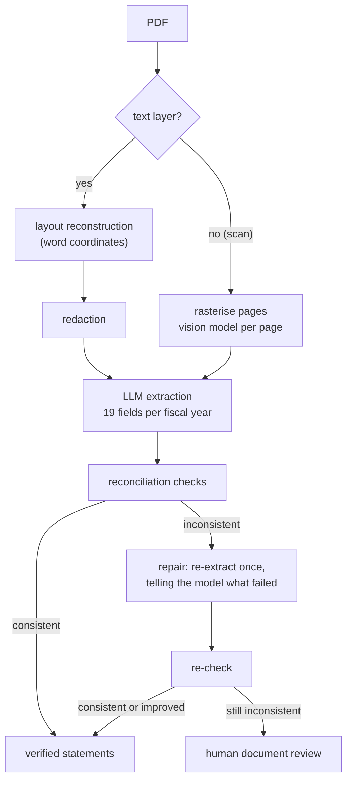

# Document parsing

The parser (`wealthpilot.parsing.pipeline`) converts an applicant's PDFs into verified numbers. Its design goal is to be **robust to
messy layouts and scans, and to know when it is wrong**.

## Inputs

For each applicant two PDFs are read:

| Document | Contents |
|---|---|
| `financials.pdf` | Income statement and balance sheet, one to three fiscal years |
| `bank_statement.pdf` | A 12-month summary (opening, deposits, withdrawals, closing) with account-holder and signatory lines |

The synthetic world renders each in three [variants](../guides/synthetic-data.md#document-variants): **clean**, **noisy layout** and
**scanned** (image-only).

## Pipeline



### 1. Text or image?

`read_pdf` extracts the text layer; if it has more than ~40 characters the document is treated as text, otherwise as image-only and every
page is rasterised at 110 dpi.

### 2. Layout reconstruction (text PDFs)

Plain text extraction loses which number belongs to which column. In the experiments the raw LLM sometimes **assigned FY2023 values to
FY2024** when column headers were formatted differently — an error reconciliation cannot catch, because each year's totals still balance.

`layout_text` rebuilds each table from word coordinates: year-header words become column anchors (by right edge), numbers are assigned to
the nearest anchor, and each row is emitted as

```text
Sales: FY2023=867,262; FY2024=870,000
Cost of Sales: FY2023=427,812; FY2024=427,808
```

so the LLM only has to map *labels* to fields; it can no longer swap columns. This raised noisy-layout accuracy from 80.3 % to 99.5 %
([E1](../experiments/e1-parsing.md)).

### 3. Redaction

Document text is passed through the [redactor](compliance.md#redaction) before reaching the LLM, so owner names that appear on statements
or bank memo lines are replaced with `[OWNER]`. Image pages cannot be redacted this way (see [Limitations](../project/limitations.md)).

### 4. LLM extraction

A system prompt fixes the rules (plain integers, parentheses mean negative, `null` for absent fields, never compute). The user prompt defines
19 canonical fields with plain-language descriptions and asks for JSON of the form
`{"years": {"2024": {"revenue": 123, ...}, "2023": {...}}}`.

| Statement | Fields |
|---|---|
| Income | `revenue`, `cogs`, `operating_expenses`, `depreciation`, `interest_expense`, `income_tax`, `net_income` |
| Balance sheet | `cash`, `accounts_receivable`, `inventory`, `total_current_assets`, `net_fixed_assets`, `total_assets`, `accounts_payable`, `current_portion_ltd`, `total_current_liabilities`, `long_term_debt`, `total_liabilities`, `total_equity` |

Malformed JSON gets one automatic "reply with only the corrected JSON" retry (`llm_json`). Scans are handled page by page and the pages'
results are merged.

### 5. Reconciliation

`reconcile` checks each fiscal year; tolerance is `max($2, 0.1 %)`:

| Check |
|---|
| no field missing |
| total assets = total liabilities + total equity |
| total current assets = cash + receivables + inventory |
| total assets = current assets + net fixed assets |
| current liabilities = payables + current portion of long-term debt |
| total liabilities = current liabilities + long-term debt |
| net income = revenue − COGS − operating expenses − depreciation − interest − tax |

`reconcile_bank` checks `closing = opening + deposits − withdrawals` per month and `opening = previous closing` across months.

### 6. Repair, then a human

If checks fail, the extraction is repeated **once** with the failed checks described in the prompt; the repaired result is kept only if it has no
more issues than before. Anything still inconsistent sends the case to the **document-review** interrupt, where a person can accept,
correct specific values or reject the documents.

## Baselines

For the E1 comparison there is a rule-based parser (`baseline_extract`) that matches row labels against a dictionary:

* **oracle dictionary** — knows every label variant the generator can emit (an unrealistically strong baseline);
* **canonical labels only** — a realistic one.

Neither can read a scan.

## Observed behaviour

| Variant | LLM + layout | + repair |
|---|---|---|
| Clean | 100 % | 100 % |
| Noisy layout | 99.5 % | 100 % |
| Scanned | 96.9 % | 96.9 % (both bad documents were *flagged*; repair did not fix OCR digit errors) |

See [E1](../experiments/e1-parsing.md) for the full table.
