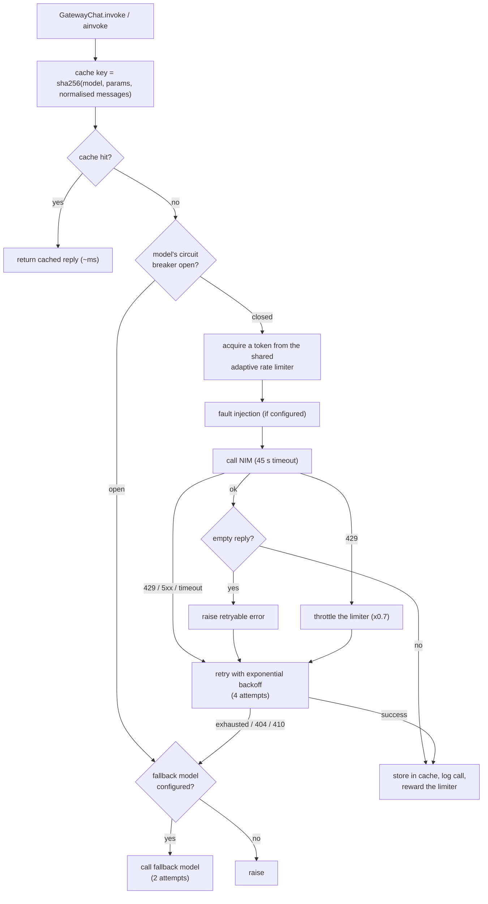

# NIM gateway and reliability

`wealthpilot.nim` is the **only** place the project talks to NVIDIA NIM (chat, vision, rerank) and to Ollama (embeddings). It is a *library*
whose state lives in Postgres, so the graph process **and every MCP server** share one request budget, one response cache and one call log.

## Anatomy of a chat call



It subclasses `ChatNVIDIA`, so `bind_tools`, `create_agent` and structured output all work unchanged, and `ainvoke` runs the same sync path in a
worker thread.

## Components

### Response cache

Replies are stored in `nim_cache`, keyed by `sha256(kind, model, params, payload)`. For chat the payload is a **normalised** view of the
conversation — role, content, tool calls and tool-call ids only. Message ids, usage and response metadata differ on every run and would
defeat the cache, so they are excluded.

Never cached: injected garbage, and **empty replies**. (A cache that stored empty replies once silently poisoned an experiment — see
[Lessons learned](../project/lessons-learned.md).) Embeddings are cached per text; rerank results per `(query, documents)`.

Effect: re-running a case is served from the cache in seconds, which is what makes the large experiments repeatable on a slow free tier.

### Adaptive rate limit

A single row in `nim_bucket` holds a **token bucket** (capacity 5) shared by all processes, plus the current allowed rate. It follows
**AIMD** (additive increase, multiplicative decrease):

| Event | Action |
|---|---|
| a request gets `429 Too Many Requests` | rate × 0.7, bucket drained (`throttle`) |
| a request succeeds | rate + 0.15 requests/minute, up to the configured ceiling (`reward`) |
| floor | 6 requests/minute |

The ceiling is `NIM_RPM_BUDGET` (default 15). A fixed budget kept overshooting the free tier's real, fluctuating, **per-model** limit; the adaptive
limiter finds it automatically. `429`s do **not** count towards the circuit breaker — rate limiting means "back off", not "the service is down".

### Retry

`call_with_retry` uses exponential backoff with jitter (2 s → 25 s, 4 attempts; 2 on the fallback path). Retryable: HTTP `429`, any `5xx`, timeouts and connection
errors. **Not** retried: `404` / `410` (a retired model — retrying cannot help) — those go straight to the fallback.

### Circuit breaker

One per model (`pybreaker`): opens after **4** consecutive failed calls and stays open for 30 s, during which calls go straight to the fallback.
Only availability failures count; `429`s and client errors (`400`) do not.

### Fallback model

`CHAT_FALLBACK_MODEL` names an optional second model. It is **empty by default**: the only other chat model that worked for the development
account returned *garbled text* on long structured outputs, so enabling it would trade a visible failure for a silent wrong answer. The
reliability experiment turns it on explicitly.

### Empty-reply guard

A reply with no content and no tool calls is raised as a retryable `[502] empty response from model`. It is neither returned nor cached.

### Thinking off

The chat and vision models are *reasoning models*. The gateway sends `chat_template_kwargs: {"enable_thinking": false}` by default
(`NIM_THINKING=false`): reasoning tokens drop to ~0 and latency falls about 3×. With thinking on, a single document extraction was still running after four minutes when the test was stopped.

### Call log

Every call — chat, vision, embed, rerank, cache hit or miss — is recorded in `nim_calls` with latency, retries, tokens, model, outcome and a **tag**
set with `with run_tag("..."):` (cases and experiment arms tag themselves). The experiments aggregate this table for call counts, retries and
fallback use. See [Database](../reference/database.md#nim_calls).

## Other models

| Call | Implementation |
|---|---|
| Vision | `get_vlm()` — the same `GatewayChat` over the vision model; images are sent as base64 `image_url` parts. |
| Embeddings | `embed(texts, kind)` — local Ollama `/api/embed`; batches of 32; `search_document: ` / `search_query: ` prefixes (required by nomic); cached per text. |
| Rerank | `rerank(query, docs)` — `NVIDIARerank` through the same limiter, cache and breaker; returns one score per document. |

## Fault injection

For the reliability experiment, faults are injected **between the cache and the network** so a cache hit can never hide a fault. Configure with the
`WP_CHAOS` environment variable (JSON) or `chaos.set_chaos({...}, seed=...)`:

| Key | Effect |
|---|---|
| `p_429`, `p_503`, `p_timeout` | probability that a call raises that failure (checked in order; probabilities add up) |
| `p_malformed` | probability that a reply is replaced by corrupted text and its tool calls removed |
| `latency_s` | extra delay before every call |
| `kinds` | restrict to `["chat"]`, `["rerank"]`, `["mcp"]`, … |
| `down_servers` | e.g. `["research"]` — simulates an outage of an MCP server |

```bash
WP_CHAOS='{"p_429": 0.35, "kinds": ["chat", "rerank"]}' uv run python experiments/e4_reliability.py
```

!!! warning
    Injected `429`s are raised *before* the limiter's `throttle()` hook, so they do not reduce the shared rate; only real `429`s do.

## MCP-side resilience

Tool calls from the graph go through `wealthpilot.graph.runtime.Runtime.call`: 3 attempts (0.5 s, 1 s backoff) behind an **async circuit breaker per
server** (opens after 3 failures for 20 s). A failure raises `ToolUnavailable`, which the node turns into a *degraded* flag rather than a crash. See
[MCP servers](mcp-servers.md#failure-handling).
