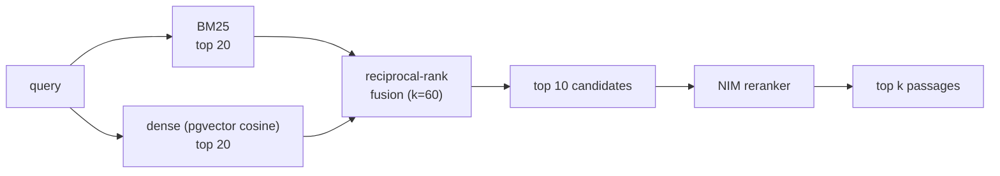
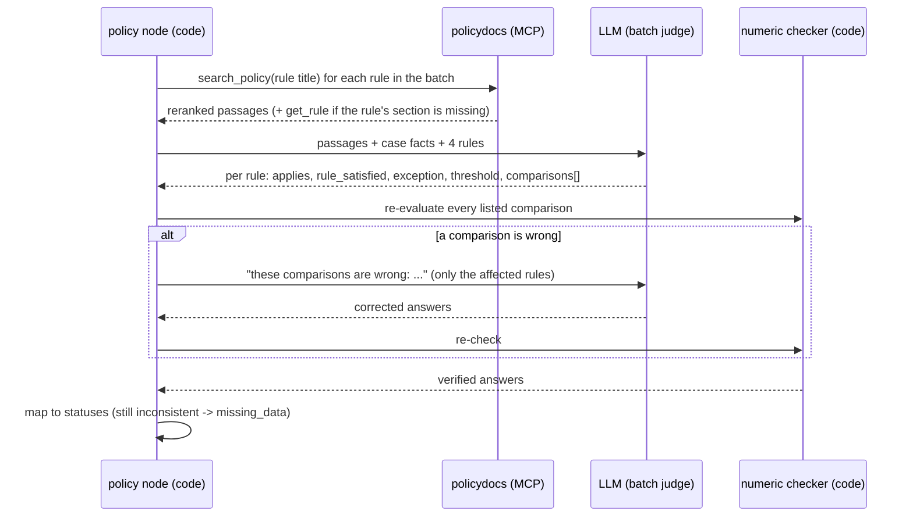

# Credit policy and RAG

The credit policy is **a Markdown document**, not code. The system must read it, find the right rule, extract thresholds, and apply the
rule's text to a case. This page explains how.

## Anatomy of a policy

Each policy lives in `data/policies/<id>/` and has two files:

| File | Visible to agents? | Purpose |
|---|---|---|
| `policy.md` | **yes** — it is what gets indexed | The policy in prose: purpose, definitions, rules `CP-1`…`CP-13`, the decision rule. |
| `reference.yaml` | **no** — read only by the ground-truth engine | The same thresholds in machine-readable form, used to compute the *correct* answer for experiments. |

!!! abstract "Why the answer key is hidden"
    If agents (or the MCP tools) could read `reference.yaml`, swapping a policy would be a trivially-correct file swap and the
    experiments would measure nothing. Because agents must extract every threshold from the *prose*, the policy-adherence
    experiment ([E0](../experiments/e0-policy-adherence.md)) measures genuine reading comprehension and rule application.

### The two example policies

Both are *Meridian Bank SME Credit Policy v3.1*; they differ in **numbers and in qualitative rules**, so a correct system must change
its behaviour, not just a constant.

| Rule | Strict (Conservative Edition) | Lenient (Growth Edition) |
|---|---|---|
| CP-1 Operating history | ≥ 3 years | ≥ 2 years |
| CP-2 Prohibited industries | cannabis, firearms, gambling, adult entertainment, crypto exchanges | cannabis, adult entertainment only |
| CP-3 Minimum DSCR | ≥ 1.30, **no exceptions** | ≥ 1.15; 1.05–1.15 is an **exception** if collateral coverage ≥ 1.20; < 1.05 fails |
| CP-4 Max debt-to-equity | ≤ 3.0 | ≤ 4.5 |
| CP-5 Min current ratio | ≥ 1.20 | ≥ 1.00 |
| CP-6 Max loan-to-revenue | ≤ 0.30 | ≤ 0.50 |
| CP-7 Statement years | 3 | 2 |
| CP-8 Collateral | coverage ≥ 1.00 for loans **> $150,000** | coverage ≥ 0.80 for loans **> $400,000** |
| CP-9 Personal guarantee | **always** required | only if loan > $250,000 **or** business < 5 years old |
| CP-10 Sanctions | any confirmed match fails | same |
| CP-11 Adverse media | **medium or high** → exception | only **high** → exception |
| CP-12 Acceptable grade | A, B or C | A, B, C or D |
| CP-13 Authority | Analyst ≤ $75k · Officer ≤ $250k · else Committee | Analyst ≤ $150k · Officer ≤ $500k · else Committee |

Definitions (DSCR, debt-to-equity, collateral coverage, …) are identical in both and are implemented in
[`wealthpilot.finance`](../reference/api.md#wealthpilot.finance); a complete listing is in [Policy rules](../reference/policy-rules.md).

## Indexing

`wealthpilot.rag.index` chunks and indexes each policy under **two strategies**, so the experiments can compare them:

| Strategy | How the text is split | Chunks per policy |
|---|---|---|
| `structure` *(default)* | one chunk per `## ` section; a rule's heading and body stay together and carry its rule id | 19 |
| `fixed` | 450-character sliding windows with 90 characters of overlap; each window records which rule sections it overlaps | 13–14 |

Each chunk is embedded with `nomic-embed-text` (with the `search_document:` prefix) and stored in the `policy_chunks` table
(`vector(768)`). `ingest()` is idempotent; `wealthpilot ingest-policy` rebuilds everything, and the `policydocs` server indexes on startup if
the table is empty.

## Retrieval



* **Hybrid fusion** — Reciprocal Rank Fusion of a BM25 ranking and a vector ranking.
* **Rerank** — the NIM cross-encoder rescores the ten best candidates. If the reranker is unavailable, retrieval keeps the fused order and
  returns `degraded: true` rather than failing.
* Every stage can be switched off (`mode = bm25 | dense | hybrid`, `use_rerank`) — that is how the [RAG ablation](../experiments/e2-rag.md) was run.

## How rules are judged

For every rule the **code** (not an LLM) takes the rule's title, calls `policydocs.search_policy` through MCP, and — if the rule's own section is
missing from the top results — also calls `get_rule` to append it. The LLM never decides *whether* to look; retrieval always happens.

Rules are then judged **in batches of four** with one LLM call per batch:



### Numeric verification

The first batched policy-adherence run showed the model making **arithmetic comparison errors** — for instance asserting that
`USD 132,000` is above a `USD 150,000` threshold — which accounted for 9 of 17 mismatches. The model is now required to list every numeric
comparison it relied on, with its claimed truth value:

```json
"comparisons": [{"left": 132000, "op": ">", "right": 150000, "claimed_true": false}]
```

`wrong_comparisons()` re-evaluates each one with `finance.compare`. A contradiction triggers one targeted re-ask that names the wrong
comparison; if the answer is still inconsistent the rule becomes `missing_data` (→ *refer*) rather than carrying a silent error. This
raised strict decision accuracy from 91.7 % to 100 % and lenient from 66.7 % to 91.7 %
([E0 ablation](../experiments/e0-policy-adherence.md#ablation-numeric-verification)).

### Extracted thresholds feed the scorecard

For rules CP-3, CP-4 and CP-5 the model also returns `extracted_threshold` — the main pass threshold *as written in the text*. Those numbers
become the arguments of the scorecard (see [the decision rule](decision-rule.md#risk-grade)), so the risk grade itself depends on the policy that
was read. In the experiments, **100 %** of extracted thresholds matched the hidden reference values.

## Ground truth

`wealthpilot.policy_ref.evaluate_case` is the **reference engine**: given a case's true financials and a policy's `reference.yaml`, it computes
every rule status, the grade, the recommendation and the approver tier deterministically. The experiments score the agents against it, and
`wealthpilot.synth.groundtruth` stores its results for all 80 synthetic applicants under both policies. Under the generated population the two
policies disagree on the decision for 42 of 80 applicants — enough to test whether the system really follows the text it is given.
