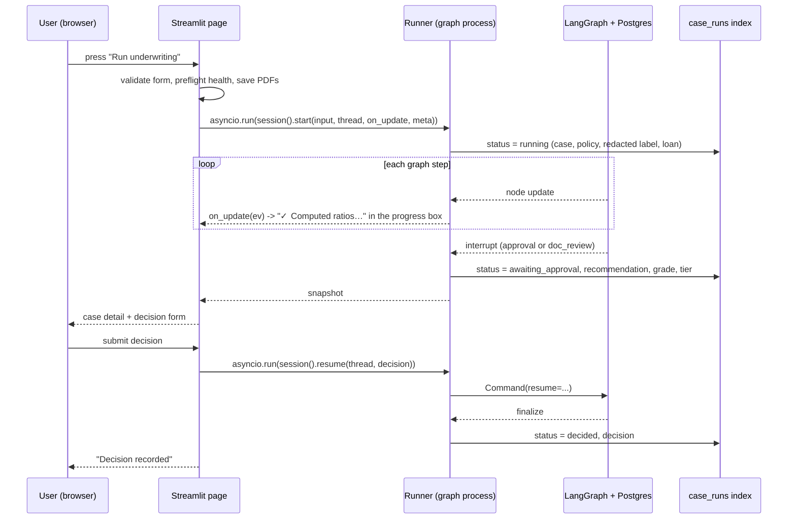
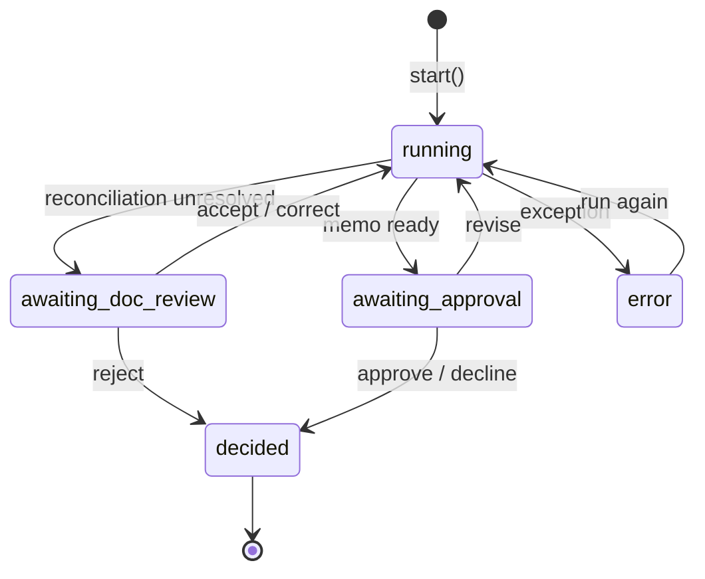

# The console (implementation)

How the Streamlit console is built. For how to *use* it, see [Using the web console](../guides/console.md).

## Design goals

1. **A human can always see and decide.** Every paused case is reachable from the UI, even after a restart.
2. **Never block on a dead service.** A missing database or tool server produces an immediate, actionable message, not a 30-second hang or a stack trace.
3. **Same code path as the CLI and the experiments.** The UI is a thin layer over `Runner` and the graph; there is no UI-only underwriting logic.
4. **Testable without a browser.** Validation, memo export and status mapping are pure functions; pages are tested with Streamlit's `AppTest`, and a script captures real-browser screenshots.

## Module map

```text
src/wealthpilot/
  health.py              service/artifact checks (Check dataclass); used by `wealthpilot doctor` AND the console
  graph/cases.py         case index: table `case_runs`, lifecycle statuses, list/get/counts
  graph/builder.py       make_input_from_applicant(), Runner (writes the case index), session(), readonly_session()
  ui/
    app.py               entry point: st.navigation with seven pages + sidebar service summary
    common.py            async bridge, cached health, progress streaming, the reusable case-detail view, approval and document-review panels
    forms.py             PURE logic: form validation, applicant building, PDF upload checks, memo/evidence export, policy rule parsing
    views/               one module per page, each exposing render()
      home.py  underwrite.py  queue.py  history.py  policies.py  results.py  system.py
.streamlit/config.toml   upload limit, theme, usage-stats off
scripts/capture_screenshots.py   Playwright script that produces docs/assets/screenshots/*.png
```

## Request flow



## Key decisions

### Synchronous scripts, one event loop per action

Streamlit reruns the whole script on every interaction, and widgets are synchronous. Each action that touches the graph opens its own event loop (`run_async`) and its own `session()` —
MCP tool connections, the Postgres checkpointer and the long-term store — and closes it afterwards. This is simple and robust (nothing long-lived to leak or go stale) at the price of a short
setup cost per action. Runs **block the page**; progress is streamed into an `st.status` box from the `on_update` callback. Closing the tab mid-run does not stop the server-side run, and the case
appears in **Cases** when it pauses.

### A case index instead of scanning checkpoints

LangGraph checkpoints store full state per thread but are not meant for listing. The `Runner` therefore mirrors the headline facts and lifecycle status of every run into a small table, `case_runs`
([Database](../reference/database.md#case_runs)). It is written at three points — when a run starts, when it pauses or finishes, and when it fails — and is **best-effort**: an index failure never
affects underwriting. The index stores only the *redacted* business label, never identity.



`status_of(snapshot)` is a pure function (unit-tested) that derives the status from a snapshot's interrupt type and `done` flag.

### Two kinds of session

| | `session()` | `readonly_session()` |
|---|---|---|
| Opens | MCP tools, checkpointer, store, tracing | checkpointer only |
| Used for | `start`, `resume` (anything that executes the graph) | `snapshot` (viewing a case) |
| Cost | ~seconds | ~tens of milliseconds |

Viewing a case happens on every widget interaction, so it uses the cheap read-only session, wrapped in `st.cache_data(ttl=3)` and cleared explicitly after each action.

### Fail fast on a missing database

With Postgres down, the connection pool used to wait 30 seconds per attempt (and a failed attempt created a *new* pool each time). Three changes fixed that:

* the shared pool is created once and times out in **5 s** (`connect_timeout` 3 s); it keeps retrying in the background and recovers by itself;
* the schema is created lazily on the first *successful* use;
* pages call `require_db()`, which consults a 5-second cached health check and shows the fix **immediately** without touching the pool.

The offline page-render tests dropped from 180 s to 12 s as a result.

### Health checks are shared and cheap

`wealthpilot.health` checks Postgres (a real connection, 3 s timeout), Ollama (and that the embedding model is pulled), each MCP port (TCP connect), the NIM key (presence only — never a paid or rate-limited
call), MLflow, and the presence of the risk model and data files. Each returns a `Check(name, ok, detail, fix, required)`. The CLI prints them (`wealthpilot doctor`); the console caches them for 5 s.
`blocking()` names the checks that make a run impossible; everything else only degrades it.

### Forms are pure functions

`ui/forms.py` imports no Streamlit. `validate_application` returns *all* problems at once; `build_applicant` produces the record `make_input_from_applicant` expects (the same function the synthetic path uses);
`save_uploads` validates each PDF (non-empty, ≤ 25 MB, ≤ 40 pages, openable) **before** writing anything, so a rejected upload leaves no files behind; `memo_to_markdown` and `evidence_json` build the downloads and
never include the sealed identity. The 25 MB limit is also enforced by Streamlit itself (`.streamlit/config.toml` and the `wealthpilot ui` flag), so the uploader's label agrees with the validator.

### Identity handling in the UI

* The LLM-facing `application` block uses the redacted business label; the owner's name lives only in `sealed`.
* The case index and the downloads never contain `sealed`.
* The *Application* tab hides identity behind an explicit checkbox, so an approver sees what the model saw unless they ask for more.

### Human gates are the same interrupts as the CLI

The decision form calls `Runner.resume` with `{decision, approver_tier, approver_id, reason}` — the payload the CLI sends. The form adds *client-side* checks (tier at least the required tier; reason when overriding or revising),
but the authoritative tier check remains in the `human_approval` node, so the rule holds for every client.

### Error translation

`friendly_error` maps common low-level failures (Postgres connection errors, a missing key, Ollama) to the sentence a user needs; anything else is shown as `ErrorType: message` truncated to 300 characters.

## Testing

| Layer | How | File |
|---|---|---|
| Validation, building, uploads, export, rule parsing, status mapping, identity-free index rows | pytest, no services | `tests/test_ui.py` |
| Every page renders **with or without** services (a page must show a message, never a stack trace) | `AppTest` | `tests/test_ui.py` |
| The whole app with `st.navigation` | `AppTest.from_file` | `tests/test_ui.py` |
| Run a sample case → under-authorised approver blocked → valid decision recorded → case index updated | `AppTest` + live stack | `tests/test_ui_live.py` |
| Override without a reason is refused | `AppTest` + live stack | `tests/test_ui_live.py` |
| New application with uploaded PDFs end to end (validation, storage, graph, index, decision) | live stack | `tests/test_ui_live.py` |
| Real rendering in a browser | Playwright screenshots | `scripts/capture_screenshots.py` |

The screenshots are not decoration: reviewing them found bugs the unit tests could not — the review screen was buried below the entry form, a long tier name was truncated in a metric tile, and short tables hid
their last rows behind an inner scrollbar. All were fixed.

## Extending the console

1. Create `src/wealthpilot/ui/views/mypage.py` with a `render()` function. Call `require_db()` before touching Postgres and wrap data access in `try/except` using `friendly_error`.
2. Register it in `ui/app.py`: `st.Page(mypage.render, title="…", icon="…", url_path="mypage")`.
3. Put any non-trivial logic in `ui/forms.py` (or a new pure module) and unit-test it; add the page name to `PAGE_MODULES` in `tests/test_ui.py` so the render test covers it.
4. Re-run `scripts/capture_screenshots.py` if the page belongs in the documentation.

## Limitations

See [Limitations and future work](../project/limitations.md#the-console): single-user, no authentication, runs block the page, and a new application is validated by form rules and PDF readability, not by understanding the documents.
