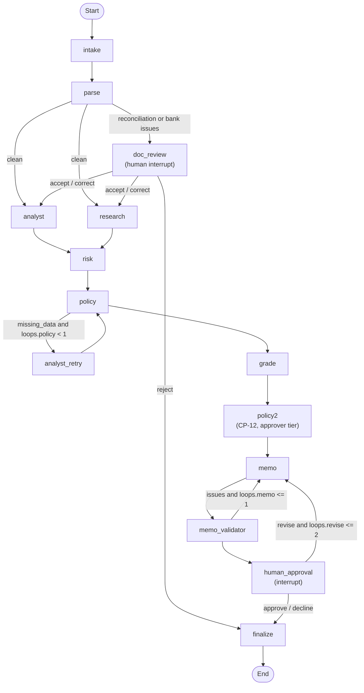

# The underwriting workflow

The workflow is a LangGraph `StateGraph` (`wealthpilot.graph.builder.build_graph`). It is **deterministic**: every branch is a
Python predicate over typed state, and every loop has a counter.

## The graph



* **Parallel branch** — `analyst` and `research` run concurrently and join at `risk`.
* **Interrupts** — `doc_review` and `human_approval` call LangGraph's `interrupt()`. State is saved to Postgres, the process can exit,
  and a later session resumes with `Command(resume=...)` on the same `thread_id`.
* **Why `analyst_retry` is a separate node** — a LangGraph join waits for *all* its sources. Looping back into `analyst` alone would
  leave `risk` waiting for `research` forever, so the retry is its own node that returns straight to `policy`.

## Nodes

| Node | Kind | What it does | Writes to state |
|---|---|---|---|
| `intake` | code | Validates the application (loan amount, term, years in business, industry), loads the applicant's prior decisions from long-term memory, initialises loop counters. | `history`, `loops` |
| `parse` | LLM / vision | Reads the financial-statement and bank-statement PDFs, extracts 19 fields per fiscal year, reconciles them and repairs once. [Details](document-parsing.md). | `extracted`, `doc_kind`, `reconciliation_issues`, `bank`, `bank_issues` |
| `doc_review` | human | Shown only when reconciliation problems remain. The reviewer can *accept*, *correct* specific values, or *reject* the documents. | `doc_review`, `extracted` |
| `analyst` | tools + LLM | Computes ratios, revenue trend and a 10 % revenue-drop stress test through MCP tools; an agent writes a short narrative. The numbers come from the deterministic calls. | `ratios`, `analysis` |
| `research` | tools (+ LLM) | Sanctions screening of owner and business, adverse-media and registry lookups, SBA sector default rate. An LLM summarises findings *only if there are any*. [Details](agents.md#credit-research). | `research` |
| `risk` | tools | Probability of default (5-year horizon) with the top SHAP reasons. No LLM call. [Details](risk-model.md). | `risk` |
| `policy` | RAG + LLM | Judges rules CP-1…CP-11 against the policy text (batches of four rules, concurrently). [Details](policy-rag.md#how-rules-are-judged). | `policy_checks`, `thresholds` |
| `analyst_retry` | tools | Runs when `policy` reports `missing_data`: recomputes ratios, filling gaps from the prior year (flagged as estimated). | `ratios`, `loops` |
| `grade` | tools | Scorecard from the thresholds the policy agent extracted, then the fixed grade matrix. | `grade` |
| `policy2` | RAG + LLM | Judges CP-12 (acceptable grade), extracts the approver authority limits, then applies the fixed [decision rule](decision-rule.md). | `policy_checks`, `required_tier`, `recommendation` |
| `memo` | LLM | Drafts a structured credit memo that explains — never changes — the recommendation. | `memo` |
| `memo_validator` | code | Verifies the memo (see [below](#memo-validation)). | `validator_issues`, `loops` |
| `human_approval` | human | Pauses with the memo and evidence; enforces the approver's tier. [Details](compliance.md#human-approval). | `human_decision`, `loops` |
| `finalize` | code | Writes the decision to long-term memory, adds the case to the precedents index, appends the audit record. | `final` |

## Routing predicates

All routing lives in `wealthpilot.graph.nodes` as `route_after_*` functions. They are unit-tested without any LLM.

| After | Condition | Goes to |
|---|---|---|
| `parse` | `reconciliation_issues` or `bank_issues` non-empty | `doc_review` |
| `parse` | otherwise | `analyst` **and** `research` |
| `doc_review` | `action == "reject"` | `finalize` |
| `doc_review` | otherwise | `analyst` **and** `research` |
| `policy` | any check is `missing_data`, `loops.policy < 1`, and statements were extracted | `analyst_retry` |
| `policy` | otherwise | `grade` |
| `memo_validator` | `validator_issues` and `loops.memo <= 1` | `memo` (one regeneration) |
| `memo_validator` | otherwise | `human_approval` (issues are shown to the approver) |
| `human_approval` | `decision == "revise"` and `loops.revise <= 2` | `memo` |
| `human_approval` | otherwise | `finalize` |

## Memo validation

The memo writer explains a recommendation that was already derived by code. `memo_validator` rejects the memo if:

1. its recommendation differs from the decision-rule result;
2. it cites a rule id that was not evaluated;
3. it contains a number that does not appear in the case facts (with tolerance; rule ids, fiscal years and small integers are exempt);
4. it uses prohibited-basis language (gender, race, marital status, … — see the [compliance profile](compliance.md#language-scan));
5. with redaction on, it contains the owner's name, ZIP or street;
6. the recommendation is *decline* but there are no adverse-action reasons, or they do not cite a failed rule;
7. the run is degraded but the memo lists no limitations.

A rejected memo is regenerated once with the issue list appended to the prompt. If the second attempt still fails, the case proceeds to the
human with `validator_issues` visible — the validator never silently passes a bad memo.

## Persistence and resumption

* The graph is compiled with an `AsyncPostgresSaver` (checkpoints) and an `AsyncPostgresStore` (long-term memory).
* `thread_id` identifies a case run. Resuming a thread with no new input continues from the last checkpoint.
* The `Runner` also mirrors each run's lifecycle status (`running`, `awaiting_approval`, `awaiting_doc_review`, `decided`, `error`) into a small **case index** table so the [console](user-interface.md#a-case-index-instead-of-scanning-checkpoints) can list and reopen cases. It is best-effort and never affects underwriting.
* The crash/resume experiment ([E4](../experiments/e4-reliability.md#crash-and-resume)) killed the process after `risk` and resumed
  in a new session: `parse`, `research` and `analyst` were **not** re-run; only the node in flight at the crash re-ran
  (at-least-once semantics).

## Running the graph from code

```python
from wealthpilot.graph.builder import session, make_input
from wealthpilot.synth.applicants import load

applicant = next(a for a in load() if a["case_id"] == "C004")

async with session() as runner:                       # opens MCP tools, checkpointer, store, tracing
    snap = await runner.start(make_input(applicant, "strict", "clean"), "my-thread")
    print(snap["interrupt"]["type"], snap["values"]["recommendation"])   # approval  decline

    snap = await runner.resume("my-thread", {
        "decision": "decline", "approver_tier": "Senior Credit Officer",
        "approver_id": "sco-7", "reason": "LTR above maximum"})
    print(snap["values"]["final"])
```
