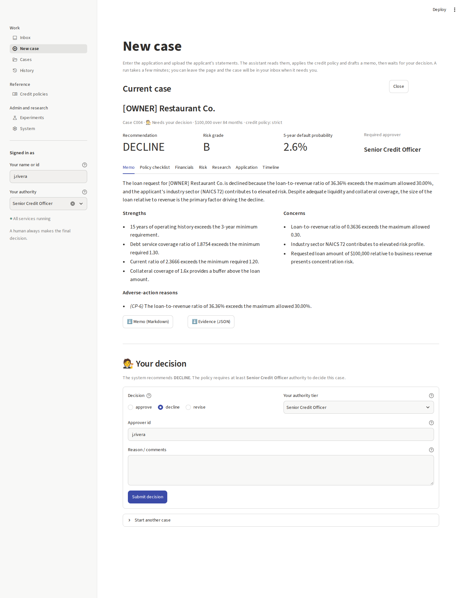

# Quickstart

This walkthrough underwrites one synthetic applicant end to end. It assumes you finished the
[installation](installation.md) and that Postgres, Ollama, MLflow and the three MCP servers are running.

## 1. Run a case

```bash
uv run wealthpilot run C004 --policy strict --variant clean --thread demo-1
```

* `C004` — a restaurant-and-catering business from the synthetic world.
* `--policy strict` — apply the *Conservative Edition* credit policy (use `lenient` for the *Growth Edition*).
* `--variant clean` — read the clean PDF documents (`noisy` and `scanned` are the harder variants).
* `--thread demo-1` — the checkpoint id. **Use a fresh thread name every time**; re-running a finished thread re-enters it.

The command prints each node as it completes and then the result so far (output abridged):

```text
  ✓ intake
  ✓ parse
  ✓ research, analyst
  ✓ risk
  ✓ policy
  ✓ grade
  ✓ policy2
  ✓ memo
  ✓ memo_validator
recommendation: decline   required approver: Senior Credit Officer   grade: B
  CP-1   pass   The applicant has 15 years in business, which exceeds the 3-year minimum requirement.
  CP-2   pass   The applicant's industry is 'Restaurant and catering', which is not in the prohibited list
  CP-3   pass   The DSCR of 1.8754 exceeds the minimum required 1.30.
  ...
  CP-6   fail   The loan-to-revenue ratio of 0.3636 exceeds the maximum allowed 0.30.
  ...
Waiting for human input (approval). Resume with `wealthpilot approve C004 ...`
```

The graph has **paused** at the human-approval gate. Nothing has been decided yet, and the paused state is stored in Postgres.

!!! info "How long does it take?"
    A first run takes roughly 1–7 minutes on the free NIM tier (about 13 chat calls, 13 rerank calls and a handful of
    embedding calls). Running the same case again is served from the cache in seconds.

## 2. Approve, decline or revise

Underwriters can only decide at or above the tier the policy requires — here a *Senior Credit Officer*. Try an
under-authorised approver first:

```bash
uv run wealthpilot approve demo-1 --decision decline --tier Analyst --approver junior-1 --reason "test"
# -> still waiting; the approval gate rejects a tier below "Senior Credit Officer"
```

Then decide properly:

```bash
uv run wealthpilot approve demo-1 --decision decline \
    --tier "Senior Credit Officer" --approver sco-7 \
    --reason "Loan-to-revenue above the policy maximum"
```

```json
{
  "recommendation": "decline",
  "decision": "decline",
  "override": false,
  "approver": "sco-7",
  "approver_tier": "Senior Credit Officer",
  "required_tier": "Senior Credit Officer",
  "grade": "B",
  "pd": 0.0264,
  "degraded": false
}
```

If the human decision contradicts the system's recommendation (for example *approve* when the recommendation is *decline*), the
record is flagged `"override": true` and the reason is kept.

## 3. Look at what happened

=== "Web console"

    ```bash
    uv run wealthpilot ui           # http://127.0.0.1:8501
    ```

    Open **Cases** to find the case, or **History** to see the recorded decision and verify the audit chain. See
    [Using the web console](../guides/console.md).

=== "MLflow trace"

    Open `http://127.0.0.1:5000`, experiment **wealthpilot-traces**. Each underwriting run is one trace tagged with
    `case_id`, `policy_id` and `thread_id`, containing a span per graph node, LLM call and tool call.

=== "Audit log"

    ```bash
    uv run wealthpilot audit-verify
    # {"ok": true, "records": 17, "first_bad_id": null}
    ```

    Each decision is appended to a hash-chained table; editing or deleting history makes verification fail.
    See [Compliance](../concepts/compliance.md#the-audit-log).

## 4. Try the other variants

```bash
uv run wealthpilot run C004 --policy lenient --variant noisy   --thread demo-2   # same applicant, other policy, messy layout
uv run wealthpilot run C004 --policy strict  --variant scanned --thread demo-3   # image-only PDFs -> vision model
uv run wealthpilot run C004 --policy strict  --no-redaction    --thread demo-4   # let the LLM see identity details
```

Comparing `demo-1` and `demo-2` shows the central idea: same applicant, same documents, **different policy text → different
decision**, because the agents read the policy rather than a hard-coded rule set.

## 5. Do it all in the web console

Everything above is also available — with more help along the way — in the browser:

```bash
uv run wealthpilot doctor       # is everything running? prints the fix for anything missing
uv run wealthpilot ui           # opens http://127.0.0.1:8501
```

1. In the sidebar, enter your name and choose the authority *Senior Credit Officer*.
2. **New case → Try a sample applicant**: pick `C004`, leave *strict* selected, press **Run underwriting**. (You can leave the page while it works; the case appears in your **Inbox**.)
3. Open the case and review the **Memo**, **Policy checklist**, **Financials** and **Risk** tabs.
4. In **Your decision**, submit approve, decline or revise.
5. Open **History** to see the recorded decision and the verified audit chain.



To underwrite **your own** applicant, use **New case → New application**, fill in the form and upload the two PDFs. The full manual is
[Using the web console](../guides/console.md).

## Next steps

- [The underwriting workflow](../concepts/workflow.md) — what each step did
- [Writing a new policy](../guides/new-policy.md) — change the rules and watch the decisions change
- [Experiments](../experiments/index.md) — how well it does this across many cases
