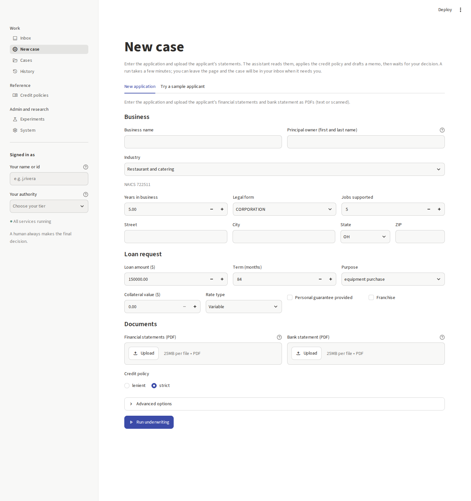
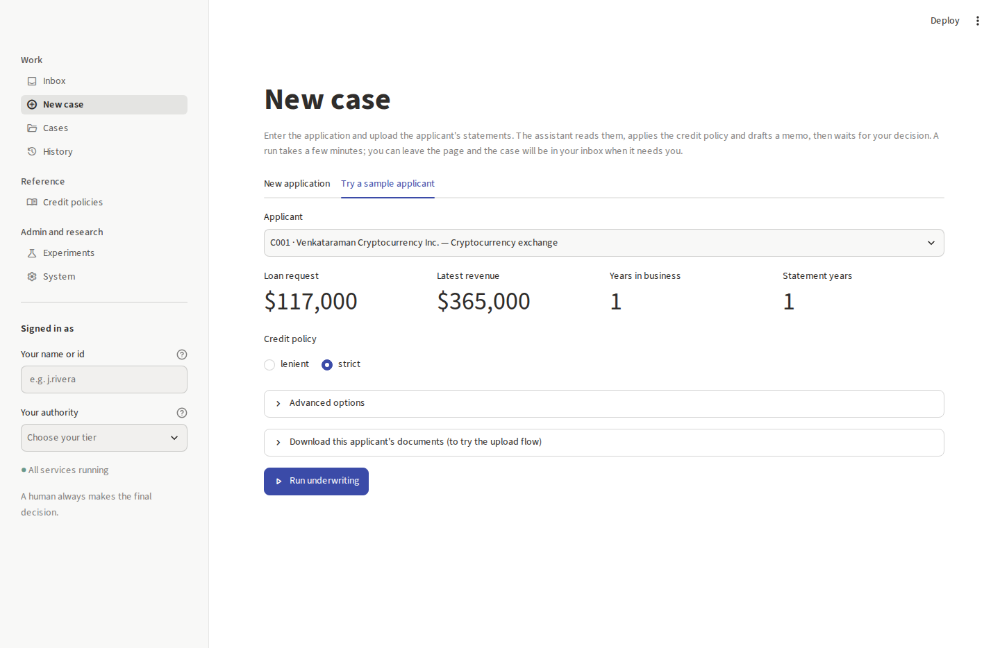
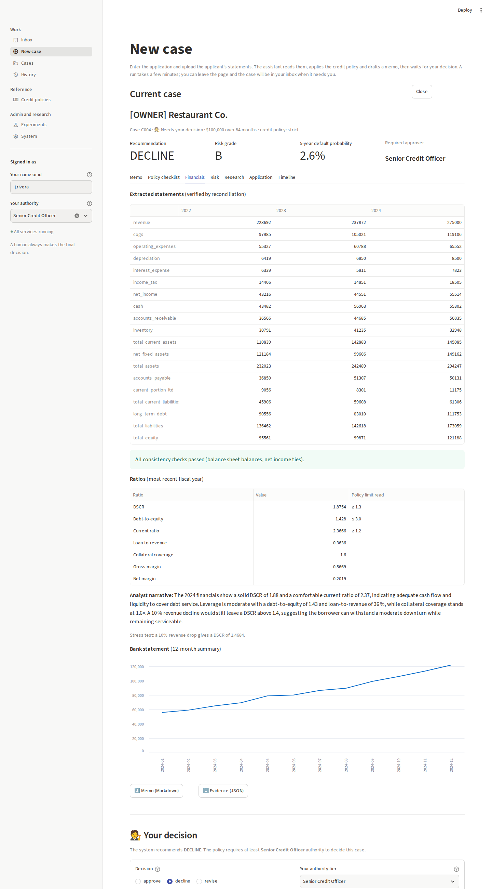
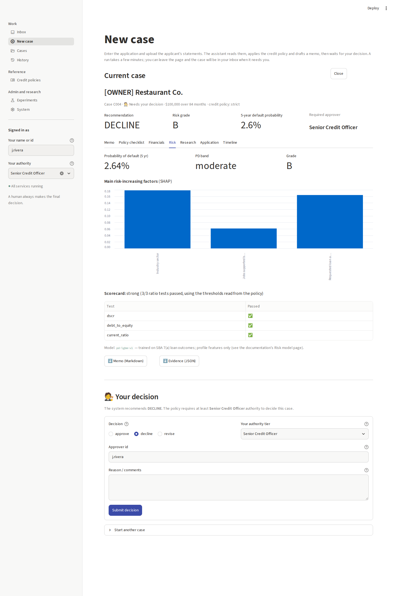
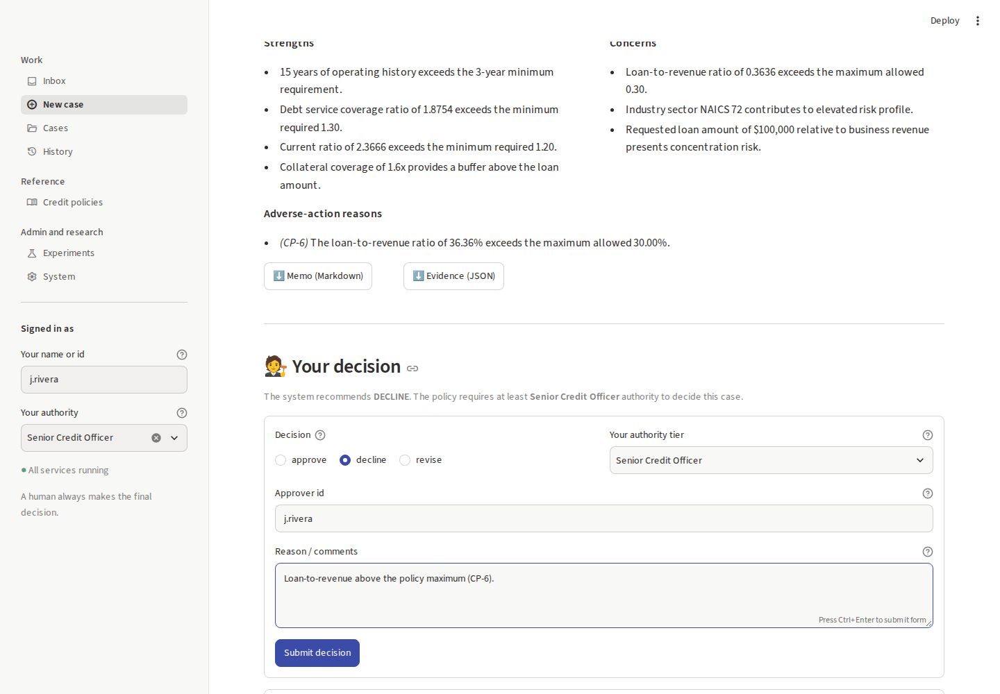
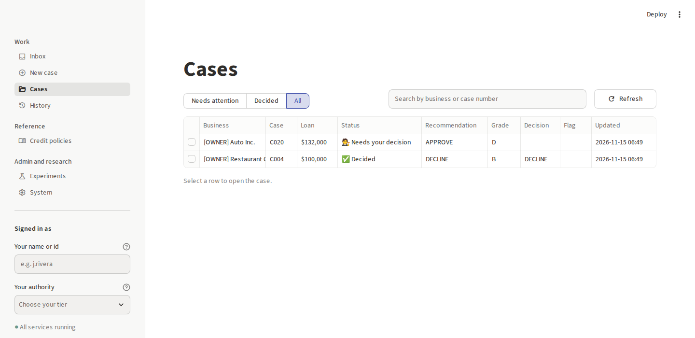
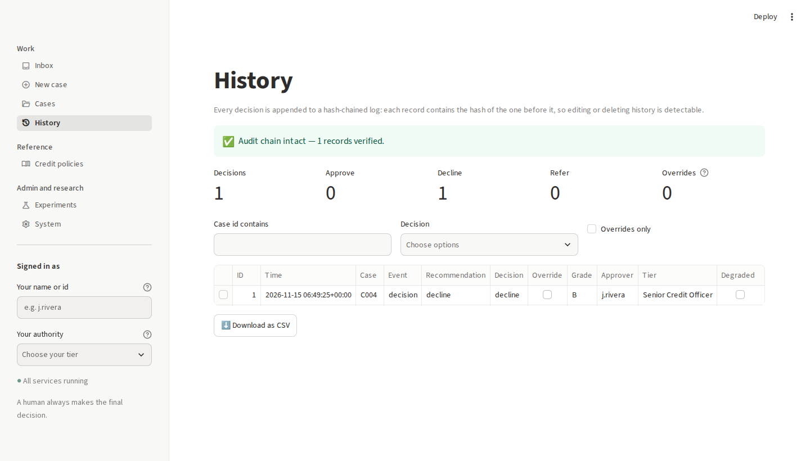
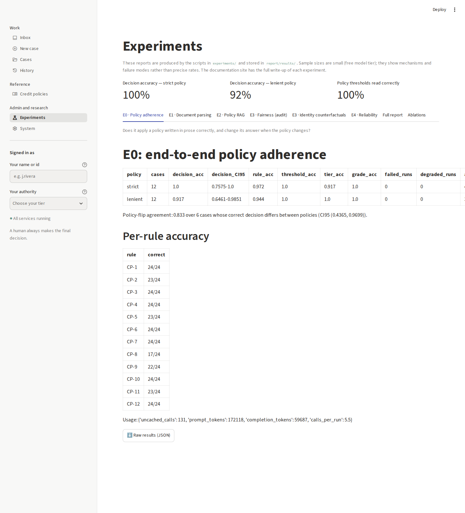

# Using the web console

The console is where a credit officer works with WealthPilot: submit an application, let the assistant do the reading and analysis, review the evidence it
produced, and record **your** decision. Everything it does is also available from the [command line](cli.md), and the research and diagnostic tools live in their own
section of the sidebar so they stay out of the way of day-to-day work.


## Start it

```bash
uv run wealthpilot doctor        # checks every service and prints the fix for anything missing
uv run wealthpilot ui            # http://127.0.0.1:8501
```

`wealthpilot ui` accepts `--port`, `--host` and `--headless` (do not open a browser tab). The equivalent without the CLI is
`uv run streamlit run src/wealthpilot/ui/app.py`.

!!! info "What must be running"
    **Postgres**, **Ollama** (with `nomic-embed-text`), the three **MCP servers** and a **NIM key**. MLflow is optional (it only adds traces).
    If something is missing, the sidebar says so and the **Inbox** shows what is unavailable, with the fix commands on the **System** page. A run with the MCP servers down
    completes in a flagged *degraded* mode (recommendation capped at *refer*) instead of failing.

!!! warning "No login — keep it local"
    The console has no authentication and binds to `127.0.0.1` by default. Do not expose it on a network. The name you enter in the sidebar is a label for the
    audit log, not a credential. See [Limitations](../project/limitations.md).

## First, tell it who you are

The sidebar has a **Signed in as** block: your **name or id** and your **authority** (*Analyst*, *Senior Credit Officer* or *Credit Committee*). Set them once per browser session.

* Your name is written to the audit log with every decision, and filled into the decision form for you.
* Your authority is pre-selected in the decision form. The policy sets the minimum authority needed for each case; you cannot decide a case above your tier.

## The pages

| Section | Page | Use it to |
|---|---|---|
| **Work** | **Inbox** | see what needs your decision, what is still running and what was decided recently |
| | **New case** | submit an application with its PDFs, or try a sample applicant |
| | **Cases** | find any case, open it, read the evidence and decide |
| | **History** | audit the decisions and verify the tamper-evident log |
| **Reference** | **Credit policies** | read the policies, compare two, and test how rules are found |
| **Admin and research** | **Experiments** | browse the evaluation reports |
| | **System** | service health with fix commands, configuration and model-call diagnostics |

## The inbox

The Inbox is the home page. **Needs your decision** lists each waiting case with its loan amount, the system's recommendation and risk grade; **Review** opens it. Below that,
**In progress** shows cases still being worked on (or interrupted or failed ones, so nothing is silently lost) and **Recently decided** shows the last few outcomes. A banner appears
at the top only if a required service is down. On a fresh install the Inbox explains how to start; the **New case** button is always at the top right.

## Submitting a case

Open **New case**. The first tab is the real workflow, **New application**.



| Section | Fields |
|---|---|
| **Business** | business name; principal owner (first **and** last name); industry; years in business; legal form; jobs supported; street, city, state, ZIP |
| **Loan request** | amount; term in months; purpose; collateral value; rate type; personal guarantee provided; franchise |
| **Documents** | **financial statements** (PDF) and **bank statement** (PDF) |
| **Credit policy** | which bank policy to apply (*strict* is pre-selected) |
| **Advanced options** | *Hide the owner's identity from the AI* (on by default; leave it on unless you are running a fairness comparison) |

**Industry.** Choose from the list (it fills the NAICS code), or *Other* and type the industry name and a 6-digit NAICS code. The policy agent reads the industry **name**, so write what the
business actually does; prohibited-industry rules are applied to that text.

**Documents.** Both PDFs are required, each up to **25 MB** and **40 pages**. They may be digital or scanned. The system was developed and tested on statements shaped like these:

* *Financial statements*: an income statement and a balance sheet with one column per fiscal year (one to three years), numbers right-aligned under `FY2024`-style headers.
* *Bank statement*: a 12-month summary with opening balance, deposits, withdrawals and closing balance per month.

!!! note "Real-world documents vary"
    Reconciliation checks catch many extraction problems, and anything they cannot resolve pauses for [document review](#document-review). But layouts very different from the above
    are untested; see [Limitations](../project/limitations.md).

When you press **Run underwriting** the form is validated first and every problem is listed in one message (for example "ZIP code must be 5 digits"). A valid application gets a case number such as
`U20261113-142530`, the PDFs are stored under `data/uploads/<case number>/`, and the run starts.

### No application to hand? Try a sample

The second tab, **Try a sample applicant**, runs one of 80 synthetic businesses. Pick an applicant and a credit policy (*strict*, or the more permissive *lenient*). **Advanced options** lets you
choose the document quality (*clean*, *noisy* layouts, or *scanned* image-only PDFs read by the vision model) and the identity setting. *Download this applicant's documents* gives you the PDFs, so you can exercise
the upload form with them.



### While it works

A progress bar lists each step as it finishes (*Read and verified the documents*, *Computed ratios and stress test*, *Screened sanctions, media and registry*, *Applied credit-policy rules*, and so on) with elapsed time.
A first run takes **1–7 minutes** on the free model tier; the same case run again is served from the cache in seconds.

**You do not have to wait.** The run happens in a background worker, not in your browser page, so you can switch to another page, start another case or close the tab. The case appears in your
Inbox under **Needs your decision** when it is ready. If the console process itself is restarted mid-run, the case is shown as **Interrupted** and a **Continue the run** button resumes it from its last saved step.

If a service is missing, a red message names it and shows the fix **before** anything starts. If only the MCP servers are down, an orange warning explains that the run will be *degraded* and lets it proceed.

## Reviewing a case

Open a case from the Inbox, from **Cases**, or straight after submitting it.


The **header** shows the business, the case number, status and loan terms, then four key figures: the **recommendation**, **risk grade**, **5-year default
probability** and the **approver tier** the policy requires. Banners appear when something needs your attention:

* **Degraded run**: a tool or check was unavailable; the recommendation is capped at *refer* and the reasons are listed.
* **Memo validator problems**: the memo failed an automatic check (a number not in the case facts, a missing adverse-action reason, …) even after one regeneration.
* **Documents rejected**: a reviewer rejected the documents and the case was closed.

Seven tabs hold the evidence:

| Tab | What you see |
|---|---|
| **Memo** | the written recommendation: summary, strengths, concerns, conditions, limitations and, for a decline, the adverse-action reasons |
| **Policy checklist** | every rule with its status (✅ pass · ❌ fail · ⚠️ exception · ➖ not applicable · ❓ missing data), the reason, the numeric threshold read from the policy, and a **numeric check** flag; expand *Evidence quoted from the policy text* for the exact sentences |
| **Financials** | the extracted statements by year, whether the consistency checks passed, ratios next to the thresholds the policy states, the analyst's narrative, the revenue-drop stress test and the bank balance chart |
| **Risk** | probability of default, PD band, grade, a chart of the main risk-increasing factors and the three scorecard tests |
| **Research** | sanctions screening result, adverse media, a summary, registry status and the sector default rate |
| **Application** | the facts the agents saw, prior decisions for the same applicant, the run id, and a collapsed **🔒 Sealed identity** section |
| **Timeline** | every step with elapsed time, loop counters and any errors |






**Downloads.** *Memo (Markdown)* is a shareable credit memo with the checklist and, once decided, the human decision. *Evidence (JSON)* is the full case state. Neither contains the sealed identity.

!!! info "Why you see `[OWNER]` instead of a person's name"
    Names of people are masked on the review screens by design. The agents never see the owner's name, and by default neither do you: the **Sealed identity** section of the *Application* tab stays closed unless you tick
    *I need to see the applicant's identity* (for example to check a document). Deciding on the same facts the model used is part of the [compliance design](../concepts/compliance.md). The case is still easy to find:
    it is identified by case number, industry, loan amount and the masked business name.

## Making the decision

Cases waiting for you show a **Your decision** form below the evidence.



| Control | Meaning |
|---|---|
| **Decision** | *approve*, *decline* or *revise*. For an approve/decline recommendation the matching option is pre-selected; for *refer* nothing is pre-selected so you are not nudged. |
| **Your authority tier** | pre-selected from your profile. The policy requires a minimum tier (shown above the form). |
| **Approver id** | pre-filled from your profile; recorded in the audit log. Required. |
| **Reason / comments** | free text; **required** if you override the recommendation or ask for a revision |

The form blocks you, with an explanation, if your tier is below the required one, your id is empty or a reason is missing. When you submit:

* **approve / decline**: the decision is recorded in long-term memory and the audit log; the case shows **Decision recorded** and the final record. If you contradicted the recommendation it is marked **override**.
* **revise**: the memo is regenerated using your comments and comes back to you (up to twice; after that the case is escalated as *refer*). This takes a few minutes and runs in the background like any other run.

### Document review

If extracted figures fail the consistency checks even after an automatic repair, the case pauses at **Document review needed** instead.

* The failed checks are listed, and an editable table shows the extracted figures by year.
* **Accept as is**: continue with the figures as extracted.
* **Submit my corrections**: fix wrong values in the table first; only the cells you change are sent.
* **Reject the documents**: close the case as declined for unusable documents.

## Cases: finding and reopening work

**Cases** lists every case. The filter at the top switches between **Needs attention** (waiting for you, still running or failed), **Decided** and **All**; the search box matches the business or case number.
Select a row to open the case, and use **Back to all cases** to return.

| Status | Meaning |
|---|---|
| ⏳ Running | the assistant is working on it |
| Interrupted | it was running when the console was restarted; open it and press **Continue the run** |
| 📄 Documents need checking | needs a document decision |
| 🧑‍⚖️ Needs your decision | waiting for you |
| ✅ Decided | a decision is recorded |
| 🛑 Stopped (error) | the run failed; the message is shown when you open it, with a **Continue the run** button |



Because the state of every case lives in Postgres, **a case survives closing the browser, restarting the console or even rebooting**.

## History: the audit trail



**History** verifies the hash-chained audit log on every visit (a green banner, or a red one naming the first broken record), shows decision counts and the number of **overrides**, and lets you filter by
case, decision or overrides only. Select a row to see the full recorded payload and its hash; **Download as CSV** exports the filtered table. See [Compliance](../concepts/compliance.md#the-audit-log).

## Credit policies


* **Read**: the policy document exactly as the agents read it.
* **Rules**: one row per rule with its text.
* **Compare policies**: two policies side by side, rule by rule (*show only rules that differ* by default). This is the quickest way to see what a policy change will change.
* **Try retrieval**: type a question and run the same hybrid search and rerank the agents use (choose BM25, dense or hybrid; rerank on/off; chunking; number of results). Handy for checking that a new policy's wording is findable.

To add or change policies see [Writing a new policy](new-policy.md).

## Experiments and System

These two pages are for the people who maintain and evaluate the system, not for case work.

**Experiments** shows the evaluation reports with headline numbers, each as a tab with a raw-JSON download, plus the full report and the preserved **ablations**. See [Experiments](../experiments/index.md).



**System** has three tabs:

| Tab | Contents |
|---|---|
| **Health** | every component with ✅/❌, what is wrong and **how to fix it**, plus the commands that start everything; *Re-check now* refreshes immediately |
| **Configuration** | models, request ceiling, timeout, cache and thinking settings (the API key is never shown) |
| **Model calls** | the **current request rate** (adaptive), its ceiling and the number of cached replies; a 24-hour table of real calls, cache hits, failures, latency and tokens per model; the most common failures; and a **Reset the rate limiter** button |


A request rate pinned near **6 per minute** means the model service is throttling your key; runs will be slow until it recovers.

## Tips

* **Start several cases in a row.** Each runs in the background; the Inbox shows them as they become ready.
* **Compare policies on one applicant:** run the same sample applicant under *strict* and *lenient* and open both from **Cases**.
* **Compare identity settings** by turning *Hide the owner's identity from the AI* off for a sample applicant and reading what changes in the memo.
* **Stuck on a slow day?** Check **System → Model calls**. Cached replays are instant, so repeating a run you have already done is cheap.
* **Press `R`** in the browser to rerun the page after you start a missing service.

## Troubleshooting

| You see | Do this |
|---|---|
| "Postgres is not reachable" | `docker compose up -d postgres`, then press **R** |
| A red message naming MCP servers | `uv run wealthpilot mcp-up` (runs complete degraded until they are up) |
| "No NVIDIA NIM key found" | export `NVIDIA_NIM_API_KEY` or set `NVIDIA_API_KEY` in `.env`, restart the console |
| A run is very slow | **System → Model calls**: is the rate at its floor? Wait, or reuse cached runs |
| Upload rejected | the message says why: not a PDF, empty, over 25 MB or over 40 pages |
| A case shows *Stopped (error)* or *Interrupted* | open it in **Cases** and press **Continue the run**; the message says what failed (usually a missing service: fix it first) |
| "Enter your name or id" on the decision form | fill in **Signed in as** in the sidebar once; the form is pre-filled from it |

More in [Troubleshooting](../project/troubleshooting.md). Implementation details are in [The console (implementation)](../concepts/user-interface.md).
