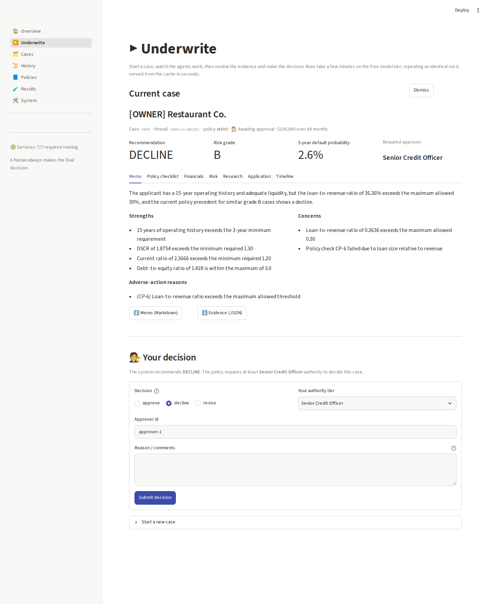
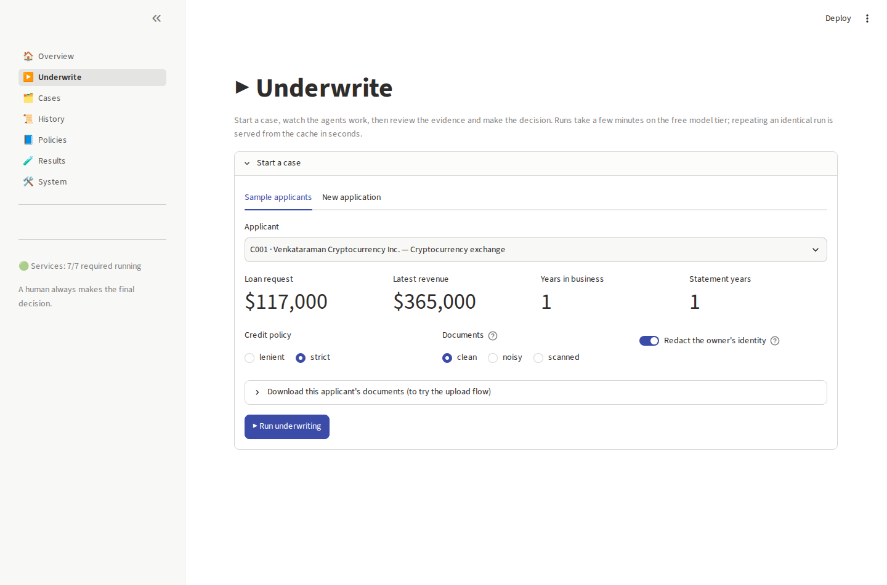
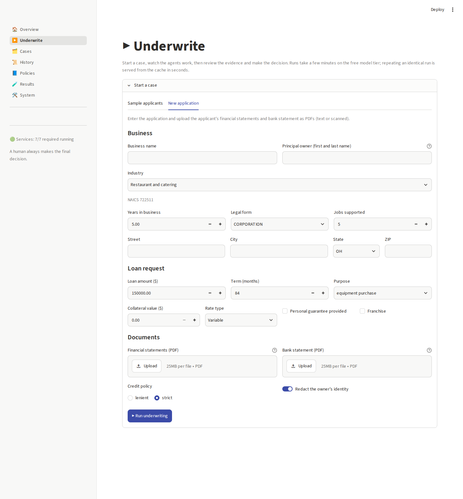
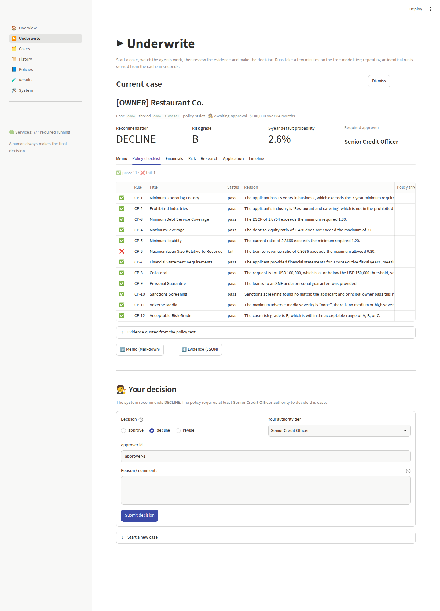
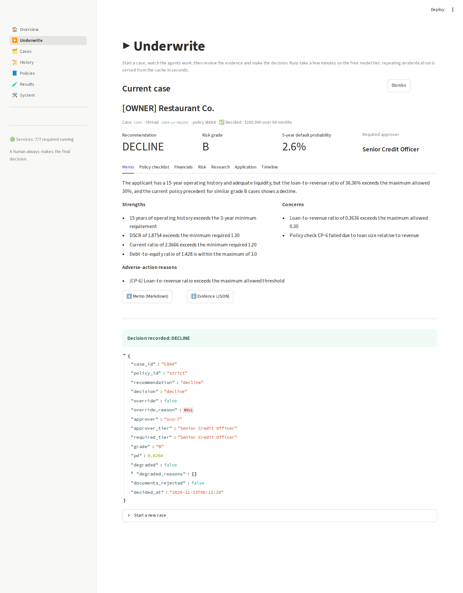
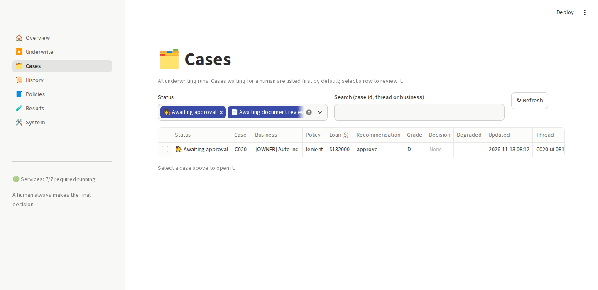
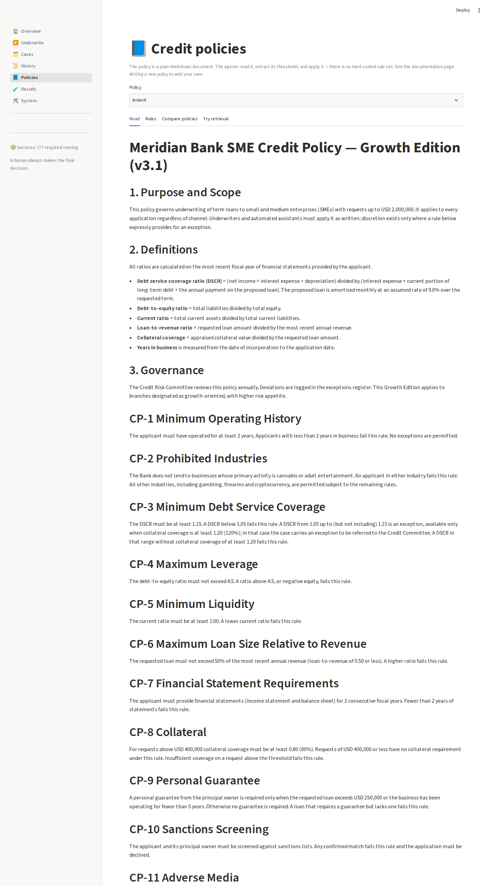
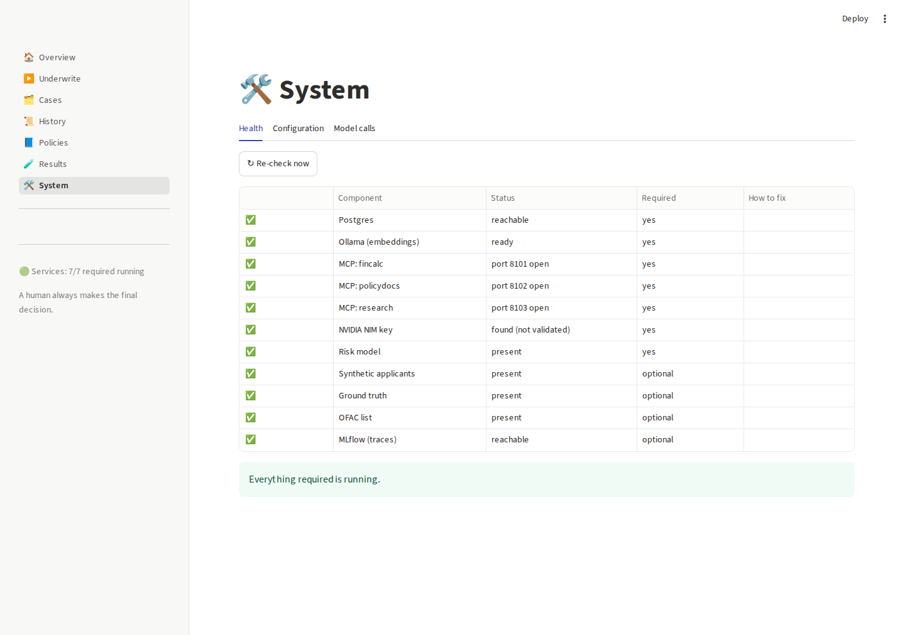

# Using the web console

The console is a Streamlit app for everything you do with WealthPilot day to day: start a case, watch the agents work, review the evidence, make the decision, and
audit what was decided. It is the friendliest way to use the system; everything it does is also available from the [command line](cli.md).



## Start it

```bash
uv run wealthpilot doctor        # checks every service and prints the fix for anything missing
uv run wealthpilot ui            # http://127.0.0.1:8501
```

`wealthpilot ui` accepts `--port`, `--host` and `--headless` (do not open a browser tab). The equivalent without the CLI is
`uv run streamlit run src/wealthpilot/ui/app.py`.

!!! info "What must be running"
    **Postgres**, **Ollama** (with `nomic-embed-text`), the three **MCP servers** and a **NIM key**. MLflow is optional (it only adds traces).
    If something is missing the **Overview** and **System** pages say exactly what and show the command that starts it, and a run with the MCP servers down
    completes in a flagged *degraded* mode (recommendation capped at *refer*) instead of failing.

!!! warning "No login — keep it local"
    The console has no authentication and binds to `127.0.0.1` by default. Do not expose it on a network. See [Limitations](../project/limitations.md).

## A tour of the pages

The sidebar lists seven pages and shows a one-line service status (🟢 all required services running).

| Page | Use it to |
|---|---|
| **Overview** | see whether the system is healthy and how many cases are waiting for you |
| **Underwrite** | start a case — a sample applicant, or a new application with your own PDFs — and review it |
| **Cases** | find any earlier or waiting case and open, review or decide it |
| **History** | audit the decisions and verify the tamper-evident log |
| **Policies** | read the credit policy, compare two policies, and test the retrieval the agents use |
| **Results** | browse the experiment reports |
| **System** | service health, configuration and model-call diagnostics |

## Underwriting a case

### Option A — a sample applicant

1. Open **Underwrite → Sample applicants**.
2. Pick an applicant (80 synthetic businesses). The tiles show the loan request, latest revenue, years in business and how many years of statements exist.
3. Choose the **credit policy** (*strict* is pre-selected; *lenient* is the Growth Edition) and the **documents**:
    * **clean** — standard layout,
    * **noisy** — messy layout and label synonyms,
    * **scanned** — image-only PDFs read by the vision model.
4. Leave **Redact the owner's identity** on to keep names, address and ZIP away from the models (turn it off to run fairness comparisons).
5. Press **▶ Run underwriting**.



!!! tip "Try your own upload with a sample's documents"
    The **Download this applicant's documents** expander gives you the PDFs for the selected applicant and variant, so you can exercise the upload flow below
    without needing real files.

### Option B — a new application with your own PDFs

Open **Underwrite → New application** and fill in the form.



| Section | Fields |
|---|---|
| **Business** | business name; principal owner (first **and** last name); industry; years in business; legal form; jobs supported; street, city, state, ZIP |
| **Loan request** | amount; term in months; purpose; collateral value; rate type; personal guarantee provided; franchise |
| **Documents** | **financial statements** (PDF) and **bank statement** (PDF) |
| **Run options** | credit policy; redact the owner's identity |

**Industry.** Choose from the list (it fills the NAICS code), or *Other* and type the industry name and a 6-digit NAICS code. The policy agent reads the industry **name** — write what the
business actually does so prohibited-industry rules can be applied.

**Documents.** Both PDFs are required, each up to **25 MB** and **40 pages**. They may be digital or scanned. The system was developed and tested on statements shaped like these:

* *Financial statements* — an income statement and a balance sheet with one column per fiscal year (one to three years), numbers right-aligned under `FY2024`-style headers.
* *Bank statement* — a 12-month summary with opening balance, deposits, withdrawals and closing balance per month.

!!! note "Real-world documents vary"
    Reconciliation checks catch many extraction problems, and anything it cannot resolve pauses for [document review](#document-review). But layouts very different from the above
    are untested — see [Limitations](../project/limitations.md).

When you press **▶ Run underwriting** the form is validated first; every problem is listed in one message (for example "ZIP code must be 5 digits"). Valid applications get a case id such as
`U20261113-142530`, the PDFs are stored under `data/uploads/<case id>/`, and the run starts.

### Watching the run

A progress box lists each step as it finishes — *Read and verified the documents*, *Computed ratios and stress test*, *Screened sanctions, media and registry*, *Applied credit-policy rules* and so on —
with elapsed seconds. A first run takes **1–7 minutes** on the free model tier; the same case run again is served from the cache in seconds.

If a service is missing, a red message names it and shows the fix **before** anything starts. If only the MCP servers are down, an orange warning explains the run will be *degraded* and lets it proceed.

## Reviewing a case

When the run pauses, the case appears at the top of the page and the entry form folds into a **Start a new case** expander.

The **header** shows the business (redacted if redaction is on), case and thread ids, policy, status and loan terms, then four key figures: the **recommendation**, **risk grade**, **5-year default
probability** and the **approver tier** the policy requires. Banners appear when something needs your attention:

* **Degraded run** — a tool or check was unavailable; the recommendation is capped at *refer* and the reasons are listed.
* **Memo validator problems** — the memo failed an automatic check (a number not in the case facts, a missing adverse-action reason, …) even after one regeneration.
* **Documents rejected** — a reviewer rejected the documents and the case was closed.

Seven tabs hold the evidence:

| Tab | What you see |
|---|---|
| **Memo** | the written recommendation: summary, strengths, concerns, conditions, limitations and — for a decline — the adverse-action reasons |
| **Policy checklist** | every rule with its status (✅ pass · ❌ fail · ⚠️ exception · ➖ not applicable · ❓ missing data), the reason, the numeric threshold read from the policy, and a **numeric check** flag; expand *Evidence quoted from the policy text* for the exact sentences |
| **Financials** | the extracted statements by year, whether the consistency checks passed, ratios next to the thresholds the policy states, the analyst's narrative, the revenue-drop stress test and the bank balance chart |
| **Risk** | probability of default, PD band, grade, a chart of the main risk-increasing factors and the three scorecard tests |
| **Research** | sanctions screening result, adverse media, a summary, registry status and the sector default rate |
| **Application** | the facts the agents saw, prior decisions for the same applicant, and a collapsed **🔒 Sealed identity** section |
| **Timeline** | every step with elapsed time, loop counters and any errors |




**Downloads.** *Memo (Markdown)* is a shareable credit memo with the checklist and, once decided, the human decision. *Evidence (JSON)* is the full case state. Neither contains the sealed identity.

!!! info "Why the identity is hidden"
    The agents never see the owner's name, and by default neither do you: the **Sealed identity** section stays closed unless you tick *I need to see the applicant's identity*. Seeing identity is sometimes
    necessary (for example to check a document), but hiding it by default lets a human decide on the same facts the model used.

## Making the decision

Cases waiting for you show a **Your decision** form below the evidence.


| Control | Meaning |
|---|---|
| **Decision** | *approve*, *decline* or *revise*. For an approve/decline recommendation the matching option is pre-selected; for *refer* nothing is pre-selected so you are not nudged. |
| **Your authority tier** | *Analyst*, *Senior Credit Officer* or *Credit Committee*. The policy requires a minimum tier (shown above the form). |
| **Approver id** | who is deciding; remembered for the session and written to the audit log |
| **Reason / comments** | free text; **required** if you override the recommendation or ask for a revision |

The form blocks you, with an explanation, if your tier is below the required one or a reason is missing. When you submit:

* **approve / decline** — the decision is recorded in long-term memory and the audit log; the case shows **Decision recorded** and the final record. If you contradicted the recommendation it is marked **override**.


* **revise** — the memo is regenerated using your comments and returns to you (up to twice; after that the case is escalated as *refer*).

### Document review

If extracted figures fail the consistency checks even after an automatic repair, the case pauses at **Document review needed** instead.

* The failed checks are listed, and an editable table shows the extracted figures by year.
* **✅ Accept as is** — continue with the figures as extracted.
* **✏️ Submit my corrections** — fix wrong values in the table first; only the cells you change are sent.
* **🛑 Reject the documents** — close the case as declined for unusable documents.

## Cases — finding and reopening work

The **Cases** page lists every run. By default it shows only cases **waiting for a human**; widen the **Status** filter to see decided, running or failed ones, or search by case id, thread or business.
Select a row to open the full review screen below the table.

| Status | Meaning |
|---|---|
| ⏳ Running | the agents are working (or the run was interrupted — rerun it) |
| 📄 Awaiting document review | needs a document decision |
| 🧑‍⚖️ Awaiting approval | needs a human decision |
| ✅ Decided | a decision is recorded |
| 🛑 Error | the run failed; the message is shown when you select it |



Because paused state lives in Postgres, **a case survives closing the browser, restarting the console or even rebooting** — reopen it from this page.

## History — the audit trail


The **History** page verifies the hash-chained audit log on every visit (a green banner, or a red one naming the first broken record), shows decision counts and the number of **overrides**, and lets you filter by
case, decision or overrides only. Select a row to see the full recorded payload and its hash; **Download as CSV** exports the filtered table. See [Compliance](../concepts/compliance.md#the-audit-log).

## Policies



* **Read** — the policy document exactly as the agents read it.
* **Rules** — one row per rule with its text.
* **Compare policies** — two policies side by side, rule by rule (*show only rules that differ* by default). This is the quickest way to see what a policy change will change.
* **Try retrieval** — type a question and run the same hybrid search + rerank the agents use (choose BM25, dense or hybrid; rerank on/off; chunking; number of results). Handy for checking that a new policy's wording is findable.

To add or change policies see [Writing a new policy](new-policy.md).

## Results

The **Results** page shows the experiment reports with headline numbers, each as a tab with a raw-JSON download, plus the full report and the preserved **ablations**. See [Experiments](../experiments/index.md).

## System



| Tab | Contents |
|---|---|
| **Health** | every component with ✅/❌, what is wrong and **how to fix it**, plus the commands that start everything; *Re-check now* refreshes immediately |
| **Configuration** | models, request ceiling, timeout, cache and thinking settings (the API key is never shown) |
| **Model calls** | the **current request rate** (adaptive), its ceiling and the number of cached replies; a 24-hour table of real calls, cache hits, failures, latency and tokens per model; the most common failures; and a **Reset the rate limiter** button |

A request rate pinned near **6 per minute** means the model service is throttling your key; runs will be slow until it recovers.

## Tips

* **Use a fresh thread for each run** — the console does this automatically; the CLI needs `--thread`.
* **Compare policies on one applicant:** run the same sample applicant under *strict* and *lenient* and open both from **Cases**.
* **Compare redaction on and off** for the same applicant to see what identity details change in the memo.
* **Stuck on a slow day?** Check **System → Model calls**. Cached replays are instant, so repeating a run you have already done is cheap.
* **Press `R`** in the browser to rerun the page after you start a missing service.

## Troubleshooting

| You see | Do this |
|---|---|
| "Postgres is not reachable" | `docker compose up -d postgres`, then press **R** |
| A red message naming MCP servers | `uv run wealthpilot mcp-up` (runs complete degraded until they are up) |
| "No NVIDIA NIM key found" | export `NVIDIA_NIM_API_KEY` or set `NVIDIA_API_KEY` in `.env`, restart the console |
| A run is very slow | **System → Model calls**: is the rate at its floor? Wait, or reuse cached runs |
| Upload rejected | the message says why: not a PDF, empty, over 25 MB or over 40 pages |
| A case shows 🛑 Error | select it in **Cases** to read the message; usually a missing service — fix it and run the case again |

More in [Troubleshooting](../project/troubleshooting.md). Implementation details are in [The console (implementation)](../concepts/user-interface.md).
