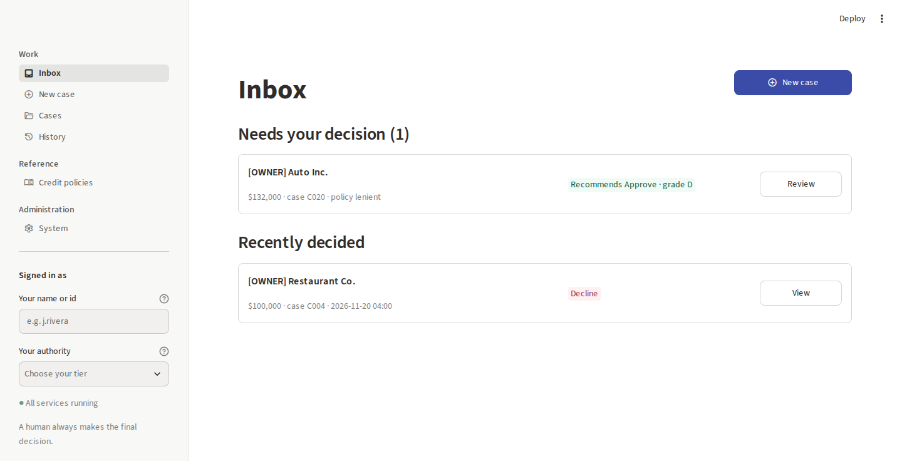
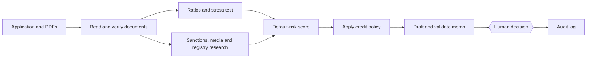

# WealthPilot

**An underwriting assistant for small-business loans.**

WealthPilot reads an applicant's financial statements, computes the credit ratios, scores default risk, applies your bank's credit policy as written, researches the borrower and drafts a
credit memo. It then stops for a human decision. Every figure the assistant states is checked by code, and every decision is recorded in a tamper-evident audit log.

## What it does

-   **Reads the documents**

    ---

    Extracts income statements, balance sheets and bank statements from digital or scanned PDFs and verifies that the figures reconcile before using them.

-   **Applies your policy, as written**

    ---

    The credit policy is a document you maintain. The assistant finds each rule, reads its thresholds and exceptions, and quotes the sentence behind every verdict.

-   **Scores risk with deterministic tools**

    ---

    Ratios, stress tests and the default-risk score come from calculation tools, never from the language model. A fixed rule turns rule results into a recommendation.

-   **Keeps a person in charge**

    ---

    Every case ends at an approval gate. The policy defines which authority tier may decide, and each decision is written to a hash-chained audit log.

-   **Protects applicants**

    ---

    Names, addresses and ZIP codes are removed from everything the language model reads, and memos are scanned for prohibited-basis language.

-   **Fails safe**

    ---

    If a tool or check is unavailable, the run is flagged as degraded and the recommendation is capped at refer. A run can never auto-approve on partial information.

## How a case flows

## Where to start

| I want to... | Go to |
|---|---|
| run the system | [Deploy with Docker](get-started/deploy.md), then [Your first case](get-started/first-case.md) |
| use the console day to day | [Using the console](user-guide/console.md) |
| change the bank's rules | [Managing credit policies](administration/policies.md) |
| operate and secure an installation | [Operations](administration/operations.md) and [Security and access](administration/security.md) |
| understand how it works and why | [Architecture](architecture/index.md) |
| see how well it performs | [Research](research/index.md) |

## Product and research

WealthPilot is organised as two separate parts. The **product** (this documentation, apart from the Research tab) is what an organisation deploys: the console, the underwriting workflow, the tool servers and the
audit trail. The **research** is the evaluation that was run against it: a synthetic-data generator, a reference engine that holds the ground truth, and five experiments on policy adherence, document parsing,
policy retrieval, fairness and reliability. The product contains no experiment code and no answer keys; the research package depends on the product, never the reverse.

!!! warning "Decision support, not a lending system of record"
    The assistant supports an underwriter; it does not replace one. Its policy reading, document extraction and research sources have known limits, and several external sources are placeholders.
    Read [Known limitations](administration/limitations.md) before using it on real applications.
