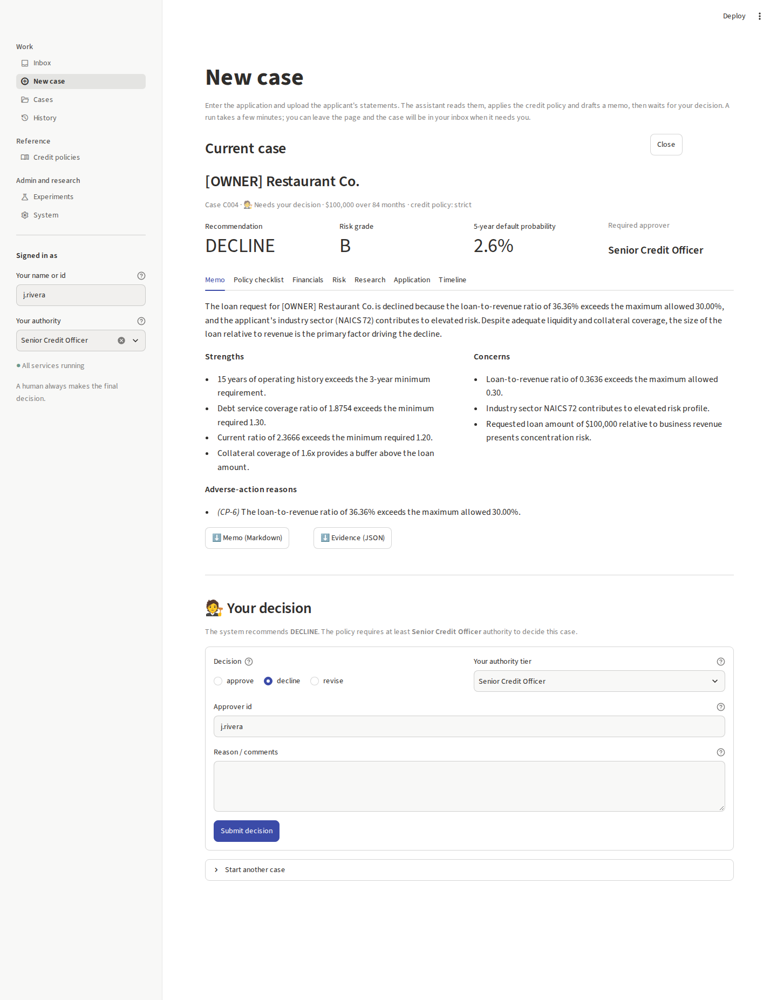

# WealthPilot

**A multi-agent assistant for SME loan underwriting and credit research.**

WealthPilot reads a small business's financial documents, computes credit ratios, scores default risk, applies a bank's
credit policy *as written*, researches the borrower, and drafts a credit memo — and then **stops for a human decision**.
Every step is observable, every number is re-checked by code, and every decision is written to a tamper-evident audit log.

!!! abstract "The question this project answers"
    *Given a clear credit policy, how faithfully does an LLM-based system apply it?* WealthPilot is **policy-agnostic**:
    the credit policy is a Markdown document the agents must read and apply. US-flavoured inputs (SBA 7(a) loan data, an
    ECOA/Reg-B-style compliance profile) are example configuration, not the thing under test.

## At a glance

-   :material-graph-outline: **Orchestration**

    ---

    A LangGraph workflow with six agent roles, parallel branches, bounded loops and a Postgres checkpointer. All routing
    is code over typed state — never an LLM.

    [:octicons-arrow-right-24: The workflow](concepts/workflow.md)

-   :material-file-document-check-outline: **Policy RAG**

    ---

    Hybrid retrieval (BM25 + vectors) with a NIM reranker over a policy written in prose. The system extracts thresholds
    from the text; the answer key is hidden from it.

    [:octicons-arrow-right-24: Policy and RAG](concepts/policy-rag.md)

-   :material-puzzle-outline: **MCP integration**

    ---

    Three FastMCP servers (16 tools) for credit math, policy search and borrower research, consumed through
    `langchain-mcp-adapters`.

    [:octicons-arrow-right-24: MCP servers](concepts/mcp-servers.md)

-   :material-shield-check-outline: **Safety by design**

    ---

    Redaction of protected attributes, numeric verification of LLM comparisons, a memo validator, mandatory human approval
    and a hash-chained audit log.

    [:octicons-arrow-right-24: Compliance](concepts/compliance.md)

-   :material-lightning-bolt-outline: **Reliability**

    ---

    A shared NIM gateway with a cache, an adaptive rate limit, retries, circuit breakers, model fallback and built-in
    fault injection.

    [:octicons-arrow-right-24: NIM gateway](concepts/nim-gateway.md)

-   :material-chart-box-outline: **Evaluated, not just built**

    ---

    Five experiments with ground truth: policy adherence, parsing, RAG, fairness and fault tolerance — including the bugs
    they exposed.

    [:octicons-arrow-right-24: Experiments](experiments/index.md)

## Headline results

All numbers come from the scripts in `experiments/` and are stored in `report/results/`. Sample sizes are small by design
(free NVIDIA NIM tier); treat them as evidence of mechanism, not precise rates. See [Experiments](experiments/index.md).

| Question | Result |
|---|---|
| Does it follow the policy it is given? (**E0**) | **100 %** decision accuracy under the strict policy and **91.7 %** under the lenient one (12 cases each); it changed its decision correctly in 5 of the 6 cases where the two policies disagree. |
| Does it read the right numbers from the text? (**E0**) | **100 %** of policy thresholds extracted correctly from prose, in both policies. |
| Can it parse messy and scanned documents? (**E1**) | **99.5 %** field accuracy on noisy layouts (100 % with reconciliation repair) and **96.9 %** on image-only scans. |
| Does retrieval find the right rule? (**E2**) | Hybrid search + rerank ranks the correct rule first **97 %** of the time (vs 77 % without the reranker). |
| Does identity affect outcomes? (**E3**) | No decision flips under name/gender/ZIP swaps; with redaction on, identity reached **0 of 84** LLM prompts. |
| Does it fail safely? (**E4**) | **0 unsafe approvals and 0 wrongful declines** in 28 fault-injected runs; degraded runs always recommend *refer*. |

## Where to start

=== "I want to run it"

    1. Check the [prerequisites](getting-started/prerequisites.md).
    2. Follow the [installation guide](getting-started/installation.md).
    3. Underwrite your first case in the [quickstart](getting-started/quickstart.md), or in the browser with [the web console](guides/console.md) (`uv run wealthpilot ui`), which is the way an officer would normally work.

=== "I want to understand it"

    1. Read the [architecture overview](concepts/architecture.md).
    2. Walk through the [workflow](concepts/workflow.md) and the [decision rule](concepts/decision-rule.md).
    3. See what was measured in the [experiments](experiments/index.md).

=== "I want to extend it"

    1. [Write a new credit policy](guides/new-policy.md).
    2. Browse the [MCP tool reference](reference/mcp-tools.md) and the [Python API](reference/api.md).
    3. Read the [design decisions](project/decisions.md) before changing the architecture.

!!! warning "Not a production lending system"
    WealthPilot is a research and teaching project. It runs on synthetic applicants, mock adverse-media and registry sources,
    and the free tier of a hosted LLM service. See [Limitations](project/limitations.md) before drawing conclusions.
