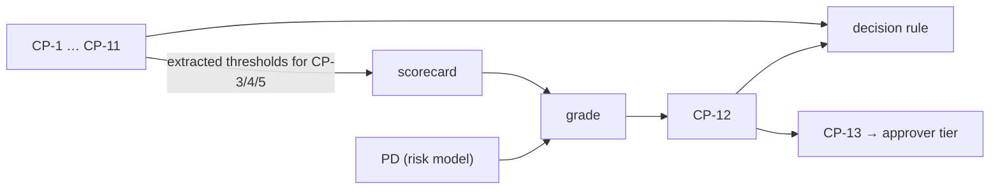

# Policy rules

The bundled policies (`data/policies/strict/policy.md`, `data/policies/lenient/policy.md`) define thirteen rules. This page lists the **case facts** each rule
consumes, how the **reference engine** evaluates it (the ground truth the experiments score against), and the shared definitions.

For the values in each policy see [Credit policy and RAG](../concepts/policy-rag.md#the-two-example-policies).

## Definitions (identical in both policies)

All ratios use the **most recent fiscal year** provided.

| Term | Definition |
|---|---|
| **DSCR** | (net income + interest expense + depreciation) ÷ (interest expense + current portion of long-term debt + annual payment on the proposed loan). The proposed loan is amortised monthly at **9.0 %** over the requested term. |
| **Debt-to-equity** | total liabilities ÷ total equity |
| **Current ratio** | total current assets ÷ total current liabilities |
| **Loan-to-revenue** | requested loan amount ÷ most recent annual revenue |
| **Collateral coverage** | appraised collateral value ÷ requested loan amount |
| **Years in business** | from incorporation to the application date |

Implemented in `wealthpilot.finance.compute_ratios`.

## Rules

| Rule | Title | Facts consumed | Reference-engine logic |
|---|---|---|---|
| **CP-1** | Minimum operating history | years in business | `pass` if ≥ policy minimum, else `fail` |
| **CP-2** | Prohibited industries | industry (name, tagged) | `fail` if the industry tag is in the prohibited list |
| **CP-3** | Minimum DSCR | DSCR; collateral coverage | `pass` if DSCR ≥ minimum; if the policy has an **exception band** and DSCR ≥ band floor **and** coverage ≥ the band's collateral requirement → `exception`; otherwise `fail`. A missing ratio → `missing_data`. |
| **CP-4** | Maximum leverage | debt-to-equity | `pass` if `0 ≤ D/E ≤ max` (negative equity fails) |
| **CP-5** | Minimum liquidity | current ratio | `pass` if ≥ minimum |
| **CP-6** | Loan size vs revenue | loan-to-revenue | `pass` if ≤ maximum |
| **CP-7** | Financial statement years | number of fiscal years provided | `pass` if ≥ required years |
| **CP-8** | Collateral | loan amount; collateral coverage | if loan > threshold: `pass` if coverage ≥ minimum else `fail`; otherwise `not_applicable` |
| **CP-9** | Personal guarantee | guarantee provided; loan amount; years in business | required if the policy says *always*, **or** loan > amount trigger, **or** years < years trigger; then `pass`/`fail` on whether one was provided; otherwise `not_applicable` |
| **CP-10** | Sanctions screening | planted sanctions flag | `fail` on a confirmed match, else `pass` |
| **CP-11** | Adverse media | worst article severity | `exception` if the severity is at an escalating level for the policy, else `pass` |
| **CP-12** | Acceptable risk grade | grade (A–E) | `pass` if the grade is at least as good as the policy's worst acceptable grade |
| **CP-13** | Delegation of authority | loan amount; whether any rule is an exception | informational: selects the approver tier |

!!! note "Where the agent's inputs come from"
    The reference engine uses the **true** values. The agents use the *extracted* statements, tool outputs and the research step — so differences in
    results reflect extraction, tool or reading errors, not a different definition.

## Evaluation order and dependencies

CP-1…CP-11 are judged first (in batches of four). The scorecard and grade depend on the thresholds extracted from CP-3, CP-4 and CP-5, so **CP-12 can only be judged afterwards**.

## Rule text conventions

A new policy must follow these conventions to work with the system — see [Writing a new policy](../guides/new-policy.md#1-create-the-policy-document):

* headings of the exact form `## CP-<n> <Title>`;
* CP-3, CP-4, CP-5 state numeric thresholds in prose;
* CP-12 lists the acceptable grades; CP-13 states approval limits in dollars.

## The decision rule

Implemented in `wealthpilot.policy_ref.derive_recommendation` (see [The decision rule](../concepts/decision-rule.md)):

1. any rule `fail` → **decline**
2. else any `exception` or `missing_data` → **refer**
3. else → **approve**
