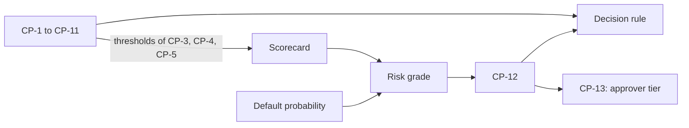

# Policy rules

The rule catalogue CP-1 to CP-13 as implemented by the two bundled credit policies, and how rule statuses are derived.

The product ships two policies for the fictional Meridian Bank: `strict` (Conservative Edition, for low risk appetite) in `policies/strict/policy.md` and `lenient` (Growth Edition, for higher risk appetite) in `policies/lenient/policy.md`. Both are written in prose and share the same thirteen rules. They differ only in thresholds and in a few conditions. The workflow reads the rules from the policy text at run time and does not contain the values below. How to add or edit a policy is described in [Managing credit policies](../administration/policies.md).

The reference answers used to evaluate the system are not part of the policies. The research package holds them separately (see [Research](../research/index.md)).

## Structure of a policy document

| Section | Content |
|---|---|
| 1. Purpose and scope | Which loans the policy covers |
| 2. Definitions | The ratio definitions below |
| 3. Governance | Review and exception logging |
| CP-1 to CP-13 | The rules, each under a heading of the form `## CP-<n> <Title>` |
| 14. Decision rule | The prose statement of how rule results become a recommendation |
| 15. Record retention | Retention period of credit files (7 years for `strict`, 5 years for `lenient`) |

## Definitions

Both policies use the same definitions. All ratios are calculated on the most recent fiscal year of financial statements provided.

| Term | Definition |
|---|---|
| DSCR | (net income + interest expense + depreciation) divided by (interest expense + current portion of long-term debt + annual payment on the proposed loan). The proposed loan is amortized monthly at an assumed rate of 9.0 percent over the requested term |
| Debt-to-equity | Total liabilities divided by total equity |
| Current ratio | Total current assets divided by total current liabilities |
| Loan-to-revenue | Requested loan amount divided by the most recent annual revenue |
| Collateral coverage | Appraised collateral value divided by the requested loan amount |
| Years in business | From incorporation to the application date |

## Rule catalogue

| Rule | Title | What it checks | Facts used |
|---|---|---|---|
| CP-1 | Minimum operating history | The business has operated for at least the minimum number of years | Years in business |
| CP-2 | Prohibited industries | The primary activity is not on the prohibited list | Industry |
| CP-3 | Minimum debt service coverage | DSCR meets the minimum; `lenient` also defines an exception band | DSCR, collateral coverage |
| CP-4 | Maximum leverage | Debt-to-equity does not exceed the maximum; negative equity fails | Debt-to-equity |
| CP-5 | Minimum liquidity | Current ratio meets the minimum | Current ratio |
| CP-6 | Loan size relative to revenue | Loan-to-revenue does not exceed the maximum | Loan-to-revenue |
| CP-7 | Financial statement requirements | Statements for the required number of consecutive fiscal years were provided | Number of fiscal years provided |
| CP-8 | Collateral | Above a loan size threshold, collateral coverage meets the minimum; below it the rule does not apply | Loan amount, collateral coverage |
| CP-9 | Personal guarantee | A personal guarantee is provided where one is required | Guarantee provided, loan amount, years in business |
| CP-10 | Sanctions screening | The applicant and owner have no confirmed sanctions match | Sanctions screening result |
| CP-11 | Adverse media | Adverse media findings at or above the escalation severity are an exception | Worst adverse media severity |
| CP-12 | Acceptable risk grade | The internal grade is no worse than the worst acceptable grade | Risk grade |
| CP-13 | Delegation of authority | Selects the approval authority; produces no pass or fail result | Loan amount, presence of any exception |

### Values in the bundled policies

Rules with a numeric or categorical threshold differ between the two policies.

| Rule | `strict` | `lenient` |
|---|---|---|
| CP-1 minimum years in business | 3 | 2 |
| CP-2 prohibited industries | Cannabis, firearms and ammunition, gambling and casinos, adult entertainment, cryptocurrency exchanges | Cannabis, adult entertainment |
| CP-3 minimum DSCR | 1.30, no exceptions | 1.15 pass. From 1.05 up to but not including 1.15 is an exception when collateral coverage is at least 1.20, otherwise a fail. Below 1.05 fails |
| CP-4 maximum debt-to-equity | 3.0 | 4.5 |
| CP-5 minimum current ratio | 1.20 | 1.00 |
| CP-6 maximum loan-to-revenue | 0.30 | 0.50 |
| CP-7 years of statements | 3 | 2 |
| CP-8 collateral | Above USD 150,000, coverage at least 1.00 | Above USD 400,000, coverage at least 0.80 |
| CP-9 personal guarantee | Always required | Required only above USD 250,000 or with fewer than 5 years in business |
| CP-10 sanctions | Any confirmed match fails | Any confirmed match fails |
| CP-11 adverse media exception | Medium or high severity | High severity only |
| CP-12 acceptable grades | A, B, C | A, B, C, D |
| CP-13 Analyst may approve up to | USD 75,000 | USD 150,000 |
| CP-13 Senior Credit Officer up to | USD 250,000 | USD 500,000 |
| CP-13 above that | Credit Committee | Credit Committee |

In both policies any case that carries an exception requires the Credit Committee regardless of the amount.

## Statuses

Each evaluated rule receives one status.

| Status | Meaning |
|---|---|
| Pass | The case complies with the rule |
| Fail | The case violates the rule |
| Exception | The rule text defines the situation as an exception that must be referred to the Credit Committee |
| Not applicable | The rule's condition does not apply to the case, for example a collateral requirement for a loan below the size threshold |
| Missing data | A fact needed to assess the rule is absent or could not be determined |

The status is derived in two steps. First, the policy agent retrieves the rule text and answers three plain questions about the case: whether the rule applies, whether the case complies, and whether the situation is an exception. The workflow then maps the answers to a status: not applicable when the rule does not apply, exception when the situation is an exception, pass or fail according to compliance, and missing data when compliance cannot be determined. The agent does not choose the status label itself.

Second, every numeric comparison the agent relied on (a case value against a number in the rule) is re-evaluated by the deterministic `compare` tool. If a comparison is wrong, the agent is asked once to answer again. If the answer is still inconsistent, the status becomes missing data. See [Policy retrieval](../architecture/policy-retrieval.md).

## Evaluation order

CP-1 to CP-11 are judged first, in batches of four rules. The thresholds read from CP-3, CP-4 and CP-5 feed the scorecard, which together with the default probability determines the risk grade. CP-12 depends on the grade and is therefore judged afterwards. CP-13 selects the approval authority.

When a rule has missing data, the workflow recomputes the ratios once, filling gaps from the prior fiscal year (the values are labeled as estimated), and judges the rules again.

## The decision rule

The recommendation follows from the statuses of CP-1 to CP-12 by a fixed rule:

1. Any fail results in a recommendation to decline.
2. Otherwise, any exception or missing data results in a recommendation to refer.
3. Otherwise the recommendation is to approve.

A run in which any tool was unavailable (a degraded run) never recommends approve or decline: it recommends refer. A human always makes the final decision. See [The decision rule](../architecture/decision-rule.md).

## Approval authority

CP-13 is not a pass or fail rule. The workflow reads the approval limits from the rule text and compares the loan amount with them. The result is the lowest authority allowed to decide the case:

| Condition | Required authority |
|---|---|
| Loan amount up to the Analyst limit | Analyst |
| Above the Analyst limit, up to the Senior Credit Officer limit | Senior Credit Officer |
| Above the Senior Credit Officer limit | Credit Committee |
| Any rule has the status exception | Credit Committee |
| The limits cannot be determined | Credit Committee |

An approval below the required authority is rejected by the approval step.

## Conventions for policy documents

A policy is recognized and evaluated correctly when it follows these conventions:

* Rule headings have the exact form `## CP-<n> <Title>`.
* CP-3, CP-4 and CP-5 state their numeric thresholds in prose, because the scorecard uses them.
* CP-12 lists the acceptable grades.
* CP-13 states the approval limits in US dollars.
* The rules use the facts listed in the rule catalogue.
