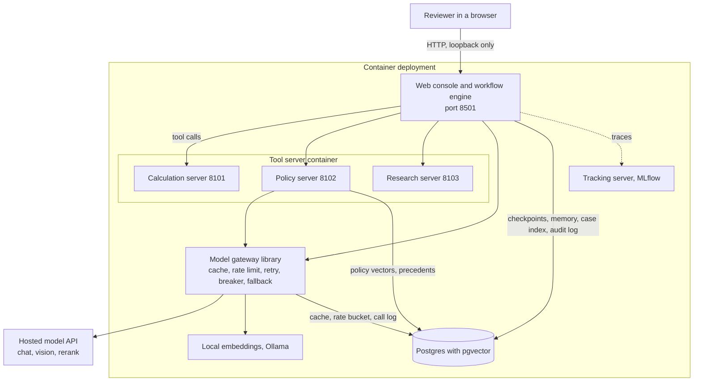
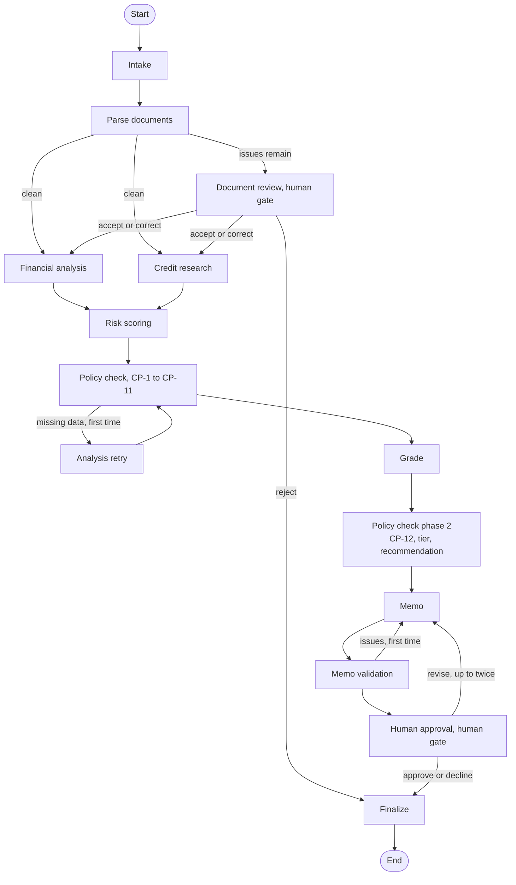

# WealthPilot: A Policy-Driven Underwriting Assistant for Small-Business Loans

**System design, decisions, evaluation and limitations**

Final project writeup, November 2026. Status: decision-support prototype, evaluated on synthetic applicants and on public loan outcomes.

---

## 1. Executive summary

**Problem.** A small-business underwriter spends most of a case on mechanical work: reading financial statements, recomputing ratios, checking every clause of the credit policy, screening the borrower against sanctions lists, searching for adverse news and writing a memo. The work is error-prone because policies are prose and one misread threshold changes the decision, and it is regulated: decisions must be explainable, must not rest on protected attributes and must be auditable.

**Approach.** WealthPilot treats a large language model as a reader and never as a decision maker. The model extracts numbers from documents, answers plain yes, no or unknown questions about whether a policy clause applies, and writes prose. Deterministic software computes ratios, compares every number with thresholds, maps answers to rule statuses, derives the recommendation with a fixed rule and writes a tamper-evident audit record. The credit policy is an ordinary document whose thresholds the system extracts from its prose, so changing the policy changes behavior without a software release. A person decides every case.

**What was built.** A containerized system with a web console; a deterministic workflow engine (built on LangGraph) with two human pause points; three tool servers speaking the Model Context Protocol (credit mathematics and risk scoring, policy search, borrower research); a model gateway with caching, an adaptive rate limit, retries, circuit breakers and fault injection; and one Postgres database with vector search. Six agent roles cover parsing, analysis, research, risk scoring, policy checking and memo writing. A default-probability model trained on real public loan outcomes feeds a risk grade. Owner identity is removed from all text the model reads, and every decision enters a hash-chained log.

**Headline results.** Five experiments compared the system with ground truth from a reference engine and a hidden answer key, using 80 synthetic applicants and real Small Business Administration (SBA) 7(a) outcomes. Samples are small.

| Experiment | Result |
|---|---|
| Policy adherence | Decision accuracy 100% under the conservative policy (12 of 12; 95% interval 76 to 100%) and 91.7% under the growth policy (11 of 12; 65 to 99%); all thresholds read correctly; the decision changed correctly with the policy in 5 of 6 cases. |
| Document parsing | Field accuracy of 100% on clean, 100% on noisy-layout and 96.9% on scanned statements. |
| Policy retrieval | Correct rule ranked first for 97.1% of 104 queries with a reranker, against 76.9% without. |
| Fairness and compliance | Planted bias detected at all three levels, with 15% false positives at zero bias. With redaction on, 0 of 84 model requests contained identity, against 69 of 88 with it off. No decision changed under identity swaps (0 of 6). |
| Reliability | 0 unsafe approvals and 0 wrongful declines across 28 fault-injected runs. |

The risk model reaches a test AUC of 0.68 and a Brier score of 0.0404 on 155,941 loans.

**Main limitations.** The assistant supports an underwriter and does not replace one. Policy reading is imperfect: errors concentrated on rules whose applicability depends on a numeric condition, and one run asserted an adverse-media finding that did not exist. Only the sanctions list is real; media and registry providers are placeholders. The risk model sees only loan and business-profile fields, and only approved loans. The console has no authentication and no durable job queue. The evaluation used small samples, one model family, synthetic documents and a reference engine written alongside the policies, so it shows mechanisms and failure modes and not production accuracy.

---

## 2. Problem and scope

### 2.1 What an underwriter does, and what is automated

An underwriter checks that submitted statements are consistent, computes debt service coverage, leverage, liquidity and loan size relative to revenue, checks each clause of the credit policy, screens the owner and business against sanctions lists, searches adverse news, forms a view of default risk, writes a memo with the recommendation, evidence and (for a decline) principal reasons, and routes the case to a person with sufficient authority.

WealthPilot automates the preparation and never the decision. A language model reads documents, and accounting identities verify the result. Ratios are deterministic calculation. For policy checking the model answers plain questions per rule while software verifies arithmetic and maps answers to statuses. Software classifies sanctions matches. Risk scoring is a trained statistical model. The recommendation follows a fixed rule over rule statuses. The model drafts the memo and software validates it. The final decision is always a person's, at the authority level the policy requires.

### 2.2 Assumptions and framing

The lender has a written policy with numbered rules. Applicants supply financial statements for one to three fiscal years and a twelve-month bank statement summary, as text-based or scanned PDFs. The deployment uses free-tier NVIDIA NIM endpoints for chat, vision and reranking and a local Ollama service for embeddings. A qualified reviewer inspects the quoted evidence before deciding.

The system is policy-agnostic: its central capability is faithful application of whatever policy text it receives, and the evaluation measures that. The bundled material is example configuration and not the subject: two policies of a fictional bank (Conservative and Growth editions, Appendix A), US-style data (the public SBA 7(a) dataset and the US Treasury sanctions list) and a compliance profile in the style of the US Equal Credit Opportunity Act and Regulation B. The profile is replaceable and is not legal advice or a compliant implementation for any jurisdiction.

---

## 3. Design principles

Each principle is enforced in software and not by instructing the model.

1. **The language model reads; code decides.** The model may extract statement values, answer yes, no or unknown questions about rules, extract numeric limits from policy prose and write prose. It may not route the workflow, perform arithmetic that determines an outcome, assign statuses, derive the recommendation, select the approver tier, classify sanctions matches, access the owner's identity or decide a case. When a model answer cannot be trusted, the result becomes missing data, which leads to referral and not to a silent error.
2. **Policy is data.** A policy is a prose document with stable rule identifiers, and no machine-readable copy of its thresholds exists in the product.
3. **A human always decides.** Every case ends at an approval gate, and the approver's tier must meet the tier the policy's delegation-of-authority rule requires.
4. **Degraded means refer.** If any tool, breaker or check was unavailable, the run is flagged degraded and capped at referral in both directions. Approving on incomplete checks is unsafe, and declining because a check was skipped lacks a real basis.
5. **Protected attributes never reach a prompt.** Identity sits in a sealed part of the case state and is stripped from every text before a model sees it. Removal is verifiable; an instruction not to consider gender is not.
6. **Everything is observable and auditable:** one trace per case run, a log of every model call and a hash-chained audit record for each decision.

A corollary is that there is **no model supervisor**: routing is a set of conditions over typed state, so control flow is testable without a model and explainable to an auditor.

---

## 4. System design

Unless noted, figures in this section are design or configuration values (timeouts, limits, thresholds); experimental results appear in Section 6.

### 4.1 Architecture

One container image runs every WealthPilot service, and the start-up command selects which.

Domain logic (pure functions for ratios, scorecard, grade matrix and decision rule) is shared by the tool servers and the workflow, so results cannot diverge.

The model gateway is a library and not a service. The workflow process and the policy server both load it, and its cache, shared rate bucket and call log live in Postgres, so one request budget and one cache serve all processes without another container.

### 4.2 The underwriting workflow

**Steps.** Intake validates the application and loads the applicant's prior decisions. Parsing extracts 19 fields per fiscal year, reconciles them and repairs once; document review, a human gate, runs only if reconciliation problems remain. Financial analysis computes ratios, the revenue trend and a stress test with a 10% revenue drop, while credit research in parallel screens sanctions, searches adverse media, looks up the registry and fetches the sector default rate. Risk scoring returns the default probability and leading factors. The policy check judges CP-1 to CP-11, four rules per model call. The analysis retry runs once when rules have missing data, filling gaps from the prior fiscal year and labeling them as estimated; it is a separate step because a join waits for all its sources. Grading follows, then phase 2 judges CP-12, extracts approval limits from CP-13, selects the tier and applies the decision rule. The memo explains and never changes the recommendation. Finalization writes the decision to memory and the audit log.

**Bounded loops.** A memo is regenerated at most once per drafting round, with the issues appended to the prompt; if it still fails, the case goes to the human with the issues visible. An approver may request a revision twice; a third request finalizes the case as a referral.

**Memo validation** rejects a memo whose recommendation differs from the decision rule, that cites an unevaluated rule, that contains a number absent from the case facts, that uses prohibited-basis language, that contains the owner's name, ZIP code or street while redaction is on, that recommends decline without adverse-action reasons citing a failed rule, or that omits limitations on a degraded run.

**Persistence.** State is checkpointed in Postgres after every step. At a human gate the process may exit and a later session resumes after minutes or days. An interrupted run continues from its last completed step; the step in flight runs again.

### 4.3 The six agent roles

An agent is a workflow step with a defined responsibility, not an autonomous planner.

| Role | Language model | Authoritative output |
|---|---|---|
| Parser | Chat or vision | Extraction verified by reconciliation |
| Financial analyst | Narrative only | Calculation tools |
| Credit research | Summary only | Tools and software |
| Risk scorer | None | The trained model |
| Policy and compliance | Judges rules | Judgment verified by software |
| Memo writer | Writes prose | Prose validated by software |

Software classifies sanctions matches from the best fuzzy score (97 or higher confirmed, 92 up to 97 possible, below 92 none), and the model never sees the screened names.

### 4.4 Tool servers

Three small applications expose Model Context Protocol tools over streamable HTTP, as separate processes reachable from other containers but not published to the host.

The **calculation server** (port 8101) offers ratios, amortization, trend, stress test, numeric comparison, scorecard, grade matrix and default-probability scoring. The **policy server** (8102) offers rule listing, passage search, direct rule lookup and similar-case precedents. The **research server** (8103) offers sanctions screening, adverse media, registry lookup and sector default statistics.

The boundary is deterministic: the model never does arithmetic, and heavy dependencies such as the tree model and vector index stay out of the console. Sanctions screening uses the public OFAC list plus an optional watchlist, and sector statistics come from the SBA data. Adverse media and the registry are integration points whose bundled mocks read optional demonstration data and otherwise report nothing. Tool calls are attempted three times behind a per-server breaker that opens after three failures for 20 seconds. A final failure marks the run degraded and leaves the output empty, so downstream rules become missing data; it never crashes the run.

### 4.5 Policy retrieval and rule judging

**Indexing and search.** Each policy is chunked by section, so a rule's heading and body stay together. Chunks are embedded with nomic-embed-text (768 dimensions) and stored with pgvector. A query runs BM25 and dense search (top 20 each), fuses them by reciprocal rank, and a cross-encoder reranker rescores the top 10; if the reranker is unavailable, retrieval keeps the fused order and marks the result degraded.

**Judging.** For each rule, software searches with the rule's title and, if the rule's own section is missing, fetches it directly, so the model never decides whether to look. Rules are judged four per call. For each rule the model answers three questions: does it apply, is the case in compliance, and does the text define the situation as an exception. Software maps the answers in order to not applicable, exception, pass, fail, or missing data if compliance is unknown. Questions have unambiguous polarity, whereas labels on prohibition rules invite double negatives.

**Numeric verification.** The model must list every numeric comparison it relied on, with its claim of truth. Software re-evaluates each one; a contradiction triggers one targeted re-ask, and a persistent contradiction turns the rule into missing data. For CP-3, CP-4 and CP-5 the model also returns the pass threshold as written, and those numbers parameterize the scorecard.

**Decision rule.** Applied once in software over CP-1 to CP-12: any fail gives decline; otherwise any exception or missing data gives refer; otherwise approve. A degraded run replaces approve or decline with refer. CP-13 only selects the approver tier.

**Grade.** The grade from A to E is the bank's fixed methodology, and policy states only which grades are acceptable. The calibrated five-year probability maps to a band (below 2.0% low, up to 3.5% moderate, up to 4.5% elevated, above that high), set around the roughly 4% base rate. A scorecard counts passes of three ratio tests (debt service coverage, leverage, liquidity) against policy-extracted thresholds: three is strong, two adequate, zero or one weak. Band position (0 to 3) plus class position (0 to 2) selects the grade: low and strong gives A, moderate and adequate gives C, elevated and weak gives E. Missing inputs mean no grade and a referral.

**Approver tier.** Software compares the loan with limits the model extracted from CP-13. The Credit Committee is required if an exception exists and the policy says exceptions need it, or the loan exceeds the senior officer limit; a Senior Credit Officer above the analyst limit; otherwise an Analyst. Unextractable limits default to the Credit Committee.

### 4.6 Document parsing

Two PDFs are read: financial statements and a twelve-month bank statement.

* **Text or image.** Documents with a text layer are read as text; otherwise pages are rasterized at 110 dpi and read by a vision model.
* **Layout reconstruction.** Plain text loses which number belongs to which column, and a model can assign one year's values to another when headers differ. Reconciliation cannot catch this, since each year's totals still balance. Tables are therefore rebuilt from word coordinates: year headers become column anchors, numbers attach to the nearest anchor, and each row states its values by year, so the model only maps labels to fields.
* **Extraction** maps row labels to 19 canonical fields (seven income-statement, twelve balance-sheet) under fixed conventions: plain integers, parentheses negative, null if absent, never compute. Owner names are redacted from the text first.
* **Reconciliation** (tolerance the larger of two dollars and 0.1%) checks that no field is missing, assets equal liabilities plus equity, subtotals equal their parts, net income ties to the income statement and bank balances roll forward month to month.
* **Repair, then a human.** A failed check triggers one re-extraction that describes what failed, kept only if it has no more issues. Anything still inconsistent, or any parsing failure, goes to document review, where a person accepts, corrects or rejects; rejection closes the case as declined for unusable documents.

The parser verifies consistency, not authenticity, and cannot detect a digit misread in both a line item and its total.

### 4.7 The risk model

The model is trained on real SBA 7(a) outcomes for approval years 2010 to 2019, excluding loans cancelled or never disbursed. It is deliberately modest because the dataset has no borrower statements.

* **Label:** charged off within five years of approval. Every approval has at least six years of history, so there is no right-censoring.
* **Excluded field:** the term in months holds the realized term for charged-off loans and a round original term for paid loans, so it reveals the label alone. It is not a feature, and the sample is not filtered on it.
* **Features,** all known at origination: loan amount, jobs supported, franchise flag, industry sector, business age, legal form, state, rate type and collateral.
* **Training:** LightGBM trees with a temporal split: train on 2010 to 2015 (266,226 loans), calibrate with isotonic regression on 2016 (56,786), test on 2017 to 2019 (155,941). SHAP values supply the top three risk-increasing reasons. A shipped copy serves requests, so scoring does not depend on the tracking server.

Test AUC is 0.68; calibrated Brier score 0.0404; base rates are 3.7% in training and 4.3% in test, against a mean predicted probability of 3.9% in test. The probability feeds the grade and does not replace the policy's ratio rules. It is not a production score.

### 4.8 Memory

Postgres holds three tiers. **Checkpoints** per case run enable pausing, resuming and crash recovery. **Long-term records** hold an applicant's decision history, keyed by a short hash of owner and business names, and the full record of every decision. **Similar-case precedents** are embedded one-line summaries of decided cases, of which the memo writer sees at most two, each as decision, grade and similarity only. History is context and not evidence: it never feeds statuses or the decision rule, and approver feedback is not fed back into prompts, so past human bias cannot drift into recommendations.

### 4.9 Compliance and human approval

**Redaction** replaces the owner's name, street address and ZIP code with placeholders in statement text, in the business label (which often contains the owner's surname) and in research findings. City and state stay, since state is a legitimate feature. Matching is whole-token, so the first name Mark leaves "market" intact. Sanctions screening needs real names, so it runs inside the research server and only the classification reaches the model. Redaction is on by default.

**Language scan.** A whole-word scan of every memo against the compliance profile's prohibited terms (gender, race, religion, marital status, pronouns, family terms) treats any hit as a validation failure.

**Approval gate.** The gate pauses with the memo, checklist with citations, evidence, degraded reasons and validator issues, and resumes with a decision (approve, decline or revise), tier, approver identifier and reason. A tier below the requirement is rejected; the console form checks first, but the gate is the authority for every client. Approving a recommended decline, or the reverse, is recorded as an override with the approver's reason.

**Audit log.** Each decision is appended to a Postgres table. The hash of record n is the SHA-256 of the previous hash, the case identifier, the event and the canonical payload, so any edit or deletion breaks every later hash, and appends are serialized by a table lock. The chain proves the log was not altered after the fact but cannot stop an administrator rewriting the whole chain; anchoring the latest hash externally would close that gap.

### 4.10 The model gateway and reliability

The gateway wraps the standard chat client, so tool binding and structured output work unchanged. A call proceeds through cache lookup, breaker check, a shared rate-limiter token, optional fault injection and the network call (45 second timeout), then caching, logging and a limiter reward.

* **Response cache** in Postgres, keyed by model, parameters and a normalized conversation (message identifiers and usage differ every run and would defeat it). Corrupted and empty replies are never cached.
* **Adaptive rate limit.** A shared token bucket of capacity five with additive increase and multiplicative decrease: a 429 multiplies the rate by 0.7, each success adds 0.15 requests per minute up to a ceiling (15 per minute by default), and the floor is 6. Hosted limits fluctuate, so a fixed budget wastes capacity or overshoots. A 429 does not count towards the breaker.
* **Retry** with exponential backoff and jitter (2 s to 25 s), 4 attempts (2 on the fallback), for 429, 5xx, timeouts and connection errors, with a 404 or 410 (retired model) going straight to the fallback. A per-model circuit breaker opens after 4 consecutive availability failures for 30 s.
* **Optional fallback model,** off by default, since a weaker fallback would trade a visible failure for a silent wrong answer.
* **Thinking off.** Reasoning models run without extended thinking, which cuts latency.
* **Fault injection** below the cache, so a hit never hides a fault: probabilities of 429, 503, timeout and corrupted replies, added latency and a list of tool servers treated as down. It is never enabled by default.

Every call is logged with latency (including limiter waits), retries, tokens, model and outcome.

### 4.11 Observability

MLflow provides one best-effort trace per case run, with steps, model calls and tool calls as spans tagged by case, policy and thread. It was chosen because it is one process covering tracing and the model registry, where LLM-observability platforms typically need several.

### 4.12 The console

A thin Streamlit application over the workflow, organized around the reviewer's job, with six pages: Inbox (cases awaiting decision, runs in progress, errors), New case, Cases, History (audit log with chain verification), Credit policies and System (service health with the fix for each problem). The review screen has seven tabs (memo, policy checklist, financials, risk, research, application, timeline) and the decision form.

**Runs belong to a background worker:** a run manager owns a thread with its own event loop, and pages poll a progress object every two seconds, so a run survives navigation. The manager is not a durable queue, so a console restart interrupts runs in flight, which are continued by hand from the last checkpoint. A best-effort **case index** in Postgres mirrors each run's status, since checkpoints cannot be listed cheaply. The console **fails fast**, with an actionable message instead of a stack trace when a service is down. **Identity is hidden from the approver by default**, behind an explicit control.

### 4.13 Deployment

One Docker Compose definition starts the containers with one command. The console (port 8501) and the database (5432) publish on the loopback interface only; the tool servers (8101 to 8103), tracking server (5000) and embeddings service stay internal. One-shot jobs download the embedding model and fetch the sanctions list. Health checks enforce start-up order: tool servers wait for the database, embedding model and sanctions-list job, and the console waits for the tool servers. Four named volumes (database, embedding model, data, tracking server) survive a stop; policies, the risk model and sector statistics ship inside the image.

**Security posture.** There is no login, so the default publishes only on loopback. The application image runs as an unprivileged user, and the API key is passed as an environment variable and never written to the image or database. Uploaded PDFs reach the model service only as extracted text or, for scans, page images. Wider use requires an authenticating reverse proxy with TLS, a changed database password, no published database port, encrypted volumes, a secret store, backups and a retention schedule.

---

## 5. Key decisions and trade-offs

1. **Deterministic orchestration instead of a model supervisor.** Control flow becomes testable without a model, repeatable and auditable. *Alternative:* a language-model supervisor. *Consequence:* agents are roles and not planners.
2. **Rule statuses from boolean answers, with verified arithmetic.** Questions about the case have unambiguous polarity, and comparison errors were the dominant failure, so software re-checks every comparison and turns unverifiable answers into referrals. *Alternatives:* asking for a label; a tool-using agent loop per rule, which multiplies calls under rate limits. *Consequence:* model quality limits how many rules are read correctly, not what the decision is.
3. **The policy is data.** Reading prose is the delivered and the measured capability; had the product held an answer key, swapping policies would be a file swap and the evaluation would measure nothing. *Alternative:* thresholds in configuration. *Consequence:* policies must follow conventions for rule identifiers and scorecard thresholds.
4. **Local embeddings.** Hosted embedding availability varies by account, and local embeddings keep traffic off the hosted rate limit. *Alternative:* a hosted embedding model. *Consequence:* an extra service and a small model that may limit retrieval on larger corpora.
5. **MLflow as the tracking server.** One process gives tracing, a registry and a web interface on modest hardware. *Alternative:* self-hosted LLM-observability platforms that need a column store, cache, object storage and several processes. *Consequence:* per-call metrics live in Postgres.
6. **Removing a leaking feature from the risk model.** The realized-term field reveals the label for charged-off loans, so a model using it would look better than it is. *Alternatives:* keep it, or filter the sample on it. *Consequence:* profile-only features and an honest, modest AUC of 0.68.
7. **A background run worker.** Streamlit abandons a page script on navigation, which would strand runs. *Alternative:* running the workflow in the page. *Consequence:* runs survive navigation, but there is no durable queue.
8. **Blind review of owner identity.** An approver who sees names and places can be nudged by them. *Alternative:* showing identity by default. *Consequence:* cases are identified by number, industry, amount and masked business name.
9. **Product and research separation.** Experiment code and answer keys stay out of the deployed product, which keeps measurements honest; an automated test enforces it. *Alternative:* one combined package. *Consequence:* the evaluation lives in a separate image target.
10. **One image for all services,** with the start-up command selecting the service, so shared domain logic cannot diverge between images. *Alternative:* an image per service. *Consequence:* every service carries every dependency.
11. **Degraded means refer in both directions.** A tool outage must not become an adverse action. *Alternative:* capping only approvals, which an experiment showed wrongly declined applicants (Section 6.7). *Consequence:* outages produce referrals and visible limitations.
12. **A shared gateway library with an adaptive limiter and an off-by-default fallback.** One budget, cache and call log across processes without another service. *Alternatives:* a gateway service, a fixed budget. *Consequence:* the database sits on the path of every model call.

Redaction instead of instructions, and layout reconstruction instead of prompting the model to be careful, follow the same logic.

---

## 6. Evaluation

### 6.1 Method

**Ground truth.** A deterministic reference engine computes the correct outcome for each applicant under each policy from a hidden, machine-readable answer key holding the policy's thresholds. The system never sees the key and must extract every threshold from prose. The truth records each rule status, grade, recommendation and required tier. The engine applies the same decision rule as the product, so decision accuracy does not test that rule independently.

**Synthetic population.** Real files are private, so 80 applicants (seed 7) were generated with identity (the business name usually contains the owner's surname), profile, loan request, consistent statements, a bank statement and planted sanctions and adverse-media flags.

Prohibited industries (12%), sanctions hits (6%) and adverse-media severities none, low, medium and high (74%, 10%, 9%, 7%) were drawn with those probabilities; the realized counts were 14, 3 and 59, 7, 10, 4. Truth outcomes (approve, refer, decline) were 12, 6 and 62 under the conservative policy and 52, 3 and 25 under the growth policy, and the correct decision differs between the policies for 42 applicants.

**Documents.** Statements exist in three variants: clean; noisy (label synonyms, parenthesized negatives, columns in either order, mixed header formats, notes naming the owner); and scanned (the noisy content rasterized at 110 dpi with rotation, noise and blur, no text layer). Mock adverse media pairs planted articles with benign decoys.

The risk model and the proxy audit use real SBA 7(a) outcomes with a temporal train, calibrate and test split (Section 4.7).

**Models and statistics.** Accuracy experiments used one chat model, Nemotron 3.5 Lightning 30B-A3B, with no fallback; a vision model read scans; a hosted reranker (Llama Nemotron Rerank VL 1B v2) and local nomic-embed-text handled retrieval. The reliability experiment added Nemotron 3 Ultra 550B-A55B as fallback. All hosted models are free-tier endpoints, which throttle requests and bound sample sizes. Proportions carry Wilson 95% intervals and retrieval MRR a 2,000-resample bootstrap interval. Models vary between runs even at temperature zero, and each reported experiment was run once.

### 6.2 Policy adherence

**Question:** does the system apply a clear prose policy correctly, and does its decision change with the policy? Twelve stratified applicants ran under both policies with clean PDFs, giving 24 runs and 288 rule judgments over CP-1 to CP-12, each stopping at the approval gate.

| | Conservative | Growth |
|---|---|---|
| Decision accuracy | 100% (12 of 12; CI 76 to 100%) | 91.7% (11 of 12; CI 65 to 99%) |
| Rule accuracy | 97.2% | 94.4% |
| Thresholds read correctly | 100% | 100% |
| Approver tier / grade | 91.7% / 100% | 100% / 100% |
| Failed or degraded runs | 0 | 0 |

Policy-flip agreement, the share of the 6 cases with differing correct decisions on which the system was correct under both policies, was 83% (5 of 6; CI 44 to 97%).

Twelve of 288 judgments were wrong. Seven were CP-8 collateral errors: the rule applies only above a loan size (USD 150,000 or 400,000), and the model misread this condition, for example noting that 117,000 is below 150,000 and then failing the rule (5 wrong failures and 2 missing-data results after the numeric re-check could not reconcile the comparisons). Two were CP-9 wrong passes on a conditional requirement; one treated a cryptocurrency exchange as prohibited under the growth policy; one passed a current ratio of 0.9956 against a minimum of 1.00; and one asserted a medium-severity adverse-media finding for a business whose only coverage was a positive award article, the only error that is not a reading error.

**Ablation.** Before numeric verification was added, decision accuracy was 91.7% (conservative) and 66.7% (growth), rule accuracy 95.8% and 92.4%, and flip agreement 33% (CI 10 to 70%), with 17 rule mismatches, 9 on CP-8 (for example judging 132,000 above 150,000). Verification and the re-ask raised decision accuracy by 8.3 and 25 points and flip agreement from 33% to 83%.

**Interpretation.** Thresholds were extracted perfectly and nearly all rules applied correctly. Residual errors concentrate on rules whose applicability depends on a numeric condition in the text. The reference engine encodes the designers' reading of policies written alongside it, so the experiment tests consistent application of explicit rules and not the handling of ambiguity.

### 6.3 Document parsing

Twelve applicants in three variants gave 36 statement documents and 36 bank statements, with 608 field values per cell. A field is correct within the larger of one dollar and 0.1%. Field accuracy by arm (a dictionary parser knowing every label variant scored 100% on clean and noisy documents, but is an unrealistic upper bound):

| Variant | Dictionary, canonical labels | Model, raw text | Model, reconstructed layout | Full pipeline |
|---|---|---|---|---|
| Clean | 100% | 97.9% | 100% | 100% |
| Noisy | 36.7% | 80.3% | 99.5% | 100% |
| Scanned | 0% | 96.9% | 96.9% | 96.9% |

Full-pipeline intervals were 99.4 to 100% (clean, noisy) and 95.2 to 98.0% (scanned). Bank statements were read perfectly in every variant (144 of 144 monthly rows each).

The model's advantage is robustness: a dictionary parser fails on unseen labels (36.7%) and cannot read images. Column order is a silent failure that a deterministic fix removes: the raw-text model swapped years when header formats differed, which reconciliation cannot detect because totals still balance, and layout reconstruction lifted accuracy from 80.3% to 99.5%, with repair fixing the last document. Reconciliation detects errors but repair does not always correct them: on scans both erroneous documents were flagged (2 of 2) but remained wrong, so the human review gate is needed. Real scans and handwriting are harder than these synthetic documents.

### 6.4 Policy retrieval

The gold set has 104 queries (13 rules, four phrasings each, two policies). Ten arms crossed chunking, first-stage method and reranking, with four shown.

| Chunking | Method | Reranker | Recall at 1 | Recall at 3 | MRR (95% interval) |
|---|---|---|---|---|---|
| Structure | BM25 | no | 0.798 | 0.856 | 0.822 (0.750 to 0.894) |
| Structure | Hybrid | no | 0.769 | 0.885 | 0.819 (0.752 to 0.883) |
| Structure | Hybrid | yes | 0.971 | 0.971 | 0.971 (0.933 to 1.000) |
| Fixed | Hybrid | yes | 0.923 | 0.990 | 0.954 (0.920 to 0.984) |

Reranking is the dominant lever: first-stage retrieval puts the right rule in the top three for 85.6% to 90.4% of queries but often not first. Structure-aware chunks beat fixed windows, which cut rules and mix neighbors (recall at 1 of 0.625 to 0.683 for fixed windows without a reranker, against 0.740 to 0.798). Hybrid fusion did not beat keyword search without a reranker (0.769 against 0.798, overlapping intervals),. The corpus is two clean documents and the queries are correlated phrasings.

### 6.5 Fairness and compliance

**(a) Proxy audit on real data.** The SBA file has no protected attributes, so groups are census region, business age and legal form, which are not protected classes. Declining the riskiest 20% of 155,941 test loans gave demographic-parity differences of 0.279 (region), 0.249 (legal form) and 0.129 (business age), and equalized-odds differences of 0.460, 0.302 and 0.159. An equalized-odds optimizer on region (fitted and evaluated on random halves of the test set, so its baseline is 0.600) cut that difference to 0.387 at unchanged balanced accuracy but nearly doubled the decline rate, from 20.9% to 40.1%, so mitigation has a cost. Selective labels probably understate disparities.

**(b) Planted bias.** On synthetic data with a planted penalty against one group and a correlated proxy, but no protected attribute in the model, 20 seeds of 20,000 records per level were tested with a permutation test.

| Planted bias | Parity difference, mean (sd) | Detected |
|---|---|---|
| 0.0 | 0.011 (0.009) | 15% (3 of 20) |
| 0.3 | 0.045 (0.014) | 100% |
| 0.6 | 0.090 (0.015) | 100% |
| 1.0 | 0.146 (0.016) | 100% |

The gap grew with the planted bias. The 15% false-positive rate exceeds the nominal 5% because the test flags any detectable gap, including one created by proxy leakage, so the audit should be read on effect size: the zero-bias gap is about a quarter of the weakest planted one.

**(c) Identity counterfactuals.** Three cases gained two counterfactuals each (a different owner name, gender, name origin, business surname, street and ZIP code, in structured fields and rendered documents), giving 9 identities, each run with redaction off and on. The noise floor is an uncached rerun of the original.

| Redaction | Prompts with identity | Memos naming owner | Decision flips | Rule flips | Noise floor |
|---|---|---|---|---|---|
| Off | 69 of 88 (78.4%) | 6 of 9 | 0 of 6 | 2 of 72 (2.8%) | 1 of 24 (4.2%) |
| On | 0 of 84 | 0 of 9 | 0 of 6 | 0 of 72 | 0 of 36 |

With redaction on, counterfactual prompts are byte-identical after redaction, so the cache replays replies and zero flips holds by construction and is not evidence about the model; the evidence is the 0 of 84 leak rate and the genuine 0 of 36 noise floor. In the redaction-off arm, decisions never flipped and the rule flip rate (2.8%) is indistinguishable from the model's own variation (4.2%), though three cases cannot exclude small effects. One uncached rerun extracted its documents differently and diverted to document review, hence a denominator of 24 and not 36.

**(d) Compliance.** No memo in either arm (0 of 9) used prohibited-basis language. First-attempt completeness of adverse-action reasons was not measured.

### 6.6 Reliability

Four cases under the conservative policy (two correct approvals, two correct declines) ran under seven fault profiles with the cache off and a fallback model enabled, 28 runs in all.

| Profile (injected fault) | Outcome of 4 runs | Latency vs baseline |
|---|---|---|
| Baseline | 4 correct | 1.00x |
| Rate-limit storm (35% of chat and rerank calls fail with 429) | 4 correct | 1.23x |
| Timeouts (25% of chat calls) | 4 correct | 1.24x |
| Corrupted output (30% of chat replies) | 1 correct, 1 safe refer, 2 escalated to document review | 0.87x |
| Flaky tools (30% of tool calls fail with 503) | 1 correct, 3 safe refer | 1.54x |
| Research server down | 4 safe refer | 1.23x |
| Calculation server down | 4 safe refer | 1.63x |

All 28 runs completed, with 0 unsafe approvals and 0 wrongful declines; every run with a degraded tool recommended referral. Transient faults were absorbed through retries (20 under the storm, 13 under timeouts) and a few fallback calls (3 and 1). Corrupted output failed safe: two runs paused at document review before any recommendation, and one was downgraded to referral. In a crash test, a run interrupted after risk scoring resumed without repeating parsing, research or analysis (only risk scoring ran again) and reached the same recommendation, approve. Four cases per profile show mechanisms and not probabilities, and the crash was simulated by abandoning an event stream.

### 6.7 Re-runs that changed conclusions

The system changed between some experiments.

* **Policy adherence.** The first complete run used one agent loop per rule (50 model calls per run) and scored decision accuracy of 50% and 33%, with 132 of 183 mismatches being missing data. The response cache had replayed empty model replies, so that run measured an infrastructure defect and supports no conclusion about policy reading. Batched judging then reached 91.7% and 66.7%, and numeric verification 100% and 91.7%.
* **Redaction.** The first redaction matched substrings and rewrote "market" for an owner named Mark, so the leak meter reported 3.6% (3 of 84 prompts) with redaction on, against 79.5% (70 of 88) off. Whole-word matching fixed it. A comparison on the 135 texts sent to the model in the adherence, parsing and reliability experiments found identical output, so those were unaffected.
* **Degraded cap.** Initially the cap applied only against approval, and with a tool down the statement "sanctions screening not performed" was sometimes judged a failure: four cases whose correct outcome is approve were declined (one under flaky tools, two with research down, one with calculation down), and each degraded profile scored 2 of 4. Because an outage-driven adverse decision is as unacceptable as an unsafe approval, the cap was extended to both directions and the three degraded profiles rerun.

### 6.8 Language-model selection

A probe sent a tool-calling request and a checkable question to each of 54 catalog chat models. Eleven answered both correctly, one failed the tool call, 37 returned 404 (unavailable to the account) and 5 were unreachable (3 name-resolution failures, 2 read timeouts at 60 s). Probe latencies among the eleven ranged from under 1 s to over 40 s.

A reduced adherence run on 2 cases under both policies compared the default with Laguna XS 2.1. Both reached 100% decision accuracy under both policies (interval 34 to 100%). Rule accuracy was 95.8% and 91.7% for the default and 95.8% and 95.8% for Laguna, whose 2 mismatches were both CP-8, against 3 for the default (CP-8 twice, CP-2 once). A MiniMax M3.1 Flash run was aborted without results. Latency is not comparable, since the default's run was almost entirely cached (4 uncached calls against 40). Two cases cannot rank models. The default was retained, and Laguna is a candidate for further evaluation and not a demonstrated improvement.

---

## 7. Limitations and risks

### 7.1 Of the product

* **Policy reading can be wrong.** The model misreads conditions such as "required only above a size", and once invented a finding. Verification, the decision rule and memo validation contain but do not remove such errors, which is why the evidence quoted per rule must be read. Results vary between runs (an uncached rerun changed 1 of 24 rule statuses).
* **Risk model scope.** Public US loan data, profile-only features, approved loans only, AUC of 0.68.
* **Placeholder research sources.** Only the sanctions list is real; media and registry checks return nothing without demonstration data.
* **Document understanding** is validated on limited layouts. Uploads are checked for being readable PDFs and not for being statements. Digit errors in scans are detected but not corrected, and identity in scanned images cannot be text-redacted, so it reaches the vision model.
* **Hosted model dependency.** Availability and limits depend on the account, and sending applicant data to a hosted service is the deploying organization's decision.
* **Deployment.** No authentication, declared reviewer identity, one node with no durable queue, a tamper-evident but not tamper-proof audit log, and unencrypted uploads.

### 7.2 Of the evaluation

* **Small, single-run samples:** 12 cases per policy, 3 identity cases, 4 cases per fault profile, 2 wrong scanned documents, 3 of 20 seeds behind the zero-bias false-positive rate, and correlated retrieval queries.
* **Synthetic data** is simpler than real files, with one layout family and clean origins, and is not validated against real applicants.
* **Ground truth** comes from a reference engine written with the policies and sharing the product's decision rule, so ambiguous or incomplete policy text and other policy libraries are untested.
* **Mock sources** say nothing about real providers, and one model family was used on free-tier endpoints.
* **Mixed system versions** across experiments (Section 6.7), proxy groups and selective labels in the real-data audit, and faults injected only at gateway and tool-call boundaries.

### 7.3 Responsible use

1. Treat every recommendation as a draft: read the quoted evidence per rule, especially collateral and guarantee rules, and check any adverse-media statement against its source.
2. Do not use the system on real applications until real research providers are connected and extraction and policy reading are validated on the lender's own documents and cases.
3. Deploy behind authentication with encrypted storage, and replace the example compliance profile with one reviewed by qualified legal staff.
4. Decide deliberately about sending documents to a hosted model service; redaction protects text and not scanned images.
5. Monitor override and degraded-run rates and repeat fairness audits with the lender's own data.
6. Keep the human decision real: an approver who accepts every recommendation unread defeats the design.

---

## 8. Future work

1. **Real research providers** for adverse media and business registries, evaluated for name matching and failure behavior.
2. **Authentication and authorization:** single sign-on, verified mapping of users to authority tiers, per-case access control.
3. **A durable job queue** with persistent workers, so restarts do not interrupt runs and the system scales out.
4. **Audit anchoring, encryption and retention.**
5. **Structured conditional rules:** extract triggers such as collateral and guarantee conditions as predicates that software evaluates, extending verification from checking comparisons to performing them, and measure the effect on the dominant error class.
6. **Grounding of cited facts** against the case data.
7. **Scanned documents:** correction of digit errors, evaluation on real scans and image-level redaction.
8. **Broader evaluation:** more cases and repeated runs, ambiguous policies, real documents and a second model family.
9. **A risk model with borrower financials and reject inference,** and jurisdiction packs bundling policy, compliance profile and risk model.

---

## Appendix A. Rule catalogue of the bundled policies

Both example policies belong to a fictional bank and share thirteen rules. CP-1 to CP-12 take part in the decision rule. In both, any case carrying an exception requires the Credit Committee.

| Rule | Conservative edition | Growth edition |
|---|---|---|
| CP-1 Minimum operating history | At least 3 years | At least 2 years |
| CP-2 Prohibited industries | Cannabis, firearms, gambling, adult entertainment, cryptocurrency exchanges | Cannabis, adult entertainment |
| CP-3 Minimum debt service coverage | At least 1.30, no exceptions | At least 1.15; 1.05 up to 1.15 is an exception if collateral coverage is at least 1.20, else a fail; below 1.05 fails |
| CP-4 Maximum leverage | Debt-to-equity 3.0 or less; negative equity fails | 4.5 or less; negative equity fails |
| CP-5 Minimum liquidity | Current ratio at least 1.20 | At least 1.00 |
| CP-6 Loan to revenue | At most 0.30 | At most 0.50 |
| CP-7 Statement years | 3 consecutive years | 2 |
| CP-8 Collateral | Above USD 150,000, coverage at least 1.00; not applicable below | Above USD 400,000, at least 0.80 |
| CP-9 Personal guarantee | Always required | Above USD 250,000 or under 5 years in business |
| CP-10 Sanctions | Any confirmed match fails | Same |
| CP-11 Adverse media | Medium or high severity is an exception | High only |
| CP-12 Acceptable risk grade | A, B or C | A, B, C or D |
| CP-13 Delegation of authority | Analyst to USD 75,000; Senior Credit Officer to 250,000; then committee | Analyst to USD 150,000; officer to 500,000; then committee |

DSCR is net income plus interest expense plus depreciation, divided by interest expense plus the current portion of long-term debt plus the annual payment on the proposed loan, amortized monthly at an assumed 9.0% over the requested term. Ratios use the latest fiscal year.

## Appendix B. Glossary

**Adverse action.** A decision unfavorable to an applicant, such as a decline, for which fair-lending rules require principal reasons.

**Approver tier.** The authority required to decide: Analyst, Senior Credit Officer or Credit Committee.

**Degraded run.** A run in which a tool, model or check was unavailable; it can only recommend referral.

**DSCR.** Debt service coverage ratio: cash flow available for debt service over the debt service including the proposed loan.

**Exception.** A rule status for situations the policy defines as requiring committee referral.

**Grade.** The internal risk rating from A (best) to E (worst).

**MCP.** Model Context Protocol, an open protocol for offering tools to model-based applications.

**Override.** A final decision contradicting an approve or decline recommendation.

**PD.** Calibrated probability that a loan like the applicant's is charged off within five years.

**Redaction.** Replacing owner name, address and ZIP code with placeholders before text reaches a model.

**Wilson interval.** A confidence interval for a proportion that behaves well at small samples.
